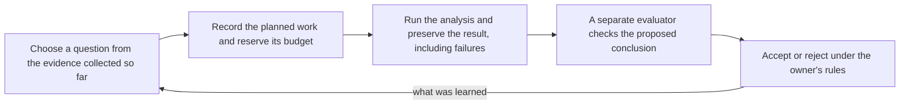
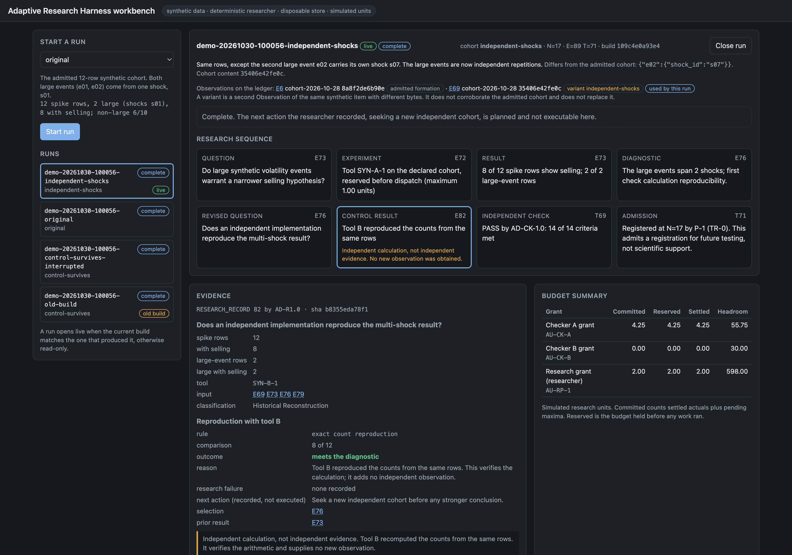

# Adaptive Research Harness

An idea I think is right, carried far enough to run.

Alpha decays, and so do the methods that find it. Investment teams need a
research process that uses what worked and what failed to decide what to
test next, which ideas to pursue and which to retire. Coding agents
already work within harnesses that manage execution, preserve state and
check their work. This prototype applies that approach to research agent
swarms.

Research agents can now generate ideas faster than a team can evaluate
them.
As they test and revise those ideas, it becomes harder to tell whether a
promising result will hold up or is simply the best-looking outcome of
many attempts.

Adaptive Research Harness, ARH, keeps track of what was tried, what it cost,
what failed and why a conclusion was accepted. Researchers can use that
history to choose what to investigate next, while separate checks govern
which results become part of the accepted research.

The aim is to let a team change its agents and methods without losing
what it has learned or quietly changing the rules for success.

A backtest result is easier to judge when you can see how it was
selected. What else was tried? Which assumptions changed after the results
were seen? What evidence justified taking the idea further? ARH
preserves that history for work run through it, alongside the checks and
decisions.

I have made the prototype public so other teams can try it with their own
workflows and help determine which parts are useful.

## How the loop works



Budget makes the search visible. Separate acceptance makes the result
accountable. The alpha-decay assumption needs both, because what you want to
know later is how much searching it took to find the result you accepted
and why it was accepted.

Each step writes its record before the next can start, so the count of
attempts and of registered hypotheses is a fact of the record rather than
a recollection. In the prototype the choice of the next question is made
by a fixed rule in the synthetic researcher, by you in the documents
workflow, or by the research code you write on the everyday interface. An
LLM researcher that makes that choice from the accumulated evidence is
future work. The owner's rules, who may do what and which routine registrations
go through without a fresh decision, are described in the
[architecture](architecture.md).



The workbench on the synthetic example, October 30, 2026. Each card in
the research sequence is a ledger record, from the question through the
independent check to the admission, which registers a hypothesis for
future testing and is not scientific support. The evidence pane shows
the control record the check rests on, with its note that an independent
calculation is not independent evidence. The budget summary shows what
each grant committed, reserved and settled.

## Where ARH sits among your tools

A research harness that lets teams change their agents and methods while
preserving the evidence, spending controls and review process around them.
It sits around the tools that do the analysis.

Agent frameworks already give you persistence, pause and resume, guardrails
and human approval. What ARH adds is how those pieces hold together across
a research process.

- Completed work does not become accepted research by itself. A proposal
  needs its evidence, a separate check and an authorized decision.
- An interrupted attempt still has a cost and an unresolved status.
  Restarting an agent neither erases what it owes nor permits another call.
- Rejected work stays useful. The next researcher sees the failed variants
  and the decisions behind the accepted result.
- Researchers and evaluators can change while the acceptance rules stay in
  place. A team can replace its graph without rebuilding the meaning of
  its research record.

That matters when several agents repeatedly revise hypotheses, draw on a
shared budget and contribute to conclusions someone will act on. A short
workflow that produces a summary does not need it.

| Kind of tool | Main job |
| --- | --- |
| Backtesting library | Calculate how a strategy would have performed |
| Experiment tracker | Record inputs, outputs, metrics and artifacts |
| Agent framework | Coordinate agents and their work |
| Adaptive Research Harness | Authorize research, account for its cost, require checks before acceptance, and preserve the history for subsequent research |

For example, a swarm proposes a signal and a backtesting engine tests it.
ARH records the authorized attempt, retains the failed variants
submitted through it, requires the designated checks, and controls whether
the proposal enters the accepted record. The researcher then uses that
history to propose its next investigation.

An experiment tracker records what happened. ARH also says no. An
attempt with no budget reserved for it, a proposal from an identity that
is not allowed to make it, or a result that has not been checked is
refused, and the refusal is recorded too.

## How to try it

Python 3.12, from the repository root. ARH itself has no dependencies.
The client installs from `client/` and LangGraph is an optional extra.
Two commands give a working result.

```sh
python3 -m venv .venv && .venv/bin/pip install -e './client[langgraph]'
PYTHONDONTWRITEBYTECODE=1 .venv/bin/python -m examples.memo_returns
```

The second command brings a small project up, imports six analyst memos
and a returns table, and runs a LangGraph graph that scores the memos
for tone, joins the scores to the returns in two parallel branches, one
of them a placebo, proposes the next question and waits for review. It
kills the graph at three points and resumes it, has one evaluator fail
the check and another pass it, records the owner's decision and applies
it, and closes and reopens the host. It prints each step and ends with
`Result: PASS` in about ten seconds. Generated data, labelled synthetic.

What the scientist wrote for that example is 136 lines of research code
and a 33-line project file, in `examples/memo_returns/`. The shape of the
interface, as a sketch rather than a runnable snippet, is this.

```python
# Interface sketch. The complete form is examples/memo_returns/research.py and graph.py.
research = api.connect('examples/memo_returns', 'researcher', run='/tmp/arh-memo')
result = research.analysis(join, inputs=[returns_table, *tone_scores], expectation=EXPECT, budget='memo-tests', operation='join')()
```

`join` is a plain function over the inputs. The expectation is recorded
before the analysis runs. The result comes back with its evidence
reference, its conclusion against the expectation, its check status once
a check exists, and, if the work was refused, the reason and what to do
about it. Each piece of work has a name. Reusing the name after a crash
recovers the progress the client journaled for it, the design, the
reservation, the attempt and the receipt, and continues from there. An
attempt whose outcome was lost is settled at its maximum and replaced
only after the host confirms the process that held it is gone. In a
LangGraph graph the same call is a node, and a review node holds the
graph until the proposal has passed its check, been authorized by the
owner and been applied to the accepted record.

The other routes, each with its verified steps in the [runbook](runbook.md).

- Your own CSV through a 55-line script, one command, path G.
- Your own documents on a page in the workbench, path F.
- The headline example, one research cycle with a LangGraph researcher
  and the situations the rules have to handle, path C.
- The original synthetic cycle with a built-in researcher, path A.
- Your own researcher on the lower-level client against a host you
  start yourself, path D.

The [client README](client/README.md) documents the interface, operation
by operation.

## What a team supplies and what ARH does

| You supply | What ARH does |
| --- | --- |
| A project file naming the question, the sources and their classes, the analyses with their costs, the budgets by name, and the researcher and evaluator entry points. The generator writes the grants, limits, theme, designs and profile from it, and a team that needs more writes those files itself | Only declared steps, tools and parameters are admitted, cost estimates must match the tariff, and sources follow their declared period and item rules. Amounts in the project file become authoritative when the owner signs the grants at startup |
| A researcher, in LangGraph or any other code, running under the researcher identity. On the everyday interface, an analysis function, its inputs, an expectation and a name for each piece of work | Budget reserved before an attempt, attempt recorded before execution, one fresh permission per attempt, settlement at the actual charge or at the maximum, every refusal kept. The client journals each named operation, so reusing the name recovers its recorded progress, and an attempt whose outcome was lost is settled and replaced only after the host confirms its process is gone |
| A provider or tool the researcher calls | The receipt is bound to the attempt and counted. A second, different receipt for the same attempt is refused |
| An evaluator running under the Checker identity. On the everyday interface, a recompute function that says what counts as a valid result | A check must come from a separate lineage with its own funded attempt, its content must equal the registered receipt, and the proposer cannot check, decide or apply. A graph that resumes approves nothing |
| The owner's decisions, or a policy the owner set for routine registrations | A decision needs a passing check at the current base, and applying it needs the decision and bound funding |

When a researcher calls a provider itself, ARH records the charge the
researcher reports and does not limit what that process spends. A tool ARH
runs under its own credential is the stronger arrangement, and the
original synthetic tools work that way. One local process holds every
identity token, and there is no operating-system isolation. The
[architecture](architecture.md) states the trust model in full.

## What is implemented and what the design describes

Implemented and exercised. The shipped examples run on generated data
labelled synthetic. The documents path and the CSV command line run on
files you supply, which are recorded as historical material.

- Reservation, attempt, execution, settlement and closure of research
  budget, with pending liabilities surviving interruption.
- Research records, proposals, independent checks, decisions under the
  Principal or policy `P-1`, apply, binding and invalidation.
- Recovery from a fresh process. Budgets, admissions and obligations are
  rebuilt from the ledgers; claims, receipts and the researcher's own
  checkpoints are kept alongside so lost responses and uncertain attempts
  are resolved rather than repeated.
- An experiment profile, an installable client, a local host and a
  LangGraph example supplied from outside the core.
- Research on your own documents. Files keep their name, content hash and
  the origin you declare. An expectation is recorded before the analysis.
  Two analyses, term counts over text and statistics over rows, run in a
  worker ARH starts. A check recomputes the result before the
  next direction is admitted. Revisions and rejected conclusions stay.
- A script run through ARH unchanged. `examples/signal_groups/` wraps a
  55-line CSV analysis, records the expectation first, lets earlier
  rejections hold candidates back until new rows arrive, and resumes an
  interrupted attempt after the run is closed and reopened. The same
  command line takes your own CSV, recorded as a historical document
  with the origin you give. You write the analysis function, the
  candidate table, the evaluation function and a project file.
  `arh_client.analysis` supplies the rest.
- Research code and LangGraph on the everyday interface.
  `examples/memo_returns/` scores six memos for tone, one metered call
  each, joins the scores to a returns table in two parallel branches,
  proposes the scientist's own next question and waits for the check and
  the decision. Killed between permission and receipt, the call is
  settled and replaced only after the host confirms the dead process is
  gone. The scientist wrote the research and a project file.
  `arh_client.api` and its LangGraph nodes did the rest.

The current prototype records research, checks calculations and preserves
decisions. The broader design adds several capabilities that are not yet
implemented.

- **Agent-directed research.** An LLM researcher that uses the accumulated
  evidence to propose the next investigation, with controlled provider
  access and recorded costs.
- **Forward evaluation.** Predictions registered before new evidence
  arrives, outcomes assessed under the original evaluation rule, and
  monitoring for deterioration. Today's local-document workflow compares
  an expectation with documents already available.
- **Strategy management.** Strategy versions, paper execution, capital
  qualification, allocation and reduction, and recorded retirement
  decisions for strategies and hypotheses.
- **Stronger isolation.** Operating-system boundaries separating
  researchers, checkers, credentials and the core.

The [Constitution](docs/doctrines/new_speedway_constitution.md) describes
the broader design. The [architecture](architecture.md) documents the
implemented boundaries and current limitations.

## Where the idea came from

Coding agents have harnesses. What governs a swarm of research agents?

I made the case for coding agents in
[An Agentic Coding Proposal: Constitutional Coherence](https://reckoningmachines.substack.com/p/an-agentic-coding-proposal-constitutional).
Tests tell you whether the code works. They do not tell you whether the
agent quietly added a second copy of the data or gave itself a permission
it should not have. The article argued that a harness needs something
written down underneath it, saying what exists, what each thing means and
who is allowed to change it. This repository asks the same question of
research agents.

## Open questions

These are the questions I want feedback on.

- **Coverage.** The ledger counts the attempts that run through the
  harness. Work done outside it, in a notebook or a spreadsheet, is never
  counted, and one recorded attempt can search thousands of parameter
  combinations while several attempts can repeat the same calculation. A
  correction based only on the recorded attempts could understate the
  extent of the search. What would the record have to capture, including
  changes to the universe, the features, the sample period and the
  selection rule, before the count said something about selection bias?
- **Judgment versus arithmetic.** The checker replays computation. Most of
  what makes research good or bad happens before the computation, in the
  choice of universe, window and definition of an event. A checker can
  confirm that two events share a shock identifier when the data carries
  one. It cannot decide whether grouping events by shock was the right
  economic call. What catches a bad definition, and is that a job for a
  checker, a second researcher or the Principal?
- **Data reuse and timing.** Researchers can repeatedly adapt an idea to
  the same historical sample, or inadvertently use information that was
  unavailable at the time, such as a revised financial statement or later
  index membership. Forming a hypothesis after examining data is
  legitimate exploration; presenting the same data as an untouched test is
  the problem. How should ARH record data access and revisions so
  those problems are visible?

## Where to read

| For | Read |
| --- | --- |
| How the system works and where your code connects | [Architecture](architecture.md) |
| Verified steps to operate it | [Runbook](runbook.md) |
| The Python client, operation by operation | [Client README](client/README.md) |
| What it would take for another team to adopt it | [Adoption review](docs/audits/adoption_review_20261101.md) |
| What was built, with its tests and limits | [BUILD.md](BUILD.md), the [integration report](docs/implementation/langgraph_integration_20261101.md) and the [interface report](docs/implementation/first_class_interface_20261101.md) |
| What a second analysis must supply | `examples/memo_returns/README.md` and `examples/signal_groups/README.md` |
| The rules themselves | [The Constitution](docs/doctrines/new_speedway_constitution.md), admitted by the [admission record](docs/decisions/cv1_admission_20261019.md) |
| How it was made and reviewed | The design was written and reviewed as documents before code. [Document-first design plan](docs/plans/document_first_design.md), the [revision 10 audit](docs/audits/independent_preimplementation_design_audit_20261019.md), [PD-010](docs/decisions/principal_decision_010_codex_audit_repairs.md), the [closure review](docs/audits/cv1_revision12_closure_20261019.md) and the [build audit](docs/audits/adversarial_first_cycle_build_audit_20261029.md) |
| The article the idea came from | [An Agentic Coding Proposal: Constitutional Coherence](https://reckoningmachines.substack.com/p/an-agentic-coding-proposal-constitutional) |
| The original proposal and slides | [Design proposal (.docx)](docs/reference/new_speedway_design_proposal_20261019.docx), [text transcription](docs/reference/new_speedway_discussion_draft_20261017.md), [presentations](docs/presentations/README.md) |
| Why some files say "New Speedway" | [Rename record](docs/decisions/project_rename_20261029.md) |
| Everything else | `docs/decisions/`, `docs/audits/` and the [package manifest](docs/package/cv1_review_package_manifest.md) |

## How the documents relate

The Constitution is the rule book. Decision records say what the
Principal approved. Audits are evidence and approve nothing. Plans say what
work is proposed and in what order. Reference material preserves the
original discussion. This README, the
architecture and the runbook explain the system without changing its rules.
