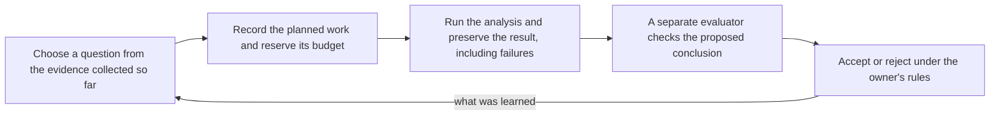

# Adaptive Research Harness

An idea I think is right, carried far enough to run.

Alpha decays, and so do the methods that find it. Investment teams need a
research process that uses what worked and what failed to decide what to
test next, which ideas to pursue and which to retire. Coding agents
already work within harnesses that manage execution, preserve state and
check their work. This prototype applies that approach to research agent
swarms.

Research agents can now generate ideas faster than a team can evaluate
them.
As they test and revise those ideas, it becomes harder to tell whether a
promising result will hold up or is simply the best-looking outcome of
many attempts.

Adaptive Research Harness, ARH, keeps track of what was tried, what it cost,
what failed and why a conclusion was accepted. Researchers can use that
history to choose what to investigate next, while separate checks govern
which results become part of the accepted research.

The aim is to let a team change its agents and methods without losing
what it has learned or quietly changing the rules for success.

A backtest result is easier to judge when you can see how it was
selected. What else was tried? Which assumptions changed after the results
were seen? What evidence justified taking the idea further? ARH
preserves that history for work run through it, alongside the checks and
decisions.

I have made the prototype public so other teams can try it with their own
workflows and help determine which parts are useful.

## How the loop works



Budget makes the search visible. Separate acceptance makes the result
accountable. The alpha-decay assumption needs both, because what you want to
know later is how much searching it took to find the result you accepted
and who decided it was real.

Each step writes its record before the next can start, so the count of
attempts and of registered hypotheses is a fact of the record rather than
a recollection. In the prototype the choice at steps 1 and 6 is made by a fixed rule in
the synthetic researcher, or by you in the documents workflow. An LLM
researcher that makes that choice from the accumulated evidence is future
work. The owner's rules, who may do what and which routine registrations
go through without a fresh decision, are described in the
[architecture](architecture.md).

## Where ARH sits among your tools

A research harness that lets teams change their agents and methods while
preserving the evidence, spending controls and review process around them.
It sits around the tools that do the analysis.

Agent frameworks already give you persistence, pause and resume, guardrails
and human approval. What ARH adds is how those pieces hold together across
a research process.

- Completed work does not become accepted research by itself. A proposal
  needs its evidence, a separate check and an authorized decision.
- An interrupted attempt still has a cost and an unresolved status.
  Restarting an agent neither erases what it owes nor permits another call.
- Rejected work stays useful. The next researcher sees the failed variants
  and the decisions behind the accepted result.
- Researchers and evaluators can change while the acceptance rules stay in
  place. A team can replace its graph without rebuilding the meaning of
  its research record.

That matters when several agents repeatedly revise hypotheses, draw on a
shared budget and contribute to conclusions someone will act on. A short
workflow that produces a summary does not need it.

| Kind of tool | Main job |
| --- | --- |
| Backtesting library | Calculate how a strategy would have performed |
| Experiment tracker | Record inputs, outputs, metrics and artifacts |
| Agent framework | Coordinate agents and their work |
| Adaptive Research Harness | Authorize research, account for its cost, require checks before acceptance, and preserve the history for subsequent research |

For example, a swarm proposes a signal and a backtesting engine tests it.
ARH records the authorized attempt, retains the failed variants
submitted through it, requires the designated checks, and controls whether
the proposal enters the accepted record. The researcher then uses that
history to propose its next investigation.

An experiment tracker records what happened. ARH also says no. An
attempt with no budget reserved for it, a proposal from an identity that
is not allowed to make it, or a result that has not been checked is
refused, and the refusal is recorded too.

## How to try it

There are three ways to use ARH.

- **The shipped example.** One research cycle on synthetic data with a
  deterministic researcher. Give the researcher different evidence and it
  runs a different experiment, and the record says why.
- **Your own researcher.** A team supplies its researcher, experiment and
  evaluation methods through a Python client connected to a running
  harness. The LangGraph example does this without changing the core.
  LangGraph is one way to organize the researchers, and tools such as
  MLflow could track experiments alongside.
- **Your own documents.** Start a run with a charter, import text,
  markdown, CSV or JSON files, write down what you expect before the
  analysis runs, run it, and pick the next question from what the result
  showed. Every step is on the record, including the ones that failed.
  Two analyses are available: how many of your text documents contain
  any of a list of terms, and a count, ratio, sum or mean over table rows
  that pass filters you set. Anything else needs a new calculator.


Python 3.12, from the repository root. ARH itself has no
dependencies. The client installs from `client/` and LangGraph is an
optional extra.

```sh
python3 -m venv .venv && .venv/bin/pip install -e './client[langgraph]'
PYTHONDONTWRITEBYTECODE=1 .venv/bin/python -m examples.langgraph_headlines
```

The command starts a local harness against the example's experiment
directory, runs startup and one research cycle, then walks through a set
of situations the rules have to handle, and prints each decision. Synthetic headlines are
classified by a deterministic stand-in for a model provider, next-day
returns arrive one period later from a second source, the researcher joins
its recorded labels to those returns, and an evaluator under a separate
identity recomputes the join before the proposal is admitted. The same run
shows an overstated result failing its check, a researcher refused when it
tries to approve its own proposal, over-budget work refused before the
provider is called, and three kinds of interruption resumed without a
second provider call.

To work on your own files, start the workbench and open the local page.

```sh
PYTHONDONTWRITEBYTECODE=1 python3 -m workbench --port 8765
```

Then open `http://127.0.0.1:8765/local`. Write the question you are
investigating, import your documents, state what you expect, run the
analysis, and choose the next question from the candidates the result
produced. A separate check recomputes the analysis before you admit the
direction. Close the run whenever you like and reopen it later from the
list. The runbook, path F, walks through it step by step.

The original synthetic cycle, with a built-in researcher and two tools the
harness runs itself, is still one command.

```sh
PYTHONDONTWRITEBYTECODE=1 python3 -m acceptance.local --example
```

The [runbook](runbook.md) has the complete paths, including connecting
your own researcher to a separately started harness, and the
[client README](client/README.md) documents the Python interface.

## What a team supplies and what ARH does

| You supply | What ARH does |
| --- | --- |
| An experiment directory with the grants, limits, theme, designs, tools, methods, hypothesis template, formation data and a profile naming steps, tariffs and sources | Only declared steps, tools and parameters are admitted, cost estimates must match the tariff, and sources follow their declared period and item rules |
| A researcher, in LangGraph or any other code, running under the researcher identity | Budget reserved before an attempt, attempt recorded before execution, one fresh permission per attempt, settlement at the actual charge or at the maximum, every refusal kept |
| A provider or tool the researcher calls | The receipt is bound to the attempt and counted. A second, different receipt for the same attempt is refused |
| An evaluator running under the Checker identity | A check must come from a separate lineage with its own funded attempt, its content must equal the registered receipt, and the proposer cannot check, decide or apply |
| The owner's decisions, or a policy the owner set for routine registrations | A decision needs a passing check at the current base, and applying it needs the decision and bound funding |

When a researcher calls a provider itself, ARH records the charge the
researcher reports and does not limit what that process spends. A tool ARH
runs under its own credential is the stronger arrangement, and the
original synthetic tools work that way. One local process holds every
identity token, and there is no operating-system isolation. The
[architecture](architecture.md) states the trust model in full.

## What is implemented and what the design describes

Implemented and exercised. The two shipped examples run on synthetic
data. The documents path runs on files you supply, which are recorded as
historical material.

- Reservation, attempt, execution, settlement and closure of research
  budget, with pending liabilities surviving interruption.
- Research records, proposals, independent checks, decisions under the
  Principal or policy `P-1`, apply, binding and invalidation.
- Recovery from a fresh process. Budgets, admissions and obligations are
  rebuilt from the ledgers; claims, receipts and the researcher's own
  checkpoints are kept alongside so lost responses and uncertain attempts
  are resolved rather than repeated.
- An experiment profile, an installable client, a local host and a
  LangGraph example supplied from outside the core.
- Research on your own documents. Files keep their name, content hash and
  the origin you declare. An expectation is recorded before the analysis.
  Two analyses, term counts over text and statistics over rows, run in a
  worker ARH starts. A check recomputes the result before the
  next direction is admitted. Revisions and rejected conclusions stay.
- A script run through ARH unchanged. `examples/signal_groups/` wraps a
  55-line CSV analysis, records the expectation first, lets earlier
  rejections hold candidates back until new rows arrive, and resumes an
  interrupted attempt after the run is closed and reopened. A new example
  on generated data, with its integration cost measured in the report.

The current prototype records research, checks calculations and preserves
decisions. The broader design adds several capabilities that are not yet
implemented.

- **Agent-directed research.** An LLM researcher that uses the accumulated
  evidence to propose the next investigation, with controlled provider
  access and recorded costs.
- **Forward evaluation.** Predictions registered before new evidence
  arrives, outcomes assessed under the original evaluation rule, and
  monitoring for deterioration. Today's local-document workflow compares
  an expectation with documents already available.
- **Strategy management.** Strategy versions, paper execution, capital
  qualification, allocation and reduction, and recorded retirement
  decisions for strategies and hypotheses.
- **Stronger isolation.** Operating-system boundaries separating
  researchers, checkers, credentials and the core.

The [Constitution](docs/doctrines/new_speedway_constitution.md) describes
the broader design. The [architecture](architecture.md) documents the
implemented boundaries and current limitations.

## Where the idea came from

Coding agents have harnesses. What governs a swarm of research agents?

I made the case for coding agents in
[An Agentic Coding Proposal: Constitutional Coherence](https://reckoningmachines.substack.com/p/an-agentic-coding-proposal-constitutional).
Tests tell you whether the code works. They do not tell you whether the
agent quietly added a second copy of the data or gave itself a permission
it should not have. The article argued that a harness needs something
written down underneath it, saying what exists, what each thing means and
who is allowed to change it. This repository asks the same question of
research agents.

## Open questions

These are the questions I want feedback on.

- **Coverage.** The ledger counts the attempts that run through the
  harness. Work done outside it, in a notebook or a spreadsheet, is never
  counted, and one recorded attempt can search thousands of parameter
  combinations while several attempts can repeat the same calculation. A
  correction based only on the recorded attempts could understate the
  extent of the search. What would the record have to capture, including
  changes to the universe, the features, the sample period and the
  selection rule, before the count said something about selection bias?
- **Judgment versus arithmetic.** The checker replays computation. Most of
  what makes research good or bad happens before the computation, in the
  choice of universe, window and definition of an event. A checker can
  confirm that two events share a shock identifier when the data carries
  one. It cannot decide whether grouping events by shock was the right
  economic call. What catches a bad definition, and is that a job for a
  checker, a second researcher or the Principal?
- **Data reuse and timing.** Researchers can repeatedly adapt an idea to
  the same historical sample, or inadvertently use information that was
  unavailable at the time, such as a revised financial statement or later
  index membership. Forming a hypothesis after examining data is
  legitimate exploration; presenting the same data as an untouched test is
  the problem. How should ARH record data access and revisions so
  those problems are visible?

## Where to read

| For | Read |
| --- | --- |
| How the system works and where your code connects | [Architecture](architecture.md) |
| Verified steps to operate it | [Runbook](runbook.md) |
| The Python client, operation by operation | [Client README](client/README.md) |
| What it would take for another team to adopt it | [Adoption review](docs/audits/adoption_review_20261101.md) |
| What was built, with its tests and limits | [BUILD.md](BUILD.md) and the [integration report](docs/implementation/langgraph_integration_20261101.md) |
| The rules themselves | [The Constitution](docs/doctrines/new_speedway_constitution.md), admitted by the [admission record](docs/decisions/cv1_admission_20261019.md) |
| How it was made and reviewed | The design was written and reviewed as documents before code. [Document-first design plan](docs/plans/document_first_design.md), the [revision 10 audit](docs/audits/independent_preimplementation_design_audit_20261019.md), [PD-010](docs/decisions/principal_decision_010_codex_audit_repairs.md), the [closure review](docs/audits/cv1_revision12_closure_20261019.md) and the [build audit](docs/audits/adversarial_first_cycle_build_audit_20261029.md) |
| The article the idea came from | [An Agentic Coding Proposal: Constitutional Coherence](https://reckoningmachines.substack.com/p/an-agentic-coding-proposal-constitutional) |
| The original proposal and slides | [Design proposal (.docx)](docs/reference/new_speedway_design_proposal_20261019.docx), [text transcription](docs/reference/new_speedway_discussion_draft_20261017.md), [presentations](docs/presentations/README.md) |
| Why some files say "New Speedway" | [Rename record](docs/decisions/project_rename_20261029.md) |
| Everything else | `docs/decisions/`, `docs/audits/` and the [package manifest](docs/package/cv1_review_package_manifest.md) |

## How the documents relate

The Constitution is the rule book. Decision records say what the
Principal approved. Audits are evidence and approve nothing. Plans say what
work is proposed and in what order. Reference material preserves the
original discussion. This README, the
architecture and the runbook explain the system without changing its rules.
