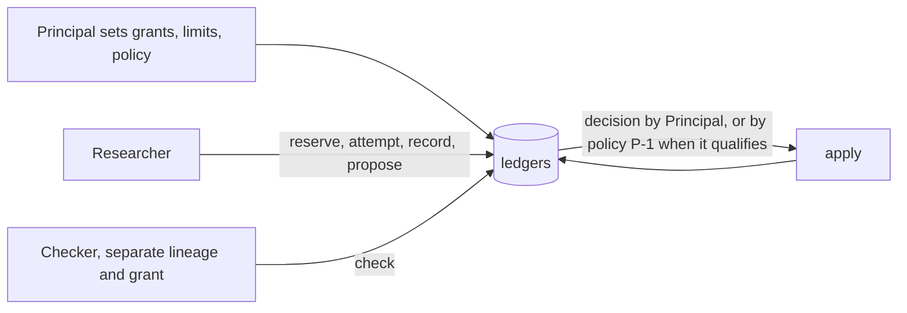

# Adaptive Research Harness

An idea I think is right, carried far enough to run.

If agent swarms make research and strategy generation extremely cheap, what
has to sit underneath them so the process remains investable over time?

Adaptive Research Harness is a working prototype of that layer. It records
authorized research attempts, reserves their budgets, preserves results and
failures, and requires separate checking and admission before a proposal
enters the accepted record. As researchers change their ideas, the system
retains what they tried and why a conclusion was accepted, rejected or
replaced.

A team supplies its own researcher, experiment and evaluation methods
through a Python client connected to a running harness. The included
LangGraph example demonstrates that integration without modifying the core.
LangGraph is one way to organize the researchers, and tools such as MLflow
could provide complementary experiment tracking.

The current examples use synthetic data and deterministic researchers. They
demonstrate the controls and recovery behavior. The next step is using those
interfaces for actual research.

I have made the prototype public so other teams can try it with their own
workflows and help determine which parts are useful.

## Try it

Python 3.12, from the repository root. The harness itself has no
dependencies. The client installs from `client/` and LangGraph is an
optional extra.

```sh
python3 -m venv .venv && .venv/bin/pip install -e './client[langgraph]'
PYTHONDONTWRITEBYTECODE=1 .venv/bin/python -m examples.langgraph_headlines
```

The command starts a local harness against the example's experiment
directory, runs startup, one research cycle and the control
demonstrations, and prints each decision. Synthetic headlines are
classified by a deterministic stand-in for a model provider, next-day
returns arrive one period later from a second source, the researcher joins
its recorded labels to those returns, and an evaluator under a separate
identity recomputes the join before the proposal is admitted. The same run
shows an overstated result failing its check, a researcher refused when it
tries to approve its own proposal, over-budget work refused before the
provider is called, and three kinds of interruption resumed without a
second provider call.

The original synthetic cycle, with a built-in researcher and two tools the
harness runs itself, is still one command.

```sh
PYTHONDONTWRITEBYTECODE=1 python3 -m acceptance.local --example
```

The [runbook](runbook.md) has the complete paths, including connecting
your own researcher to a separately started harness, and the
[client README](client/README.md) documents the Python interface.

## What a team supplies and what the harness enforces

| You supply | The harness enforces |
| --- | --- |
| An experiment directory with the grants, limits, theme, designs, tools, methods, hypothesis template, formation data and a profile naming steps, tariffs and sources | Only declared steps, tools and parameters are admitted, cost estimates must match the tariff, and sources follow their declared period and item rules |
| A researcher, in LangGraph or any other code, running under the researcher identity | Budget reserved before an attempt, attempt recorded before execution, one fresh permission per attempt, settlement at the actual charge or at the maximum, every refusal kept |
| A provider or tool the researcher calls | The receipt is bound to the attempt and counted. A second, different receipt for the same attempt is refused |
| An evaluator running under the Checker identity | A check must come from a separate lineage with its own funded attempt, its content must equal the registered receipt, and the proposer cannot check, decide or apply |
| The owner's decisions, or a policy the owner set for routine registrations | A decision needs a passing check at the current base, and applying it needs the decision and bound funding |

The receipt a researcher reports for a provider it calls itself is
accounting, not enforcement over what that process spends. A tool the
harness runs under its own credential is the stronger arrangement, and the
original synthetic tools work that way. One local process holds every
identity token. There is no operating-system isolation.

## The research loop

The owner, called the Principal, sets authority and policy. Grants say who
may research what, with which tools and how much budget. Policy `P-1` lets
qualifying registrations proceed under that authority without a fresh
decision each time. Everything else stays with the Principal.



A proposal is admitted only after a check from a separate lineage, a
recorded decision and an apply. A proposal that fails its check stays on
the ledger as evidence. Attempts that run through the harness are recorded
before they run, so the count of attempts and of registered hypotheses is a
fact of the record rather than a recollection. That is a record of executed
work, not preregistration. The example forms its hypothesis after examining
the data and registers it for future testing, and the record says so.

## What is implemented and what the design describes

Implemented and exercised, on synthetic data.

- Reservation, attempt, execution, settlement and closure of research
  budget, with pending liabilities surviving interruption.
- Research records, proposals, independent checks, decisions under the
  Principal or policy `P-1`, apply, binding and invalidation.
- Recovery from a fresh process using the ledgers alone, including lost
  responses and the rule for replacing an uncertain attempt.
- An experiment profile, an installable client, a local host and a
  LangGraph example supplied from outside the core.

Described in the [Constitution](docs/doctrines/new_speedway_constitution.md)
and not built.

- Forward predictions and their outcomes, evaluation against a committed
  expectation, and decay monitoring.
- Strategy versions, paper execution, capital qualification, allocation and
  reduction.
- Retirement of strategies and hypotheses as recorded decisions.
- Real providers, real documents and operating-system isolation.

The [architecture](architecture.md) keeps the two apart in detail.

## Open questions

These are the questions I want feedback on.

- **Coverage.** The ledger counts the attempts that run through the
  harness. Work done outside it, in a notebook or a spreadsheet, is never
  counted. If that outside work decides which ideas get registered, the
  ledger understates how many were tried, and any multiple-testing
  correction built on it is too small. How much of a team's research has to
  run through the harness before the count means anything, and how would
  the team know?
- **Judgment versus arithmetic.** The checker replays computation. Most of
  what makes research good or bad happens before the computation, in the
  choice of universe, window and definition of an event. A checker can
  confirm that two events share a shock identifier when the data carries
  one. It cannot decide whether grouping events by shock was the right
  economic call. What catches a bad definition, and is that a job for a
  checker, a second researcher or the Principal?
- **Lookahead.** The dominant practical failure in quantitative research is
  a hypothesis formed after seeing the test window. Timestamped records
  help only if data vintage is part of the record. Is that enough, and what
  else is needed?

## Where to read

| For | Read |
| --- | --- |
| How the system works and where your code connects | [Architecture](architecture.md) |
| Verified steps to operate it | [Runbook](runbook.md) |
| The Python client, operation by operation | [Client README](client/README.md) |
| What was built, with its tests and limits | [BUILD.md](BUILD.md) and the [integration report](docs/implementation/langgraph_integration_20261101.md) |
| The rules themselves | [The Constitution](docs/doctrines/new_speedway_constitution.md), admitted by the [admission record](docs/decisions/cv1_admission_20261019.md) |
| How it was made and reviewed | The design was written and reviewed as documents before code. [Document-first design plan](docs/plans/document_first_design.md), the [revision 10 audit](docs/audits/independent_preimplementation_design_audit_20261019.md), [PD-010](docs/decisions/principal_decision_010_codex_audit_repairs.md), the [closure review](docs/audits/cv1_revision12_closure_20261019.md) and the [build audit](docs/audits/adversarial_first_cycle_build_audit_20261029.md) |
| The original proposal and slides | [Design proposal (.docx)](docs/reference/new_speedway_design_proposal_20261019.docx), [text transcription](docs/reference/new_speedway_discussion_draft_20261017.md), [presentations](docs/presentations/README.md) |
| Why some files say "New Speedway" | [Rename record](docs/decisions/project_rename_20261029.md) |
| Everything else | `docs/decisions/`, `docs/audits/` and the [package manifest](docs/package/cv1_review_package_manifest.md) |

## How the documents relate

The Constitution governs. Decision records document what the Principal
approved. Audits are evidence and authorize nothing. Plans propose work.
Reference material preserves the original discussion. This README, the
architecture and the runbook explain the system without changing its rules.
