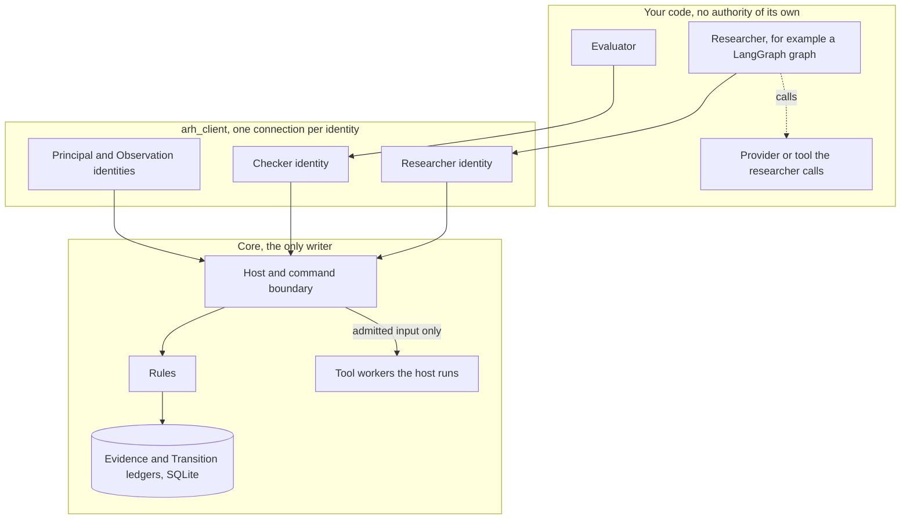

# Adaptive Research Harness: Architecture

How the system works and where a team connects its code. The
[README](README.md) says what the harness is for and how to try it, and
the [runbook](runbook.md) gives the verified steps. The
[client README](client/README.md) documents each Python operation. The
[Constitution](docs/doctrines/new_speedway_constitution.md) governs where
this explanation and the rules disagree.

Terms used below. A **grant** is the Principal's authorization for an
identity to do a kind of work with named tools and a budget. The
**Principal** is the accountable owner. An **attempt** is one recorded
piece of metered work. A **check** is an independent verification of a
proposal. **Apply** is the one act that changes the accepted record.

## 1. The pieces and the authority boundaries

Three boundaries matter.

| Boundary | What crosses it | What cannot cross it |
| --- | --- | --- |
| Your code to the client | Requests under one identity's token | Authority. A request is admitted or refused by the core |
| Client to core | Commands with a request key, reads of the ledgers | Direct writes. The core is the only writer and every write is one of its rules |
| Researcher to provider | Input the attempt admitted, the claim identity | Anything before the attempt is admitted, a second execution of the same attempt |

The researcher, the evaluator and the Principal run as separate processes
under separate tokens. A researcher connection that calls a Checker or
Principal operation is refused and the refusal is kept.

## 2. One attempt, end to end

The headline example, followed through the records it writes. Sequence
numbers are from a retained run and will differ on yours.

| Step | Who | Operation | Record |
| --- | --- | --- | --- |
| 1 | Observation function | commit the headline document | Evidence, OBSERVATION |
| 2 | Researcher | reserve 0.50 for theme TH-H1 | Evidence, RESERVATION |
| 3 | Researcher | attempt step classify-headlines with tool FAKE-LLM-1, maximum 0.48 | Evidence, ATTEMPT, pending liability 0.48 |
| 4 | Researcher | claim, which returns permission exactly once | durable claim in the core |
| 5 | Researcher | call the provider, store the receipt durably, register it | receipt bound to the claim |
| 6 | Researcher | commit the research record with labels and counts, settle 0.48, close the reservation | Evidence, RESEARCH_RECORD, SETTLEMENT, CLOSED |
| 7 | Observation function | commit the returns document one period later | Evidence, OBSERVATION |
| 8 | Researcher | join recorded labels to committed returns, commit a second record, propose the hypothesis and fund it | Evidence, RESEARCH_RECORD, RESERVATION. Transition, PROPOSED |
| 9 | Evaluator | reserve under its own grant, attempt, compute every criterion, register the receipt, commit the check | Evidence, four records. Transition, CHECK with PASS or FAIL |
| 10 | Principal, or policy P-1 | decide | Transition, DECISION |
| 11 | Principal | apply | Evidence, BIND. Transition, APPLIED, head N moves by one |

A failing check stops at step 9. The proposal stays on the Transition
ledger with its check, the head does not move, and nothing is lost.

## 3. What the team supplies and what the core enforces

| You supply | Where | The core enforces |
| --- | --- | --- |
| Setup, designs, methods, tools, hypothesis template, formation data | `setup.json`, `designs_and_methods.json` in your experiment directory | Grants decide who may act. Designs must be registered. Methods and tools are referenced by hash |
| The profile of the experiment | `experiment.json` | Steps, permitted tools, exact parameters, tariff, check cost, source period and item rules, extraction validator chosen from the core's registry, the genesis pair |
| A researcher | Any program using `arh_client.Researcher` under the researcher token, optionally the LangGraph adapter | Reserve, attempt, one permission, one receipt, settlement, record shape, proposal scope |
| A provider or tool | Called by the researcher (`execution: caller`) or run by the host (`execution: core`) | Its bytes are pinned in the build inventory. A caller-executed tool's receipt is counted and bound. A host-run tool receives only the admitted input |
| An evaluator | Any program using `arh_client.Checker` under the Checker token, supplying the experiment's recomputation | Separate lineage and grant, own funded attempt, criteria complete, content equal to the registered receipt |

## 4. Research execution is not acceptance

Executing an attempt produces evidence. It does not make a conclusion
accepted. Acceptance is the separate sequence of proposal, independent
check, decision and apply. A node completing in a graph, a record being
committed, or a provider returning a result changes nothing in the
accepted record. The example makes this visible by proposing an overstated
count, which fails its check and is never applied, before proposing the
honest one.

The evaluator recomputes the arithmetic and the join from the recorded
labels and the committed returns. It does not verify the labels, which
only the provider produced, and it does not supply new evidence. The same
holds in the synthetic cycle, where tool B reproducing counts on the same
rows is an independent calculation and not independent evidence.

## 5. Where things belong

| Thing | Location | Who reads it |
| --- | --- | --- |
| The core and its rules | `adaptive_research_harness/` | Nobody edits it to add an experiment |
| The synthetic experiment's profile | `experiments/synthetic_flow/experiment.json` | The core, after it is frozen into a bundle |
| An external experiment | A directory such as `examples/langgraph_headlines/` holding the three JSON files and the modules the profile names | The host freezes it into a bundle and pins every module's bytes |
| Evaluation methods | Declared in `designs_and_methods.json` and implemented in the evaluator the team registers as a Checker design | The evaluator process. The core checks the method hash, not the method |
| Tool implementations | Modules named in the profile, installed or relative to the experiment directory | A worker the host starts, or the researcher process. Never the core process |
| The client | `client/`, import name `arh_client` | Any process the team runs |
| Run records | A run directory holding `bundle/`, `state/` and whatever the researcher keeps | The host, the client and the workbench |

## 6. Identity, retries, uncertain execution and recovery

**Identity.** The host writes one token per identity into a connection
file. A connection presents its token on every request. In the local
arrangement this is a shared secret plus a self-reported process id.

**Request keys.** Every command carries a key the caller made and
persisted first. Sending the same key and payload again returns the
original outcome, so a retried node or a reconnecting process cannot act
twice. A different payload under the same key is refused. A lost reply is
resolved by asking the core what became of the key.

**Permission.** Claiming an attempt returns permission exactly once. Every
later claim of the same attempt, including a replay of the request that
once succeeded, returns no permission. The LangGraph adapter obtains
permission inside the node that executes and keeps it out of graph state,
because a node that dies re-runs from its beginning on resume.

**Receipts.** The researcher writes its receipt durably before telling the
core. The core binds the first receipt and refuses a different one.

**Uncertain execution.** When permission was consumed and no receipt exists
in the researcher's store, the provider's own record or the core, the work
may have run or may still be running. The client reports `uncertain`, the
researcher settles at the maximum so the liability is counted, and nothing
calls the provider again for that attempt.

**Replacement.** A new attempt for the same work is admitted only when the
earlier one is settled, the host has recorded that the process which held
the claim is gone, and, for a provider declared able to outlive its caller,
the provider has reported completion or cancellation of the earlier
operation. Provider deduplication recovers the earlier operation under its
own identity and never authorizes a new one.

**Recovery.** A host reopened on the same run directory rebuilds every view
from the ledgers. Nothing is kept in memory that the ledgers do not hold.

## 7. The local trust model

- One host process generates every token and writes them to one file.
  Anyone who can read that file can act as any identity.
- There is no operating-system isolation. Linux templates for user, socket
  and cgroup isolation exist under `isolation/` and have not been exercised.
- For a tool the researcher calls itself, the receipt is the researcher's
  statement. The core binds it and counts it. It cannot stop that process
  spending at a provider it can reach. A tool the host runs is handed the
  admitted input and its receipt comes from the worker the host started.
- Quiescence proofs rest on process ids no longer running, which is fixture
  evidence. Provider dispositions are recorded by the host from what the
  provider reported. The core checks their shape and binding to the claim,
  not their truth.
- Everything shipped is synthetic and earns no forward standing.

## 8. Implemented behavior and the broader design

| Area | Implemented and exercised | In the Constitution, not built |
| --- | --- | --- |
| Research budget | Reserve, attempt, settle, close, fence, lineage caps, pending liabilities across interruption | Discovery screening cadence beyond the declared scope |
| Admission | Proposal, independent check, Principal decision or policy P-1, apply, binding, invalidation, release | Suspension of policy as an exercised path |
| Evidence | Observations with listing and extraction, research records, refusals | Predictions, outcomes, evaluations against a committed expectation, decay monitoring |
| Recovery | Fresh-process reconstruction, lost replies, uncertain attempts, replacement rule | Linux generation and cgroup evidence on the intended host |
| Integration | Profile, client, host, LangGraph example, evaluator under a Checker identity | A general independent reader for arbitrary experiments |
| Capital and execution | Zero-capital limits as a registered control | Strategy versions, paper execution, qualification, allocation, reduction, retirement |
| Provenance | Synthetic sources and deterministic programs | Real documents, real providers, provider caps and identity rules |

The broader design is explained in the Constitution and in the decision
records under `docs/decisions/`. The governing records for the
integration are the
[integration plan](docs/plans/langgraph_integration_20261101.md), the
[readiness audit](docs/audits/langgraph_integration_readiness_audit_20261101.md)
and the
[implementation report](docs/implementation/langgraph_integration_20261101.md).
[BUILD.md](BUILD.md) records the coverage and its limits.
