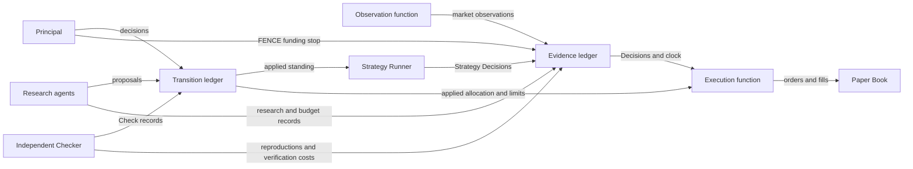

# Adaptive Research Harness: Architecture

A constitutional harness for evolving investment hypotheses, strategies and research agents.

Current name: Adaptive Research Harness. The [rename record](docs/decisions/project_rename_20261029.md)
explains why CV1 and historical evidence retain their original names. The
[first research-cycle plan](docs/plans/first_research_cycle_implementation_20261029.md)
set a smaller initial milestone than the two broader demonstrations in
section 7: one active researcher, controlled synthetic tools, checked
admission and fresh-process recovery. That milestone is now built; section 9
describes it.

This is an explanation of Constitution revision 12, admitted by the
Principal as `ConstitutionVersion 1`, the document-phase design
baseline, after the
[independent closure review](docs/audits/cv1_revision12_closure_20261019.md).
The [Constitution](docs/doctrines/new_speedway_constitution.md)
governs and the [admission record](docs/decisions/cv1_admission_20261019.md)
names its exact digest. The design sections below describe the full system
as admitted. The build in section 9 implements the bounded first cycle of
it on synthetic data.

## 1. The investment case

Alpha decays, and so do the research methods that found it. A firm
therefore needs a research process that keeps probing its own ideas,
retires the bad ones and records why, rather than one that drifts.
Adaptive Research Harness retains what the investment process learns:
what was predicted, what happened, what failed and why a decision was made.
A successor strategy starts with its own record. It cannot inherit a
predecessor's performance or obtain capital simply by being related to it.

The Principal, the accountable human owner, controls mandates, capital,
limits and the standards used to evaluate results. Agents can propose
changes and conduct authorized research. Independent checking sits
between a proposal and its admission.

The original [design proposal with figures](docs/reference/new_speedway_design_proposal_20261019.docx)
and its [text transcription](docs/reference/new_speedway_discussion_draft_20261017.md)
provide background. They remain reference material where later decisions
have changed the design.

### Why documents first

Working through the design in documents is cheaper and faster than
building first. It allows us to debug the system before writing the
software, when a correction usually means changing a few clauses rather
than reworking code and data.

The reviews follow concrete cases: a process dies after a decision, a
provider charges more than expected, a funding stop arrives during
registration, or a fill arrives after an allocation expires. The aim is
to settle what should happen before implementing it. Paper review does
not establish that the eventual software works.

Ten decision records have been admitted at the document stage. The
independent review of revision 10 found ten blocking defects. PD-010
addressed those findings through four proposal revisions. The final
review checks the consolidated text and its interactions. All prior
audits, including failures, remain in `docs/audits/`.

## 2. The operating loop

| Stage | What happens |
| --- | --- |
| Frame the research | An agent proposes a Theme or investigates an authorized empirical question, recording its motivation and selection basis |
| Fund the work | The Principal grants scope, tools, budget and expiry. The agent reserves budget and records each metered attempt before using it |
| Preserve the evidence | Research Records retain inputs, methods, results and failures. Predictions and their Outcomes are recorded separately under declared resolution rules |
| Check the proposal | An independent Checker reviews a proposed registration, allocation or other change against the applicable criteria |
| Decide and apply | The Principal decides, or policy `P-1` decides a permitted routine registration. Apply records the admitted change in the Applied History |
| Review and repeat | Evaluations inform the next research or capital proposal. They do not change standing or capital by themselves |

The contracts are in [Evidence](docs/doctrines/new_speedway_constitution.md#5-evidence),
[Authorizations](docs/doctrines/new_speedway_constitution.md#7-authorization),
[Transitions](docs/doctrines/new_speedway_constitution.md#8-transition)
and the [Evaluation Standard](docs/doctrines/new_speedway_constitution.md#part-x-evaluation-standard-es-10).

## 3. What evolves

| Population | Basis for assessment | What a successor inherits |
| --- | --- | --- |
| Hypotheses | Calibration of their own committed Predictions | The visible research history, with no transferred predictive record |
| Strategy Versions | Their own forward decision record, assessed with costs, stress and the full search family | Lineage and prior evidence, with no transferred performance or allocation |
| Agent Designs | Research contribution relative to budget, including negative results that close a question | Access to lineage history, with no automatic Authorization |

Historical backtests can reject candidates and motivate new work. They
cannot establish forward investment performance. A profitable strategy
does not validate a Hypothesis merely because it cites it. These
separations are explicit in the [invariants](docs/doctrines/new_speedway_constitution.md#part-iv-invariants).

## 4. Records and responsibilities

Three logical ledgers preserve the authoritative records. Each has one
commit boundary that enforces the permitted callers and admission rules.

| Ledger | Records and responsibility |
| --- | --- |
| Transition ledger | Proposals, Checks, decisions, refusals and binding invalidations. Its applied subsequence, the Applied History, establishes membership, standing, allocations, limits and active governing versions. Only Apply adds to that subsequence |
| Evidence ledger | Observations, Predictions, Outcomes, Strategy Decisions, Research Records, budget records and committed Evaluations. It supplies the system's clock. A stored Evaluation remains a derived assessment and cannot decide standing |
| Paper Book | Orders, provisional fills, confirmations and refusals, committed on the Execution function's calls under the Paper Book rules |

The Observation function commits market data. The Strategy Runner commits
Strategy Decisions. The Execution function submits paper orders and fills.
Each operates under its own Authorization. Research agents propose and
record research. Checkers verify. The Principal grants authority and makes
the decisions reserved to the owner.

The diagram shows the main record flows, not every caller or validation
step. Tools produce inputs to these boundaries. A cache, dashboard or
runtime checkpoint cannot establish current authority. A database may
host the ledgers without acquiring decision rights.

## 5. Controls

| Control | Design rule |
| --- | --- |
| Research budgets | Reserve before work, record an attempt before spending, then settle actual cost. Pending liabilities survive interruption and closure. Overruns count in full. A `FENCE` stops new spending without erasing existing liabilities |
| Independent checking | Consequential Transitions require an independent Check under criteria pinned at the base. The narrowly specified genesis act is the exception. A Checker funds its work from its own grant and cannot waive a criterion |
| Delegated admission | `P-1` permits scoped Hypothesis registrations and successor Agent Design registrations that request no Authorization. Capital, grants, the Standard and the Constitution remain Principal decisions |
| Registration funding | `BIND` establishes funding eligibility before Apply. A later fence, expiry or overrun can stop spending while that registration remains eligible. Apply and invalidation compete at one serialized boundary. Release requires durable invalidation, so a delayed Apply cannot use a released binding |
| Capital qualification | Exploratory paper capital is bounded and expires. Qualified capital requires the exact version's forward record, sufficient effective observations, family adjustment, verified cost evidence and stress assessment |
| Reduction | A Principal-decided, independently checked `REDUCE` can lower an allocation without meeting a qualification floor. It changes the target, not the position. Revision 12 limits the residual-breach exception at the execution boundary to orders that execute an applied `REDUCE` toward its target. Ordinary Decision orders and expiry orders stay under the ordinary limit rule, as the follow-up check required |
| Expiry | Opening fills need clock-bracketed confirmation. Expiry stops opening permission and creates the applicable cancellation and reduction obligations. Residual positions can remain during an outage or incomplete execution. A permitted `HOLD` has its own declared end time |
| Recovery | A fresh process reads the ledgers to establish the next lawful action. Applied changes are not repeated. An uncertain dispatch cannot be retried as though no spending occurred. A Principal control act continues on the Principal's own authority, which revision 12 states at every lifecycle point |

See the [Evidence contract](docs/doctrines/new_speedway_constitution.md#5-evidence),
[Transition contract](docs/doctrines/new_speedway_constitution.md#8-transition),
[Paper Book rules](docs/doctrines/new_speedway_constitution.md#10-paper-book)
and [Transition classes](docs/doctrines/new_speedway_constitution.md#part-v-transition-classes).

A workflow engine can resume a task, but its checkpoint cannot establish
permission to continue. The resumed process must consult current ledger
state. Binding recovery also has no guaranteed release time. If a required
ledger cannot be reached, the binding remains frozen.

## 6. Build versus reuse

The standing rule is to reuse commodity capabilities as replaceable tools.
Custom infrastructure requires an identified OSA requirement that existing
components cannot satisfy. Adaptive Research Harness owns the investment rules and the
boundaries that enforce them. This does not require writing every
computational component from scratch.

The first cycle is built on the Python 3.12 standard library and SQLite
with no third-party dependencies; see section 9. That choice covers the
bounded prototype and selects nothing for later stages. Each later
component is assessed against the same concrete requirements: reserve,
attempt, interruption, fence, retry, settlement and admission.

The harness is the layer underneath agent frameworks, not a replacement for
them. Frameworks supply orchestration and research content; the harness
holds the budgets, the independent checks and the record. The
[feasibility review](docs/audits/feasibility_coherence_public_library_20261029.md)
defines the boundary points an adapter must pass through and examines
LangGraph as an orchestration candidate and MiroFish as a scenario-research
candidate. No adapter is built or authorized.

| Component | Planned reuse | Acceptance requirement |
| --- | --- | --- |
| Agent runtime | An existing model and tool runtime | Replacement preserves governed records. Agent context and memory confer no authority |
| Scheduling and recovery | An existing workflow or job engine | Recovery derives permission from ledgers, with no duplicate spending or admission |
| Storage | An existing transactional store | Ordered durable append, stale-base and duplicate refusal, and readable authoritative heads |
| Data retrieval | Vendor APIs, document feeds and caches | The Observation function commits declared sources with witnessed receipt times and the required extraction or absence evidence |
| Backtesting | One existing, simple backtester | Exact data, parameters and tool versions are recorded. Repeated execution under the same reproducibility binding yields the same result hash |
| Paper fill computation | Reusable computation within an internal simulator, assessed later | Proposed fills pass Adaptive Research Harness's Paper Book rules, including expiry and reversal cases. The governed boundary remains Adaptive Research Harness's responsibility |
| Model inference | A bounded synthetic provider for the demonstrations, with real providers assessed separately | A maximum charge is computable before dispatch. Real-provider cap and billing assumptions require recorded Principal acceptance |

An internal simulator means simulated execution within Adaptive Research Harness rather
than an external paper-trading account. It does not establish a need for
custom fill computation. The fill rule is granted with the first Execution
Authorization, after the two research demonstrations. Any later build
proposal must satisfy the same reuse requirement.

The governing sources are [PD-006 section PD-006.1](docs/decisions/principal_decision_006_replaceable_tools_and_first_prototype.md),
[Part IX principle 10](docs/doctrines/new_speedway_constitution.md#part-ix-operating-principles)
and [plan step 9](docs/plans/document_first_design.md).

## 7. The two prototype demonstrations

**Evolutionary research.** Ten registered research agents use a shared
budget and one replaceable backtester on historical or synthetic data.
They test and reject candidates, preserve negative results and propose
successors. An independent Checker reviews registrations. The demonstration
includes a lineage reaching its cap, interruption and a funding stop.
Retiring an admitted Hypothesis requires the applicable checked Transition.
An agent's abandonment note cannot retire it.

The expected record includes reservations, attempts, settlements, failed
proposals and successor registrations. The demonstration tests the research
process under budget and recovery constraints. Backtest results establish
no investment edge.

**Development-driven research.** Agents receive an unfamiliar synthetic
market development through a declared feed, investigate within scope,
propose a Theme and develop competing Hypotheses under a common experiment
design. They also produce an executable Strategy Version registered at zero
capital and record how they choose the next research question.

Theme admission is a checked Principal decision. Research on a new Theme
requires an appropriate grant. Registering the Theme does not expand an
existing grant's scope. The demonstration preserves document provenance,
typed claims, selection history and the order of Predictions and resolution.
Synthetic resolution tests the machinery and earns no forward market credit.

Both demonstrations depend on the corrected genesis chain described in
the final review. Neither runs the Strategy Runner or paper execution.
Their scope remains the one admitted in [PD-006 section PD-006.3](docs/decisions/principal_decision_006_replaceable_tools_and_first_prototype.md)
and [PD-009](docs/decisions/principal_decision_009_genesis.md).

## 8. Current standing and open work

Constitution revision 12 is admitted as `ConstitutionVersion 1`. All
admissions to date, that one included, are document-phase decisions.
The Principal's [build decision addendum](docs/decisions/first_research_cycle_build_approval_addendum_20261029.md)
authorizes disposable synthetic development runs, including genesis in
clearly labelled disposable stores. Those runs are build evidence, not
production genesis. Nothing is certified, and the parameters below are
still to be supplied before the production genesis acts that need them.

| Open item | Present constraint |
| --- | --- |
| Provider identity, D-14 | The prototype fixes the provider and model version to the registered design. Substitution under that identity stops pending an admitted rule. A vendor update does not automatically retire a pinned design |
| Non-reproducible strategies, U-1 | Their records can be preserved and scored, but the current Standard provides no route to capital qualification |
| Limits between execution witnesses, U-8 | The exact moving-limit rule remains plan step 7 work. Timing a manual limit change is not an admitted solution |
| Real-provider output caps | Each provider needs a recorded decision on its cap, billing basis and enforcement assumption before calls are treated as capped |
| Paper fill rule | `FR-0` is provisional content for a later Execution Authorization. Neither initial demonstration needs it |
| Pre-genesis grant and source content | The binding interval of `AU-RP-1`, the Source Declarations with extraction rules and resolution grace, the exact design provenance and method commitments, and the complete grant content are supplied by the Principal before their genesis acts. An incomplete grant cannot be applied or used for a binding |

These limits are recorded in the [initial audit](docs/audits/initial_osa_audit.md),
[PD-002](docs/decisions/principal_decision_002_predictions_decisions_observation.md),
[PD-004](docs/decisions/principal_decision_004_exploratory_capital_standings.md)
and [PD-009](docs/decisions/principal_decision_009_genesis.md).

The final review and its first follow-up found two defects, both
corrected in revision 12 and closed by the closure review. The
Principal's decisions on
[PD-011](docs/decisions/principal_decision_011_proposed_confirmations.md)
and the admission of `ConstitutionVersion 1` are recorded in the
[admission record](docs/decisions/cv1_admission_20261019.md).

## 9. The first cycle as built

The first research cycle is implemented in `adaptive_research_harness/`
under the [reconciled contracts](docs/plans/research_cycle_reconciled_20261029/contracts.md).
[BUILD.md](BUILD.md) describes the implementation and its coverage limits;
the [runbook](runbook.md) says how to run it.

| Element | As built |
| --- | --- |
| Ledgers | Two immutable SQLite event logs, Transition and Evidence, with one writer process holding a lifetime lock. Every event records its sequence, digest, authenticated requester and acting role. Views are rebuilt from events; no view is authoritative |
| Commit boundary | One core service receives commands over a local socket. `rules` admits or refuses each operation; `engine` commits inside a single transaction. Each command carries a request key, so a repeated command returns the original receipt rather than acting twice |
| Actors | Fixed identities for the Principal, the Observation function, the clock, two Checkers, ten researcher designs and two tools. On Linux the identity is the peer process UID; the local fixture substitutes tokens and reports OS isolation as unverified |
| Funding | A reservation is appended before any metered work, with the attempt and its maximum charge recorded before dispatch. A proposal cites its funding by a prospective Evidence sequence; a collision strands the proposal rather than re-pointing it. Pending liabilities survive interruption and settle at the actual charge or the admitted maximum |
| Checking | Two Checker implementations in separate code replay the committed record and recompute each criterion. They import neither the core admission predicates nor the research tool calculations, cannot check their own lineage, and are funded from their own grant |
| Decision and Apply | Routine Hypothesis registrations are decided under policy `P-1`; everything else is a Principal decision. Apply and binding invalidation compete at one serialized boundary. A refusal at Apply durably invalidates the binding in the same transaction |
| Tools | Two synthetic calculators, A and B, that compute the same counts by different code paths with an explicit simulated charge. No network or provider is contacted |
| Dispatch and recovery | Work is handed to a tool only against an admitted attempt and a durable claim. A fresh process reads the ledgers and continues from them. An uncertain dispatch is never retried as new work; replacement requires evidence that the earlier worker generation cannot still act |
| Clock | A synthetic durable clock with a receipts journal. A rollback below the recorded high-water mark is refused |
| Acceptance | A catalog of 51 named cases, 20 process-death schedules and two forced orderings, run by a cooperative local fixture that starts core, researchers, Checkers, tools and a final independent reader as separate processes. Each run snapshots the covered source and records its inventory digest |

The example cycle reaches a derived Hypothesis through startup, one
researcher, two tool calls, an independent Check and `P-1` Apply, then
extends by one diagnostic experiment whose negative result is preserved.
The [first-cycle build audit](docs/audits/adversarial_first_cycle_build_audit_20261029.md)
lists the defects still open. Linux UID, socket, file and cgroup
enforcement is templated under `isolation/` and has not been exercised on
the intended host.
