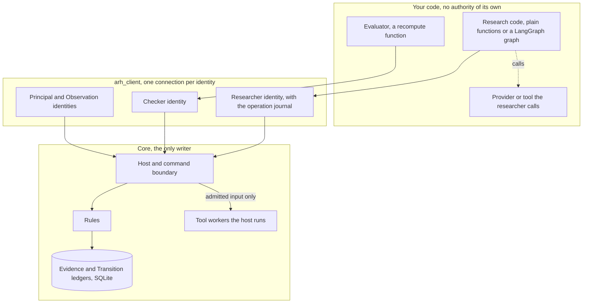

# Adaptive Research Harness: Architecture

How Adaptive Research Harness, ARH, works and where a team connects its code. The
[README](README.md) says what ARH is for and how to try it, and
the [runbook](runbook.md) gives the verified steps. The
[client README](client/README.md) documents each Python operation. The
[Constitution](docs/doctrines/new_speedway_constitution.md) governs where
this explanation and the rules disagree.

Terms used below. A **grant** is the Principal's authorization for an
identity to do a kind of work with named tools and a budget. The
**Principal** is the accountable owner. An **attempt** is one recorded
piece of metered work. An **operation** is a piece of work the research
code names, which the client journals so it can be resumed. A **check** is
an independent verification of a proposal. **Apply** is the one act that
changes the accepted record.

## 1. The pieces and the authority boundaries



Three boundaries matter.

| Boundary | What crosses it | What is kept out, and by what |
| --- | --- | --- |
| Your code to the client | Requests under one identity's token | Authority. A request is admitted or refused by the core |
| Client to core | Commands with a request key, reads of the ledgers | Direct writes. The core is the only writer and every write is one of its rules |
| Researcher to provider | Input the attempt admitted, the claim identity | A call before the attempt is admitted, or a second execution of the same attempt. These are kept out by the client workflow, which asks the core for permission first and reuses receipts. The researcher process can call a provider directly, so this is a cooperative rule, not an isolated boundary. A tool the host runs is isolated from the researcher |

The researcher, the evaluator and the Principal run as separate processes
under separate tokens. A researcher connection that calls a Checker or
Principal operation is refused and the refusal is kept.

## 2. One attempt, end to end

The headline example, followed through the records it writes. Sequence
numbers are from a retained run and will differ on yours.

| Step | Who | Operation | Record |
| --- | --- | --- | --- |
| 1 | Observation function | commit the headline document | Evidence, OBSERVATION |
| 2 | Researcher | reserve 0.50 for theme TH-H1 | Evidence, RESERVATION |
| 3 | Researcher | attempt step classify-headlines with tool FAKE-LLM-1, maximum 0.48 | Evidence, ATTEMPT, pending liability 0.48 |
| 4 | Researcher | claim, which returns permission exactly once | durable claim in the core |
| 5 | Researcher | call the provider, store the receipt durably, register it | receipt bound to the claim |
| 6 | Researcher | commit the research record with labels and counts, settle 0.48, close the reservation | Evidence, RESEARCH_RECORD, SETTLEMENT, CLOSED |
| 7 | Observation function | commit the returns document one period later | Evidence, OBSERVATION |
| 8 | Researcher | join recorded labels to committed returns, commit a second record, propose the hypothesis and fund it | Evidence, RESEARCH_RECORD, RESERVATION. Transition, PROPOSED |
| 9 | Evaluator | reserve under its own grant, attempt, compute every criterion, register the receipt, commit the check | Evidence, four records. Transition, CHECK with PASS or FAIL |
| 10 | Principal, or policy P-1 | decide | Transition, DECISION |
| 11 | Principal | apply | Evidence, BIND. Transition, APPLIED, head N moves by one |

A failing check stops at step 9. The proposal stays on the Transition
ledger with its check, the head does not move, and nothing is lost.

On the everyday interface steps 2 to 6 are one call. Research code
names the work, hands over the analysis function, its inputs and the
expectation, and gets the result back with its evidence reference.

```python
result = research.analysis(join, inputs=['SRC-RET-SYN', *scores], expectation=EXPECT, budget='memo-tests', operation='join')()
```

Behind that call the client records the design with the expectation,
reserves under the named budget, records the attempt, asks for the one
permission, lets the host run the tool or runs the caller's function,
stores and registers the receipt, records the result with its conclusion,
settles and closes. Each of those stages is journaled under the
operation's name before and after the call that makes it, so the same
call after a crash picks up where the journal stopped. Steps 8 to 11 are
`research.select`, which records the choice and proposes it, and
`research.review`, which reads where the proposal stands.

## 3. What the team supplies and what the core enforces

Most teams touch three things: a project file, research code, and an
evaluator's recompute function. The rows below them are for a team that
wants the lower level.

| You supply | Where | The core enforces |
| --- | --- | --- |
| A project file | `project.json`: the question, sources and their classes, analyses with their steps, tariffs and costs, budgets by name, researcher and evaluator entry points, the theme, a formation document. The generator writes the three setup files from it | Grants decide who may act. Designs must be registered. Methods and tools are referenced by hash. Amounts become authoritative when the Principal signs the grants at startup |
| Research code | Functions over an `Inputs` object, plain or wrapped as LangGraph nodes by `research.langgraph`; a name for each piece of work; an expectation when there is one; the next question, from a candidate table or in your own words | Reserve before attempt, attempt before execution, one permission, one receipt, settlement, record shape, proposal scope |
| An evaluator | A `recompute(inputs, spec, result)` function, registered under the Checker identity through `arh_client.api.connect(..., 'checker', recompute=...)` | Separate lineage and grant, own funded attempt, criteria complete, content equal to the registered receipt |
| Setup, designs, methods, tools, hypothesis template, formation data, written by hand | `setup.json`, `designs_and_methods.json` in your experiment directory, when the generator's defaults do not fit | The same |
| The profile of the experiment, written by hand | `experiment.json` | Steps, permitted tools, exact parameters, tariff, check cost, source period and item rules, extraction validator chosen from the core's registry, the genesis pair |
| A researcher on the lower-level client | Any program using `arh_client.Researcher` under the researcher token | Reserve, attempt, one permission, one receipt, settlement, record shape, proposal scope |
| A provider or tool | Called by the researcher (`execution: caller`) or run by the host (`execution: core`) | Its bytes are pinned in the build inventory. A caller-executed tool's receipt is counted and bound. A host-run tool receives only the admitted input |

## 4. Research execution is not acceptance

Executing an attempt produces evidence. It does not make a conclusion
accepted. Acceptance is the separate sequence of proposal, independent
check, decision and apply. A node completing in a graph, a graph resuming
after a pause, a record being committed, or a provider returning a result
changes nothing in the accepted record. A decision is recorded and is
still not acceptance. Only Apply changes the accepted record, and the
client reports the two as different states, `decided` and `applied`, so
work that needs accepted research waits for the second. The example makes this visible by proposing an overstated
count, which fails its check and is never applied, before proposing the
honest one.

The evaluator recomputes the arithmetic and the join from the recorded
labels and the committed returns. It does not verify the labels, which
only the provider produced, and it does not supply new evidence. The same
holds in the synthetic cycle, where tool B reproducing counts on the same
rows is an independent calculation and not independent evidence.

## 5. Where things belong

| Thing | Location | Who reads it |
| --- | --- | --- |
| The core and its rules | `adaptive_research_harness/` | Nobody edits it to add an experiment |
| The synthetic experiment's profile | `experiments/synthetic_flow/experiment.json` | The core, after it is frozen into a bundle |
| An external experiment | A directory such as `examples/langgraph_headlines/` or `experiments/local_documents/` holding the three JSON files and the modules the profile names | The host freezes it into a bundle and pins every module's bytes |
| Evaluation methods | Declared in `designs_and_methods.json` and implemented in the evaluator the team registers as a Checker design | The evaluator process. The core checks the method hash, not the method |
| Tool implementations | Modules named in the profile, installed or relative to the experiment directory | A worker the host starts, or the researcher process. Never the core process |
| A project description | `project.json` in the experiment directory | The generator, and the client for roles, analyses and budgets by name |
| The client | `client/`, import name `arh_client`. `arh_client.api` is the everyday interface, the rest is underneath it | Any process the team runs |
| The researcher's operation journal | `<run>/researcher/operations/`, one file per named operation | The client on resume. Never the core |
| Run records | A run directory holding `bundle/`, `state/` and whatever the researcher keeps | The host, the client and the workbench |

## 6. Identity, retries, uncertain execution and recovery

**Identity.** The host writes one token per identity into a connection
file. A connection presents its token on every request. In the local
arrangement this is a shared secret plus a self-reported process id.

**Request keys.** Every command carries a key the caller made and
persisted first. Sending the same key and payload again returns the
original outcome, so a retried node or a reconnecting process cannot act
twice. A different payload under the same key is refused. A lost reply is
resolved by asking the core what became of the key.

**Operation identity.** On the everyday interface the research code
names each piece of work. The client makes the operation's keys once and
writes them with fsync before the first call, and writes every reply
after it, in a journal under the run directory and outside any graph
checkpoint. The same name resumes the operation from the journal. A new
name is new work. A name reused for different work is refused. A
replacement for an attempt whose outcome was lost is explicit,
`research.retry`, under the original name with the next dispatch index.
Parallel graph branches carry names the research code gives them, and
graph state merges by name, so they cannot overwrite each other.

**Permission.** Claiming an attempt returns permission exactly once. Every
later claim of the same attempt, including a replay of the request that
once succeeded, returns no permission. The LangGraph adapter obtains
permission inside the node that executes and keeps it out of graph state,
because a node that dies re-runs from its beginning on resume.

**Receipts.** The researcher writes its receipt durably before telling the
core. The core binds the first receipt and refuses a different one.

**Review states.** A proposal is `waiting_for_review` until a check and a
decision exist, `check_failed` when the last check failed, `decided` with
the decision, and `applied` once the Principal applied it. A graph's
review node pauses on the first and again on `decided`, and resuming it
re-reads the ledger and approves nothing.

**Uncertain execution.** When permission was consumed and no receipt exists
in the researcher's store, the provider's own record or the core, the work
may have run or may still be running. The client reports `uncertain`, the
researcher settles at the maximum so the liability is counted, and nothing
calls the provider again for that attempt.

**Replacement.** A new attempt for the same work is admitted only when the
earlier one is settled, the host has recorded that the process which held
the claim is gone, and, for a provider declared able to outlive its caller,
the provider has reported completion or cancellation of the earlier
operation. Provider deduplication recovers the earlier operation under its
own identity and never authorizes a new one.

**Reopen eligibility.** A retained run reopens live when every file that
takes part in running or recovering it matches the current tree and the
installed Python and declared package versions match those recorded at
freeze. The list of such files is recorded in the bundle inventory as
`execution_files`; tests, documents and build tooling are in the build
identity but not in it. Otherwise the run opens read-only and says why.

**Recovery.** A host reopened on the same run directory rebuilds budgets,
admissions, bindings and obligations from the two ledgers. Three other
things are retained on disk and read on recovery rather than
reconstructed: the core's dispatch claims and registered receipts, which
sit in the same database beside the ledgers; the researcher's receipt
store, its operation journal and, for a LangGraph researcher, its graph
checkpoints; and the provider's own records of operations by claim.
Nothing is kept only in memory.

## 7. The local trust model

- One host process generates every token and writes them to one file.
  Anyone who can read that file can act as any identity.
- There is no operating-system isolation. Linux templates for user, socket
  and cgroup isolation exist under `isolation/` and have not been exercised.
- For a tool the researcher calls itself, the receipt is the researcher's
  statement. The core binds it and counts it. It cannot stop that process
  spending at a provider it can reach. A tool the host runs is handed the
  admitted input and its receipt comes from the worker the host started.
  A node that makes several provider calls accounts for them one attempt
  per call through the client's call wrapper; calls made outside it are
  invisible to ARH.
- Quiescence proofs rest on process ids no longer running, which is fixture
  evidence. Provider dispositions are recorded by the host from what the
  provider reported. The core checks their shape and binding to the claim,
  not their truth.
- The shipped examples are synthetic. Documents you import are real
  material recorded as historical. Neither earns forward standing.

## 8. Implemented behavior and the broader design

| Area | Implemented and exercised | In the Constitution, not built |
| --- | --- | --- |
| Research budget | Reserve, attempt, settle, close, fence, lineage caps, pending liabilities across interruption | Discovery screening cadence beyond the declared scope |
| Admission | Proposal, independent check, Principal decision or policy P-1, apply, binding, invalidation, release | Suspension of policy as an exercised path |
| Evidence | Observations with listing and extraction, research records, refusals | Predictions, outcomes, evaluations against a committed expectation, decay monitoring |
| Recovery | Fresh-process reconstruction, lost replies, uncertain attempts, replacement rule | Linux generation and cgroup evidence on the intended host |
| Integration | Profile, client, host, LangGraph example, evaluator under a Checker identity; the everyday interface with its project file, one-command start, operation journal, LangGraph nodes and review states, tested on a two-source example with parallel branches and killed processes | A general independent reader for arbitrary experiments; a graph pausing for review without a checkpointer |
| Capital and execution | Zero-capital limits as a registered control | Strategy versions, paper execution, qualification, allocation, reduction, retirement |
| Provenance | Synthetic sources, and historical documents the Principal imports with declared origin and content hash | Real providers, provider caps and identity rules |
| Own research | Expectation recorded as a design before the analysis, host-run calculations, conclusions, evidence-derived candidates, recorded selections, Themes as next investigations, revisions and rejections, stop and resume in the workbench | Forward predictions and outcomes on those documents, an LLM researcher |

The broader design is explained in the Constitution and in the decision
records under `docs/decisions/`. The governing records for the
integration are the
[integration plan](docs/plans/langgraph_integration_20261101.md), the
[readiness audit](docs/audits/langgraph_integration_readiness_audit_20261101.md)
and the
[implementation report](docs/implementation/langgraph_integration_20261101.md);
for the everyday interface, the
[interface audit](docs/audits/first_class_interface_audit_20261101.md),
the [interface plan](docs/plans/first_class_interface_20261101.md) and its
[report](docs/implementation/first_class_interface_20261101.md).
[BUILD.md](BUILD.md) records the coverage and its limits.
