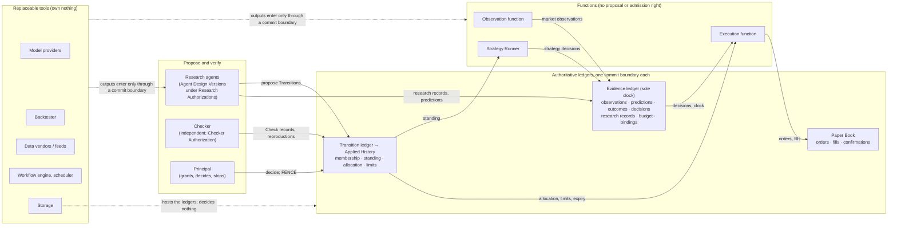

# New Speedway — Architecture

Status: **EXPLANATORY. Not doctrine.** This document explains the design;
it introduces no policy and holds no authority. Where it and the
[Constitution](docs/doctrines/new_speedway_constitution.md) differ, the
Constitution governs. Baseline: Constitution revision 11 at commit
`4407723`. Nothing described here is implemented, certified or admitted
as `ConstitutionVersion 1`.

## 1. What it is, and why it exists

New Speedway is an operating system for an evolving quantitative
investment process. Its premise is that every edge is temporary:
strategies decay, and so do the research methods that find them. What
should last is the **evidence**: what was predicted, what happened, what
was tried and failed, and under whose authority each change was made.
The system is designed so that strategies, hypotheses and the research
agents that produce them can all be replaced without losing that
record, and so that no agent can grant itself capital, rewrite the
standard it is judged by, or inherit credit it did not earn.

The Principal's original design proposal, with its research survey,
worked example and figures, is filed as
[reference material](docs/reference/new_speedway_design_proposal_20261019.docx)
(also [transcribed as text](docs/reference/new_speedway_discussion_draft_20261017.md));
it governs nothing, and where it and the Constitution differ, for
example its nine objects against the Constitution's ten, the
Constitution governs.

The product is therefore not a strategy. It is the governed process by
which strategies and research methods are proposed, funded, tested,
checked, admitted, allocated, reduced and retired, with the full history
preserved. A system that only scaled backtesting would scale a known
failure mode: more trials, more overfitting, no memory of what was
discarded. The design treats memory of failure as an asset and makes
the preservation of negative results a rule, not a habit
([Part IX, principle 6](docs/doctrines/new_speedway_constitution.md#part-ix-operating-principles)).

### Why documents first

The system was built in documents before any code for a specific
reason: in a system where agents can change the investment process,
the dangerous defects are not bugs in code but **unowned facts and
ambiguous authority**. Who decides that a hypothesis is admitted? What
makes a fill count? Can a restarted process spend a budget twice? Those
questions have to be answered exactly, and it is far cheaper to find a
contradiction in a paragraph than in a running system that has already
allocated paper capital on it. So the discipline, adopted from a prior
governed-analytics project
([adoption record](docs/decisions/fin123_core_adoption_20261018.md)),
is: every governed fact has exactly one owner and one commit boundary;
every change declares what it alters about what exists, what it means
and who decides; and no code is authorized until the human owner, the
**Principal**, admits the Constitution. The constraint that nothing
becomes true by being written down applies to this document as well.

### How much has been checked

Each decision below went through the same motion: proposed in a decision
record, audited against the Constitution for conflicts, challenged by
the Principal with adversarial cases (process death between a decision
and its apply; budget overruns; a funding stop racing an in-flight
registration; a fill arriving after an allocation expired), repaired,
admitted, propagated, and re-audited. Ten decision records have been
admitted this way. The whole design was then handed to a separate,
independent reviewer with no stake in the text, which **failed** it on
ten blocking findings; those were repaired through four reviewed
revisions and propagated. The final independent whole-design review of
the propagated design is the next step, and it may fail again. Every
audit is preserved in `docs/audits/`, including the failures. What has
*not* been done matters as much: no code, no runtime, no executed
witness, no certification. The checks so far are on paper.

## 2. The operating loop

The investment workflow is one loop, run continuously by agents under
authorizations the Principal grants. Every step leaves a durable record.

| Step | What happens | Where the rule lives |
| --- | --- | --- |
| **Frame a question** | A **Theme** (a research direction, with the observations that motivate it) or a search over price data is proposed, with a stated reason, an estimate of value or an honest `UNESTIMATED`, and a stopping rule | [§III.1](docs/doctrines/new_speedway_constitution.md#1-theme) |
| **Authorize and fund** | The Principal grants an **Authorization**: scope, budget in units, which tools may be consumed, expiry. An agent holds no right it was not granted | [§III.7](docs/doctrines/new_speedway_constitution.md#7-authorization) |
| **Run experiments** | The agent reserves budget, pre-records each metered attempt, runs backtests or forward tests, and settles the actual cost. Spending without a prior reservation is refused | [§III.5, reservation block](docs/doctrines/new_speedway_constitution.md#5-evidence) |
| **Preserve results and failures** | Every result, including abandoned and negative ones, is a Research Record on the Evidence ledger with the exact data and tool versions it used. Predictions are committed before the data that resolves them exists; outcomes are computed from declared sources by a fixed rule | [§III.5](docs/doctrines/new_speedway_constitution.md#5-evidence) |
| **Independently check** | A proposal to register, allocate, reduce or retire is a **Transition**. A **Checker**, separate from the proposer and its lineage, verifies it against criteria pinned at the time of proposal and records a Check | [§III.8](docs/doctrines/new_speedway_constitution.md#8-transition) |
| **Admit permitted changes** | The Principal decides, or an admitted policy decides routine registrations. Apply appends the change to the **Applied History**, the single authority for what is in the population and what capital it holds | [Part V](docs/doctrines/new_speedway_constitution.md#part-v-transition-classes) |
| **Choose the next research** | Evaluations under the Evaluation Standard rank what to investigate, incubate, explore on paper, qualify, reduce or retire. An Evaluation changes nothing by itself; a Transition acts on it | [Part X](docs/doctrines/new_speedway_constitution.md#part-x-evaluation-standard-es-10) |

## 3. The three populations

Three kinds of thing evolve, and they compete for different things. No
score in one competition is an input to another unless a Transition
says so ([I-1](docs/doctrines/new_speedway_constitution.md#part-iv-invariants)).

| Population | Competes for | How it evolves | What lineage preserves |
| --- | --- | --- | --- |
| **Hypotheses**: testable claims about market behavior, with declared resolution sources and a falsifier | Belief, measured by the calibration of their own committed Predictions | A hypothesis is never edited; a rewrite is a successor with zero record | The chain of successors, the motivating evidence, and every negative result |
| **Strategy Versions**: exact executable rules bound to one immutable economic proposition | Paper capital, measured on their own forward decision record net of modelled costs | A rule change is a new version; a change of meaning is a new proposition | The family of versions and trials, so that a hundred variants count as a hundred trials |
| **Agent Designs**: versioned research methods (instructions, tools, model provenance) that may write their successors | Research contribution per unit of budget, counting negative results that closed a question | An agent may propose a successor but cannot grant it any authority | Budget consumed, questions closed and rejected screens, as a view no successor can shed |

The rule that makes this safe is **successor at zero**: a new version
has no forward record, no fitness and no allocation until a Transition
gives it each one, and the predecessor's record stays visible but
transfers nothing
([I-4, I-5, I-6](docs/doctrines/new_speedway_constitution.md#part-iv-invariants)).
A profitable strategy does not prove the hypothesis it cites; a
hypothesis gains standing only from its own predictions.

## 4. System architecture

Three append-only ledgers hold everything that is authoritative. Each
has exactly one commit boundary and admits only the callers named for
each kind of record. Everything else, caches, dashboards, agent memory,
materialized state, is derived and has no vote.

| Authoritative record | Owns | Written only by |
| --- | --- | --- |
| **Transition ledger**, whose applied subsequence is the **Applied History** | Membership, standing, allocation, limits, which Constitution and Standard are in force | Apply, after a Check and a decision |
| **Evidence ledger** | Predictions, Outcomes, Market Observations, Strategy Decisions, Research Records (including budget reservations, attempts, settlements, funding stops and bindings), Evaluations; the only clock | The Evidence commit boundary, caller restricted by kind |
| **Paper Book** | Orders, simulated fills, confirmations, refusals | The Execution function only |

Three **functions** operate under their own Authorizations and propose
nothing: the Observation function is the only committer of market
data; the Strategy Runner is the only committer of strategy decisions;
the Execution function is the only writer of the Paper Book. Research
agents propose and record; a Checker verifies; the Principal grants and
decides. Tools sit outside every boundary: their output becomes
evidence only when an authorized party commits it.

**Mutation boundaries.** A consequential change (membership, standing,
allocation, limits, an Authorization, the Standard, the Constitution)
exists only as a Transition: proposed with an immutable content and a
base state, checked, decided, applied in a total order. A Transition
whose base is no longer current is refused and re-checked. Ordinary
records (observations, decisions, research records, orders) are commits
to their ledger by the one caller permitted for that kind. There is no
third path.

## 5. Controls, in plain English

| Control | What it prevents | How it works | Clause |
| --- | --- | --- | --- |
| **Research budgets: reserve, attempt, settle** | Runaway spend, double-spend after a crash, and liabilities that vanish when a process dies | An agent reserves units before work, pre-records each metered attempt with its estimated maximum, and settles the actual afterwards. An attempt must fit its reservation, the grant's remaining headroom and the lineage's cap. Overruns are counted in full and never offset. The Principal can stop funding instantly with a `FENCE`; existing liabilities still settle | [§III.5 reservation block](docs/doctrines/new_speedway_constitution.md#5-evidence) |
| **Independent checking** | An agent admitting its own work, or a Checker moving the goalposts | Every consequential Transition is checked by a party that is not the proposer, did not act under the proposer's authority and is not in its lineage, against criteria pinned at the base state. The Checker cannot waive a criterion; it can only pass, fail or stop. Its own cost is funded from its own grant, never the proposer's | [§III.8 Independence and Check record](docs/doctrines/new_speedway_constitution.md#8-transition) |
| **Delegated versus Principal decisions** | Either a human bottleneck or an uncontrolled delegation | One admitted policy lets routine hypothesis registrations and authority-free successor agents be admitted on an independent pass without a per-instance human decision. Everything that touches capital, authority, the Standard or the Constitution stays with the Principal, who can suspend the policy at any time | [Part V, policy `P-1`](docs/doctrines/new_speedway_constitution.md#part-v-transition-classes) |
| **Funding at the moment of admission** | A registration admitted on a budget that was stopped or exhausted while the proposal waited | Immediately before applying a budgeted registration, the Apply boundary obtains a binding on the Evidence ledger that verifies the reservation is open, unfenced, unexpired and the grant not overspent. Eligibility is fixed at that instant; a later funding stop forbids new spending but does not retroactively unregister. Exactly one terminal fate exists per binding, so a delayed apply and a release can never both succeed | [§III.5 `BINDING`; §III.8 Apply binding](docs/doctrines/new_speedway_constitution.md#8-transition) |
| **Capital qualification** | Capital allocated on backtests, on a few lucky trades, or on the family's best variant | Capital goes only to an exact Strategy Version, in three standings: incubating at zero; exploratory, a small bounded paper allocation with a mandatory expiry for measuring fills and behavior, never grounding anything it earned; qualified, which requires its own forward decision record, an effective-sample floor, multiplicity adjustment across the whole search family, a cost model checked against committed market observations, and survival under a stress set at the proposed size | [§III.3 Capital standing](docs/doctrines/new_speedway_constitution.md#3-strategy); [Part X](docs/doctrines/new_speedway_constitution.md#part-x-evaluation-standard-es-10) |
| **Reduction** | Being unable to cut exposure quickly because cutting requires the same evidence as adding | A `REDUCE` Allocation lowers an amount, to zero if needed, on the Principal's decision alone, with no qualification floor. It never promotes standing, admits only a residual breach and never a new risk, and leaves the execution function with a visible obligation to re-execute toward the lower target | [Part V Allocation row](docs/doctrines/new_speedway_constitution.md#part-v-transition-classes) |
| **Expiry and the paper book** | Exposure that outlives the authority that opened it; fills that cannot be shown to have happened in time | Every order and fill carries a clock read taken by the commit boundary; an opening fill is provisional until a second read confirms the allocation was still in force. An exploratory allocation's expiry creates an obligation to flatten that survives process death and is discharged only by the terminal state, never by a record claiming it | [§III.10](docs/doctrines/new_speedway_constitution.md#10-paper-book) |
| **Recovery after interruption** | A restart that re-spends a budget, re-applies a decision, or resurrects something the ledgers superseded | A fresh process receives only ledger coordinates. It reconstructs the lawful next step from the ledgers and the clock: an applied Transition is never re-done; a pending attempt is settled or dispatched under the permission it already consumed; a new attempt is a fresh admission ordered against any funding stop. A process that cannot reach an authority refuses rather than falling back to a cache | [§III.8 Continuation; I-13](docs/doctrines/new_speedway_constitution.md#8-transition) |

A note on the last row, because it bears on reuse: **a runtime's
checkpoint does not establish lawful continuation.** A workflow engine
can resume a process at the step it was on; it cannot know whether that
step is still lawful, because lawfulness depends on what the ledgers
say now (has the funding been fenced, has the base moved, has the
allocation expired). Speedway's rule is that continuation is derived
from the ledgers, and engine state is at most a hint about where to
look ([Part IX, principle 8](docs/doctrines/new_speedway_constitution.md#part-ix-operating-principles)).

## 6. Build versus reuse

The rule is explicit: adopt commodity capability as replaceable tools;
build only what no existing component can satisfy, and name the
requirement it fails ([Part IX, principle 10](docs/doctrines/new_speedway_constitution.md#part-ix-operating-principles)).
Speedway owns investment semantics, evidence and lineage, evolution
policy, budget authority, admission and capital rules. It does not own
model inference, scheduling, storage, data retrieval or backtesting,
and it does not build a general-purpose agent swarm framework.

**No runtime, store, vendor or product has been selected.** The
implementation plan, which follows admission of the Constitution, will
evaluate existing engines against one concrete sequence: reserve,
attempt, interruption, funding stop, retry, settlement, evidence
admission. The table names component categories, not products, because
no product's capabilities have yet been verified against that
sequence; naming one here would present a candidate as a commitment.

| Component | 1. What we intend to reuse | 2. What it does | 3. What Speedway owns and validates | 4. How its outputs enter authoritative records | 5. Status and decisive acceptance criterion |
| --- | --- | --- | --- | --- | --- |
| **Agent reasoning and tool invocation** | An existing agent runtime or SDK that runs a model with tools, under our instructions | Executes one Agent Design Version: reads the ledgers, calls tools, drafts proposals and research records | The Agent Design Version (instructions, tools, provenance) as an immutable governed object; the Authorization it runs under; the rule that it holds no authority and its memory is ephemeral | Only by committing records at the Evidence boundary under its Authorization, or proposing Transitions; nothing in its context is evidence | **Candidate category; selection deferred.** Criterion: the runtime can be replaced without any governed fact changing, and nothing it stores is read as authority |
| **Scheduling and recovery** | An existing durable workflow or job engine | Starts runs on schedule or on ledger events, retries, resumes after failure | The continuation rule: what a fresh process may do is derived from the ledgers and the Evidence clock, never from engine state; attempt identity and dispatch indices; refusal on unreachable authority | It writes nothing authoritative; every effect it drives is a commit by an authorized function or agent | **Candidate category; selection deferred** until evaluated against the sequence above. Criterion: a replay of reserve → attempt → crash → fence → retry → settle → admit in which every lawful next step was reconstructed from ledgers and the engine's checkpoint decided nothing |
| **Storage** | An existing transactional store hosting the three logical ledgers | Durable append with a sequence number, head reads, conflict refusal | The ledger semantics: append-only, one commit boundary per ledger, callers restricted by kind, sequence as the ordering of record; the classification of every copy as derived or cache | The store holds the ledgers; the commit boundary, not the store, admits. Hosting confers no decision right | **Candidate category; selection deferred.** Criterion: serializable append with refusal of a stale base or duplicate key, and a head read, without any store feature becoming a decision right |
| **Data retrieval** | Vendor APIs, document feeds and a market data store used as a cache | Returns prices, documents and feed listings | Source Declarations (identity, print rule, extraction rule, resolution grace) as Authorization content; the Observation function as sole committer; absence witnesses; the availability interval that decides whether a prediction was truly prospective | As Market Observations, each a receipt of what the declared source returned and when it was witnessed; the cache can resolve nothing | **Candidate category; sources declared per Authorization at genesis** (a daily equity close source and a synthetic development feed). Criterion: a declared source yields values and absences the Observation function can commit with witnessed times; a source without a deterministic extraction rule cannot resolve a prediction |
| **Backtesting** | One existing, simple backtester | Replays a strategy over a historical dataset | The research record of each run: exact dataset hash, source cutoff, parameters, tool version and a reproducibility binding; the rule that every backtest is historical reconstruction, which can reject a candidate but never establishes fitness | As Research Records committed by the agent that ran it, labelled Historical Reconstruction; never a forward record | **Candidate category; deferred to the implementation plan.** Criterion: two runs under one reproducibility binding yield one result hash, and the tool can be swapped with every record still readable |
| **Paper execution** | Nothing external: an internal simulator with a declared fill rule | Proposes simulated fills against committed decisions and the allocation in force | The whole Paper Book: order classes, clock-bracketed admission, provisional and confirmed fills, the reducing bound, expiry obligations; the fill rule as Authorization content | Fills are proposed by the fill rule and admitted by the Paper Book boundary; only confirmed fills form positions; simulated fills are never cost evidence | **Build, minimal, deferred:** the first fill rule is granted with the first Execution Authorization, not at genesis. Criterion: the expiry and reversal cases of the Constitution's worked examples replay correctly |
| **Model inference** | Hosted model providers through their APIs; for the demonstrations, a bounded synthetic provider that caps output by construction | Produces the agent's reasoning and drafts | Provenance (provider, model version, training cutoff) on every Agent Design Version; metering into units; the guarantee tier of each provider; the rule that a different provider neither establishes nor defeats a Checker's independence | Model output is ephemeral until an authorized party commits a record; a provider's record is the provenance of a settlement | **Candidate category; real providers gated.** Until the Principal records, per provider, the output-cap parameter, billing basis and acceptance of the enforcement assumption, no real provider call is treated as capped; the demonstrations run on the synthetic provider and metered local tools. Criterion: the maximum charge of a call is computable before dispatch |

## 7. The two prototype demonstrations

Both demonstrate the operating system, not alpha. Neither needs
streaming data, a broker, an exchange simulator or a custom backtesting
framework ([PD-006 §PD-006.3](docs/decisions/principal_decision_006_replaceable_tools_and_first_prototype.md)).

**Proof 1, evolutionary research.** Ten research agents, each an Agent
Design Version under a pooled Research Authorization, propose,
challenge, test, mutate and retire Hypotheses through one replaceable
backtester over historical or synthetic data.

- *Inputs:* a historical daily-close source; a shared research grant in
  units with a per-lineage cap; ten registered agent designs; one
  Checker agent.
- *User-visible steps:* agents reserve and attempt; backtests are
  committed as Research Records with dataset hash, cutoff, parameters
  and tool version; candidates are rejected and replaced; restatements
  are refused by the Checker; a lineage hits its cap and is refused; an
  agent proposes its successor, which starts with the lineage's memory
  and no authority; the Principal fences a grant mid-flight and the
  system stops new spending while settling what was admitted.
- *Expected evidence:* reservations, attempts and settlements that
  reconcile to the unit; negative Research Records preserved; Check
  records with pass, fail and stop; registrations decided under the
  policy and attributed; refusals preserved with reasons.
- *What it can establish:* that the governance loop works end to end
  under budget, interruption and succession. **It cannot establish an
  edge.** Every backtest is Historical Reconstruction; it can reject a
  candidate and motivate succession, and it earns nothing.

**Proof 2, forward research and Themes.** Agents encounter a previously
unseen, synthetic market development through a declared feed,
investigate it within scope, register a Theme with its motivating
closure and a selection basis, develop competing Hypotheses under one
experiment design, write an executable Strategy Version registered at
zero capital, and choose the next research question as a recorded
selection with estimates or an honest `UNESTIMATED`.

- *Inputs:* a synthetic development feed, labelled synthetic in its
  Source Declaration; the same grant and Checker.
- *User-visible steps:* screening of feed items with dispositions;
  on-request document retrieval under the hop rule; Theme registration
  checked and decided by the Principal; competing Predictions committed
  before resolution; the "resolution" of the synthetic development
  recorded as a test of the machinery.
- *Expected evidence:* typed claims that cite the exact bytes read;
  formation evidence kept disjoint from resolution sets by rule; a
  derivable selection history of what was chosen, rejected and why.
- *What it can establish:* that the system generates questions from a
  development rather than searching price relationships, and that
  provenance and commitment-before-availability hold. **No
  Contemporaneous Forward Record is claimed**; synthetic data tests
  system behavior and is never prospective market evidence.

Neither proof exercises paper execution or the Strategy Runner; a third
demonstration would, once a genuine forward window is wanted.

## 8. Current standing and open decisions

**Standing.** Every admission so far is a *document-phase* admission by
the Principal: it stands in for a Constitutional Transition that cannot
execute before the system exists. No genesis has executed, no code is
authorized, no runtime is selected, and no CPOC witness (an executed
proof that lawful state survives process death and reopening) has been
run. The Constitution is a draft at revision 11, not admitted as
`ConstitutionVersion 1`. Nothing is certified, and the design says so of
itself ([Part IX, principle 9](docs/doctrines/new_speedway_constitution.md#part-ix-operating-principles)).

**Open decisions, with their practical implications.**

| Item | What is actually undecided | Practical implication now |
| --- | --- | --- |
| **D-14** ([initial audit](docs/audits/initial_osa_audit.md)) | Whether the model provider and model version are part of an Agent Design Version's identity. If yes, every provider update retires every agent; if no, a provider change silently alters behavior under one identity | For the prototype the provider and version are fixed to the registered design; a substitution is stopped until a rule is admitted. In practice: a vendor's model update means re-registering agents, by design, until the Principal decides otherwise |
| **U-1** ([PD-002](docs/decisions/principal_decision_002_predictions_decisions_observation.md)) | What, if anything, could ever ground capital for a Strategy Version whose decisions cannot be reproduced (for example, one that calls a hosted model whose version cannot be fixed) | Such versions run, are scored and are preserved, but no allocation to them can be admitted under the current Standard. A strategy that depends on a live model call is, today, a research subject and not a capital candidate |
| **U-8** ([PD-004](docs/decisions/principal_decision_004_exploratory_capital_standings.md)) | Whether a portfolio limit that changes between an order's two clock reads can be enforced exactly; limits are not monotone, so bracketing does not settle it | Limits are checked at the order's first witness only. During the paper prototype the Principal should change limits when no orders are in flight; an exact rule is plan step 7 content |
| **Provider-cap assumptions** ([PD-009 §5](docs/decisions/principal_decision_009_genesis.md)) | Whether a real provider enforces an output cap and bills by metered tokens at a declared price, which is what makes a call's maximum charge computable before dispatch | Until the Principal records that acceptance per provider, no real provider call is treated as capped; the demonstrations run on a bounded synthetic provider and metered local tools, and the budget protocol is demonstrated there, not on a vendor's guarantee |
| **The later fill-rule grant** ([PD-009 §6](docs/decisions/principal_decision_009_genesis.md)) | The first fill rule `FR-0` (fill at the first witnessed value after admission, plus declared slippage, up to a participation fraction of volume) is granted with the first Execution Authorization, not at genesis | Neither demonstration executes anything on paper; execution behavior, expiry and the reversal cases are exercised by a later demonstration under a separately granted Authorization |

**What the final review is for.** The independent reviewer failed the
design once and the repairs have been propagated; the reviewer now
assesses the complete propagated design and its interactions. If it
passes, the Principal may admit `ConstitutionVersion 1`, after which an
implementation plan, with its own declared delta and its evaluation of
existing engines, becomes proposable. If it fails, the repair goes
through another decision record. Either way, the record of what was
tried stays.

## Terms

- **Principal**: the accountable human owner; the only grantor of
  authority.
- **Authorization**: a Principal-granted scope, budget and expiry under
  which an agent or function acts; nothing acts without one.
- **Transition**: a proposed, checked, decided and applied change to
  governed state; the only way membership, standing, allocation,
  limits, authority or the Standard change.
- **Applied History**: the ordered list of applied Transitions; the
  authority for what the population is.
- **Evidence ledger**: the append-only record of observations,
  predictions, outcomes, decisions, research and budget facts, with the
  system's only clock.
- **Paper Book**: the ledger of simulated orders and fills.
- **Checker**: an independent party, human or agent, that verifies a
  Transition and cannot admit it.
- **Historical Reconstruction** versus **Contemporaneous Forward
  Record**: evidence whose values were available before commitment,
  versus evidence committed before its resolving values could exist.
  Never summed; only the second grounds standing.
- **Document-phase admission**: a Principal decision recorded in
  documents that stands in for a Constitutional Transition until
  genesis executes.
