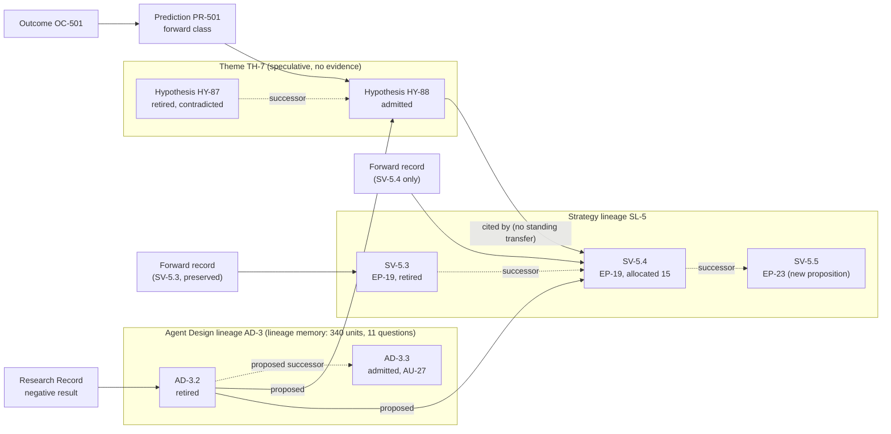
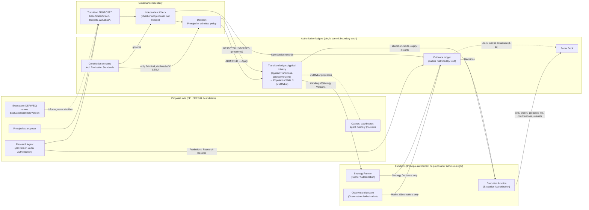

# New Speedway Constitution

Status: **DRAFT PRODUCT DOCTRINE — NOT ADMITTED. Document-first design.
Authorizes no implementation.**

Date: 2026-10-18. Revision 5 (2026-10-19): applies
[Principal Decision Record 004](../decisions/principal_decision_004_exploratory_capital_standings.md)
(admitted 2026-10-19, revision 3 with the internal-simulator
clarification) for capital standings, exploratory expiry, the admission
witness and bracketing contract, the Fill Confirmation kind, provisional
and confirmed fills, and recovery of execution obligations; closes FR-12
and UD-14. Revision 4 applied
[Principal Decision Record 003](../decisions/principal_decision_003_forward_research_formation.md)
(admitted 2026-10-18, dispositions PD-003.1 to PD-003.5 only) for
feed-based discovery, document provenance, formation versus resolution
evidence, the explanatory graph and selection history; PD-003.6 was
superseded by PD-004. Revision 3 applied
[Principal Decision Record 002](../decisions/principal_decision_002_predictions_decisions_observation.md)
(admitted, PD-002.1 to PD-002.6) for Strategy Decisions, independent
Market Observation, the Strategy Runner, Source Declarations and
training-cutoff provenance. Revision 2 applied
[Principal Decision Record 001](../decisions/principal_decision_001_identity_and_evidence.md)
(admitted) for D-07, D-03, D-08 and their D-02 and D-05 consequences. The
Constitution as a whole remains a draft; nothing is certified.

Engineering discipline: adopted from fin123-core at
`8175d504998bf682170847119a866d7f5e7df8fd`; see
[the adoption record](../decisions/fin123_core_adoption_20261018.md). Terms
marked *(adopted)* keep their fin123-core meaning and are not redefined here.

Open questions and known defects are routed to
[the initial OSA audit](../audits/initial_osa_audit.md). Where this doctrine
says **TENTATIVE**, the audit carries the alternative and the deciding
authority. Nothing marked TENTATIVE is settled by appearing here.

## Jurisdiction

This doctrine owns the New Speedway ambition, investment philosophy, the
governed objects, their identities and relationships, the constitutional
boundary around them, and the operating principles under which agents and
humans may change them. It does not own implementation, storage, scheduling
or provider selection, and it does not certify anything.

---

## Part I. Thesis

**Here is something nobody could do before generative AI.**

New Speedway is an operating system for an evolving quantitative investment
process. The ambition is a system that can generate new research, write its
own strategies, evolve its own research agents, challenge its market
hypotheses, and continuously revise its investment process while preserving
what it has learned.

Three organizing ideas govern the design.

### 1. Decay is a feature, not a failure

Every edge is assumed temporary. Strategies are disposable. The research
methods that discover them are also temporary. The system is therefore
designed around retirement, succession and preserved negative results, not
around protecting any one strategy or agent. A strategy that stops working
has produced evidence; the evidence is kept and the strategy is retired.

### 2. State, not Agents

Agents changing software taught one lesson: every consequential state change
needs an authorization and a budget. New Speedway extends that discipline to
agents changing an investment system.

The durable asset is the **governed state of the investment process**: what
has been proposed, tested, admitted, allocated, retired and learned, with
the authority under which each change was made. No individual agent,
strategy or research method is the asset. Any of them may be replaced
without loss as long as the governed state survives intact.

### 3. Forward Research and Themes

Agents inside the traditional quantitative OODA loop mostly scale the
existing research model: more backtests, faster. New Speedway must also
develop hypotheses about emerging market behavior, structural change,
positioning, liquidity and money flows, including cases with few or no
relevant historical examples. Those hypotheses lead to quantitative
strategies that are evaluated and traded through prices, volume, flows and
risk.

New Speedway is not a fundamental investment platform. It is a test of
whether generative AI makes a different kind of systematic research process
possible.

### What is not claimed

Nothing in this doctrine claims that profitable alpha, reliable regime
prediction, or durable investment superiority has been demonstrated. The
system records what was predicted and what happened. Any claim of edge is a
claim about a specific exact record, bounded by its evidentiary class.

---

## Part II. Constitutional foundations

### Constitutional Coherence *(adopted)*

A change is admissible only when it preserves ontological, semantic and
authority coherence or changes them through explicit legitimate authority,
and when the motion proves that preservation or lawful evolution. The three
questions asked of every object, relationship and transition are:

- **Ontology.** What exists, what is its stable identity, what relationships
  are permitted?
- **Semantics.** What does it mean, what must remain invariant?
- **Authority.** Who is the single authoritative owner of each governed
  fact, and who may create, change, certify, supersede or retire it?

### Authority Normal Form *(adopted)*

Every governed fact has exactly one canonical authority and one governed
commit boundary at the relevant as-of and lifecycle point. Every other
durable or material representation is classified as one of `AUTHORITATIVE`,
`DERIVED`, `CACHE`, `RECEIPT`, `LEGACY_ONLY` or `EPHEMERAL` and holds no
independent decision right. Duplication of representation is lawful;
duplication of authority is not.

### CPOC *(adopted)*

Cross-Process Operational Continuity is the obligation to prove that an
already-lawful state and its lawful continuation survive persistence,
process death, fresh reopening, reconstruction and later historical reading,
using durable authority only. CPOC is subordinate to the scoped authorities
below. It never creates authority and never decides whether a state is
lawful. It is not a portfolio check, a composition check or a reliability
category.

### Three kinds of budget

New Speedway distinguishes three budgets. Confusing them is a defect.

| Budget | Bounds | Owner | Normal value |
| --- | --- | --- | --- |
| **Constitutional budget** `ΔO / ΔS / ΔA` | Change to what exists, what it means, who decides | Principal, through a constitutional Transition | `0 / 0 / 0` for ordinary coding and for every ordinary research Transition |
| **Research budget** | Research effort an Authorization may consume: runs, provider spend, registrations, candidate submissions, review attention | Principal, allocated through Authorizations to Themes and Agent Designs | Set per Authorization |
| **Capital and risk budget** | Paper capital, gross and net exposure, concentration, factor and drawdown limits, at strategy and portfolio level | Principal, carried as limits in the Applied History and projected in Population State | Set by Transition |

Creating an instance under an existing ontology (a new Hypothesis, a new
Strategy Version) consumes research budget and possibly capital budget. It
is **not** an ontology change. `ΔO` is non-zero only when a new kind of
thing, a new identity rule or a new permitted relationship is introduced.

### Roles

| Role | Nature | Holds |
| --- | --- | --- |
| **Principal** | Human. The accountable owner. | The Constitution, every Authorization, capital and risk limits, final admission of consequential Transitions, and every constitutional Transition |
| **Checker** | Human or an Agent Design Version operating under a Checker Authorization | Independent verification of a proposed Transition. May refuse. Cannot admit. |
| **Research Agent** | An Agent Design Version operating under a Research Authorization | Proposal of Themes, Hypotheses, Strategy Versions, successor Agent Design Versions, and the Evidence kinds Part V permits it (Predictions, Research Records, Evaluations other than reproduction records) |
| **Observation function** | A function under an Observation Authorization (PD-002). Not an Agent Design Version | Retrieval of declared sources on the declared plan; the only committer of Market Observations. Proposes nothing; checks nothing |
| **Strategy Runner** | A function under a Runner Authorization (PD-002). Not an Agent Design Version | Runs admitted Strategy Versions on their declared triggers against closed inputs; the only committer of Strategy Decisions. May not propose or admit Transitions, change a Strategy Version, modify a Standard, or touch capital or the Paper Book. Runs by Applied History standing and survives the proposing agent's retirement. Never certifies reproduction |
| **Execution function** | A function under an Execution Authorization (PD-002, PD-004) | Consumes committed Decisions, the allocation and limits in force, Paper Book state, and the expiry instants of applied allocations as established by a clock read; proposes simulated fills by the fill rule its Authorization names; the only committer of paper execution facts. May not run a Strategy Version, commit any Evidence, or open exposure under an expired or superseded allocation |
| **Engineering Agent** | Future. Not defined in this phase. | Nothing yet |

The three functions are distinct in authority, not necessarily in process.
A shared process holds each Authorization separately, and every commit is
attributed to exactly one.

Agents are **not** governed objects in their own right. The governed object
is the Agent Design Version; a running agent is an `EPHEMERAL` process
executing one Agent Design Version under one Authorization.

---

## Part III. Governed objects

Each object below states: identity, mutability, authority, governed commit
boundary, what it competes for, and the representation classification of
everything else that may carry it.

Objects are either **immutable records** (created once, never changed,
superseded by successors) or **ledgers** (append-only sequences whose
current value is the result of their admitted entries).

### Summary

| Object | Identity | Mutability | Authority | Commit boundary | Competes for |
| --- | --- | --- | --- | --- | --- |
| Theme | `ThemeId` | Immutable statement; standing in the Applied History | Transition ledger (content as proposed); Applied History (standing) | Registration Transition | Research budget |
| Hypothesis | `HypothesisId` (version); `HypothesisLineageId` | Immutable | Transition ledger (content as proposed); Applied History (standing) | Registration Transition | Belief |
| Strategy | `StrategyVersionId`; `StrategyLineageId`; `EconomicPropositionId` | Immutable | Transition ledger (content as proposed); Applied History (standing, allocation) | Registration and Allocation Transitions | Capital |
| Agent Design | `AgentDesignVersionId`; `AgentDesignLineageId` | Immutable | Transition ledger (content as proposed); Applied History (standing); Authorization (rights) | Registration Transition | Research contribution |
| Evidence | `EvidenceId` with commit sequence number | Immutable, append-only | The Evidence ledger; callers restricted by kind (Part V) | Evidence commit | Nothing |
| Applied History | Apply sequence number | Append-only | Itself: the applied subsequence of the Transition ledger. `AUTHORITATIVE` for membership, standing, allocation, limits, budget consumption, currentness and pinned versions | Apply | Nothing |
| Population State | `StateVersion` (= Apply sequence number) | `DERIVED` projection | None of its own; reproduced from the Applied History | None (not writable) | Nothing |
| Authorization | `AuthorizationId` | Immutable; revoked by successor | Principal | Authorization Transition | Nothing |
| Transition | `TransitionId`; `BaseStateVersion` | Immutable proposal; append-only lifecycle events | The Transition ledger (one ledger; its applied subsequence is the Applied History) | Propose, Check, Decide, Apply | Nothing |
| Constitution | `ConstitutionVersion` | Immutable versions | Transition ledger (text as proposed in the Constitutional Transition); Applied History (which version is current) | Constitutional Transition | Nothing |
| Paper Book | Order set key, `OrderId`, `FillId`; a Fill Confirmation bound to one `FillId`; positions derived from confirmed fills | Ledger | The execution ledger; the Execution function is its only caller | Order commit, Fill commit, Confirmation commit | Nothing |

**Amendment to the candidate list.** The Paper Book is added. The brief's
nine candidates have no owner for execution facts (orders, fills,
positions), and allocation targets and executed positions are different
facts with different owners. Without a tenth object either Population State
becomes the owner of execution facts it did not decide, or orders have no
authority. See audit D-09.

### 1. Theme

A developing research domain. A Theme may be speculative. It is a statement
of where research attention is directed and why, with the structural,
positioning, liquidity or flow observations that motivate it.

- **Identity.** `ThemeId`. Content is immutable. A change of scope is a
  successor Theme that cites its predecessor; the predecessor is retired
  by the same Transition. Existing Hypotheses are not re-parented: their
  `motivated_by` sets stand, and a Hypothesis registered under the
  successor cites the successor (PD-003.4; closes audit D-01).
- **Relationships.** A Theme is a member of zero or more Hypotheses'
  `motivated_by` sets. A Theme has a research budget through an
  Authorization. Lineage memory for a successor Theme includes its
  predecessor's by the predecessor reference (I-5).
- **Registration content** (PD-003.4, PD-003.5). A Theme registration
  carries a **motivation closure** (the Research Records and Observations
  that formed it) and a **selection basis**: the uncertainty; the decision
  it could change; the proposed experiment; a value estimate with its
  declared basis or `UNESTIMATED` with the reason; cost and time
  estimates or `UNESTIMATED`; the horizon and stopping rule; and its
  origin: the `SELECTION` Research Record that chose it, or
  "discovery-scope initiative". No precision is invented.
- **Standing** (active, dormant, retired) is an Applied History fact,
  projected in Population State.
- **Authority.** The Principal registers and retires Themes. A Research
  Agent may propose a Theme; the proposal is a Transition. The Checker
  verifies that the motivation closure cites Observations under the
  proposer's scopes, that claims are typed, and that the selection basis
  is complete.
- **Invariant.** A Theme makes no testable claim and earns no evidentiary
  standing. Theme standing is a research-direction decision, never an
  evaluation result.

### 2. Hypothesis

A testable proposition about market behavior.

- **Identity.** `HypothesisId` names one exact immutable statement
  including its falsification conditions and declared resolution sources.
  `HypothesisLineageId` names the chain of successors.
- **Immutability.** A Hypothesis is never edited. A rewrite is a successor
  Hypothesis with a new `HypothesisId`, zero forward record and an explicit
  predecessor reference.
- **Testability.** Registration requires: the observable the Hypothesis
  predicts; the declared resolution sources by `SourceId` (§III.7),
  each under an Observation Authorization active at the registration's
  base state; the **resolution rule**: a deterministic function from a
  declared **resolution set** of (`SourceId`, period, print) members to
  the target value, with its content hash; which print resolves (first
  print or a named final); the tolerance; and what would count against
  it. All are fixed at registration, and every Prediction of the
  Hypothesis carries its own resolution rule and set fixed at commitment
  (PD-002 F-2).
- **Motivation and funding** (PD-003.3, PD-003.4). Registration declares
  `motivated_by`: a **set** of Themes and Research Records; funding is
  exactly one Authorization. It declares a **motivation closure**: the
  Research Records and Observations that formed the claim. **No member of
  the motivation closure, and no Observation with sequence below a
  Prediction's commitment, may be a member of that Prediction's
  resolution set.** Formation evidence never tests; standing is built only
  from Outcomes. Registration carries a selection basis as for a Theme.
- **Document-sourced resolution** (PD-003.3). A resolution-set member may
  be a field in a document only when, fixed at commitment: the `SourceId`
  is a declared document source or feed under an Observation
  Authorization active at commitment, never a hop retrieval; the period or
  event is declared; the field meaning is a meaning field of the
  `SourceId`; the print rule is declared; the `SourceRevision` pinned at
  commitment carries a **deterministic extraction rule**; and the
  resolving Observation's availability interval has a lower bound (a
  prior `COMPLETE` feed retrieval within contract that did not contain
  the item, an `ABSENT` result at a declared absence slot, or an accepted
  structural bound) that commitment precedes. A source with no
  deterministic extraction rule cannot be a resolution source; its
  documents are formation evidence only. Checker-adjudicated extraction is
  not part of this doctrine (future proposal with audit D-10).
- **Standing** (admitted, supported, contradicted, retired) is an Applied
  History fact, projected in Population State. "Proposed" is a Transition
  lifecycle standing; an unadmitted Hypothesis is not in the population.
  A standing change is itself a Transition that cites an Evaluation of the
  Hypothesis's own committed Predictions and their Outcomes under the
  Evaluation Standard pinned at that Transition.
- **Competes for belief.** Hypotheses are ranked by the calibration of their
  committed Predictions: how often they held, where they failed, and whether
  they declined to predict when they should have. **Hypothesis fitness is
  not strategy profitability.** A Strategy citing or consuming a Hypothesis
  does not raise the Hypothesis's standing. Only the Hypothesis's own
  committed Predictions do.
- **Competing Hypotheses** commit Predictions over the same resolution set
  with incompatible targets. An experiment that distinguishes them is a
  Research Record of kind `EXPERIMENT DESIGN` that names the set and
  precedes every Prediction over it. The Checker refuses a registration
  that restates a contradicted Hypothesis under the same Theme without a
  declared difference, reading the Theme's lineage memory (audit FR-4,
  direction).
- **Forward research.** A Hypothesis may be about a non-price observable
  (positioning, flows, issuance, dealer inventory, funding conditions)
  resolved against a declared source. A Hypothesis with little historical
  precedent is admissible; its evidentiary record will simply be almost
  entirely Contemporaneous Forward Record.

### 3. Strategy

An economic proposition expressed through executable investment rules.

Three identities, deliberately separated:

| Identity | Names | Survives |
| --- | --- | --- |
| `StrategyLineageId` | The continuity of development: a chain of versions | Any implementation change |
| `EconomicPropositionId` | The immutable statement of meaning, fixed by five boundaries declared at registration: **mechanism** (or "none claimed" for an empirical Strategy), **prediction target**, **market or domain**, **horizon**, **payoff** | Only versions for which all five boundaries are unchanged and equivalence has been independently established |
| `StrategyVersionId` | One exact immutable executable artifact: rules, parameters, universe, declared input kinds and `SourceId`s, declared trigger, any frozen model (weights, configuration, seed), content hash; bound to exactly one `EconomicPropositionId` and one `StrategyLineageId` | Nothing; each version is its own evidentiary subject |

- **Prediction target** means the scored observable and its sign: the
  quantity the Evaluation Standard marks every Strategy Decision against,
  and the direction the Strategy claims to capture. It is a scoring
  commitment, not a causal one, and is required whether or not a
  mechanism is claimed. Changing the scored observable, its sign or the
  horizon it is scored over is a boundary change (PD-002).
- **Lineage survives implementation change; economic identity does not
  automatically survive a change in meaning** (PD-001.2). A Transition
  that registers a new Strategy Version declares `Proposition delta:
  NONE` (binds the predecessor's `EconomicPropositionId`) or `Proposition
  delta: NEW` (binds a new one). `NONE` is lawful only when all five
  boundaries are unchanged **and the Checker has independently
  established equivalence from the rule change itself, not from the
  declaration.** Implementation facts (parameter values, rebalance
  frequency, signal construction, inputs within the declared kinds,
  trigger, a frozen model's weights) may change within a proposition
  unless the change moves a boundary. Any boundary change is `NEW`: a new
  `EconomicPropositionId`, successor at zero, lineage preserved. A
  disputed equivalence is decided by the Principal.
- **Lineage never automatically transfers evidence, fitness or capital
  authority.** A new Strategy Version has no forward record, no assessed
  fitness and no allocation until a Transition gives it each one.
- **A Strategy need not originate from a Hypothesis.** An empirical
  Strategy declares an Economic Proposition whose mechanism field is
  "none claimed". It still must be executable and still competes for
  capital on its own forward record.
- **A profitable Strategy does not prove its explanatory Hypothesis.** A
  Strategy that consumes a Hypothesis's committed Predictions as inputs
  builds its own record; the Hypothesis is evaluated only through its own
  Predictions and Outcomes (I-1).
- **Selection basis** (PD-003.5). Registration carries, on either
  discovery path and without requiring a Theme or Hypothesis: the
  question or purpose; the alternatives actually considered, by Research
  Record sequence within the version's declared `SearchFamily`; the
  unsuccessful trials in that family; the reason for proposing; the
  budget consumed to date as read at a `StateVersion`; a value estimate
  with its declared basis or `UNESTIMATED` with the reason; cost and
  time estimates or `UNESTIMATED`; horizon and stopping rule; and its
  origin. The Checker verifies the cited alternatives and trials are in
  the family. A cited Hypothesis or `motivated_by` reference transfers no
  standing; whether the mechanism field is immutable as declared when its
  explanation is contradicted is open (audit FR-6).
- **Competes for capital.** Capital is allocated to exact Strategy
  Versions by Allocation Transitions, within the limits in force in the
  Applied History.
- **Capital standing** (PD-004.1). Every admitted Strategy Version has
  one of three standings, set by the Allocation Transition in force:
  `INCUBATING` (allocation zero; Decisions and the decision-implied
  record accrue; entered at registration or by a standing Transition
  after expiry); `EXPLORATORY` (a bounded allocation from the
  Principal-declared exploratory pool, with a required `expiry_time`, an
  optional `quota_events` and an instruction, §III.10; its executed
  record is labelled `EXPLORATORY` and may ground implementation
  shortfall, fill quality, turnover and operational measurement only);
  `QUALIFIED` (an allocation citing an Evaluation under the Standard in
  force at base whose grounding series is the forward decision-implied
  record). An Evaluation whose grounding series includes any exploratory
  executed figure is non-conforming and a Transition citing it is
  refused at Check. No standing changes a Decision or the
  decision-implied record. No numerical threshold is constitutional.
- **Executability.** Registration requires that the artifact be
  executable without further judgment: a mapping from an input closure
  (§III.5) to target exposures in fractions of allocated capital, or to
  `DECLINED`. A Strategy Version that requires discretion is not a
  Strategy; it is a Hypothesis or a Theme. A frozen model held by the
  system (weights, tokenizer, inference configuration, seed, all in the
  content hash) may be part of the artifact.
- **Declared inputs and trigger.** Registration declares the input kinds
  (Market Observations by `SourceId`; Predictions by lineage; Outcomes;
  Decisions of named versions; committed Evaluations; the projection at
  a `StateVersion`; own confirmed fills) and the trigger: a schedule, or a ledger
  event (a new `VALUE` Observation of a named `SourceId`; a new Prediction
  of a named lineage). The Checker refuses a registration whose
  `SourceId`s are not under an Observation Authorization active at the
  base state.
- **Reproducibility class** is found by the Checker at registration by
  test execution, never declared by the proposer: `REPRODUCIBLE` when two
  executions against one closure, with the closure alone available,
  yield one content hash; otherwise `NON-REPRODUCIBLE` (an external model
  call, a hosted model whose version the system cannot fix, or
  nondeterminism). Decisions of a `NON-REPRODUCIBLE` version are
  committed, preserved and scored, cannot obtain `REPRODUCED` standing,
  and under the current Evaluation Standard ground no capital
  competition; an Allocation Transition citing them is `STOPPED` (I-14).
  What else might ground it is open (PD-002 U-1).
- **Forward record.** The forward record of a Strategy Version is the
  series of its Contemporaneous-Forward-Record Strategy Decisions
  (§III.5), each shown with its derived reproduction standing. From it
  the Evaluation Standard computes a decision-implied record at a
  Standard-declared notional, which exists at zero allocation, and, where
  capital was allocated, an executed record from confirmed fills. Both are
  `DERIVED`; shortfall is their reported difference.

### 4. Agent Design

A versioned research or engineering method that can produce successor
agents.

- **Identity.** `AgentDesignVersionId` names one immutable method:
  instructions, tools, evaluation inputs it may read, outputs it may
  propose, content hash. `AgentDesignLineageId` names the chain.
- **Relationships.** An Agent Design Version may propose a successor Agent
  Design Version. The successor references its predecessor. The successor
  is a candidate until admitted by a Transition it did not check.
- **Method class.** Registration declares `RESEARCH`, `SELECTION` or
  `CHECKER` (PD-003.5). A research-selection method, Applied Information
  Economics among them, is an Agent Design lineage of class `SELECTION`
  under an ordinary Research Authorization: it proposes and never funds
  or admits, its choices are `SELECTION` Research Records, and it is
  replaced by an Authorization act. Selection is optional; a lineage may
  select by no declared method and cite its origin directly.
- **Provenance.** Registration declares the provider model and its
  training cutoff (PD-002.6). This is a provenance fact recorded so that
  an Evaluation Standard can describe Historical Reconstruction honestly.
  It is never evidence of freedom from leakage, and no rule may treat a
  period after the cutoff as leak-free on that ground. Whether provider
  and model version are part of identity is open (audit D-14).
- **Authority is never carried by the design.** An Agent Design Version has
  no rights. Rights come only from an Authorization granted by the
  Principal. **An agent may write a successor agent but may not grant that
  successor any authority, and may not redefine the standard by which
  either is evaluated.** A successor runs under no Authorization until the
  Principal grants one.
- **Competes on research contribution.** Agent Design Versions are ranked
  under the Evaluation Standard by the admitted, forward-resolved research
  they produced per unit of research budget consumed, counting negative
  results that closed a question as contribution.
- **Search history belongs to the lineage and the Theme, not the version.**
  Research budget consumed, questions closed and negative results are
  lineage-level and Theme-level facts. **Lineage memory is a `DERIVED` view
  over the Research Record ledger keyed by `AgentDesignLineageId` and
  `ThemeId`.** No record carries it, so no successor can be created without
  it and no proposer can omit it. Creating a successor does not reset it.
  See challenge 7 in the audit.

### 5. Evidence

What was predicted, decided, tested, observed and learned. Evidence is an
append-only ledger of immutable records, each stamped with a commit
sequence number and, where the kind carries one, a commitment or
witnessed time assigned by the Evidence commit boundary's declared clock,
never by the proposer. The Evidence clock is the only clock in this
doctrine. Who may call the commit boundary for each kind is restricted in
Part V.

**Clock read** (PD-004.2). A clock read is the answer the Evidence commit
boundary gives when asked the instant: the pair `(t, E)`, the instant its
declared clock shows and the Evidence sequence at its head at that
answer. Answering is a duty of the boundary; a read commits nothing,
assigns a time to no Evidence fact, originates no record, and is
`EPHEMERAL` in the hands of whoever took it until another commit boundary
records it on its own record. A read at `t ≥ T` establishes that `T` has
passed; a read at `t < T` establishes that it had not at that instant;
the absence of any record establishes nothing about time. A function
that cannot obtain a read has no time and never substitutes a local
clock, a prior read or a previously committed timestamp.

| Evidence kind | Bound to | Meaning |
| --- | --- | --- |
| **Prediction** | Exactly one `HypothesisId` or `StrategyVersionId`; a target; a resolution rule over a declared resolution set of (`SourceId`, period, print) members, with its content hash; a tolerance; a **commitment time** and sequence by the Evidence clock | A claim committed at a recorded time, fixed at commitment |
| **Outcome** | Exactly one Prediction; exactly one **bound observation set**: for each member of the resolution set, the sequence of the `VALUE` Observation of that member's declared print; the pinned `SourceRevision` of each; the rule hash; the computed value; **outcome availability time** = the witnessed receipt of the last member bound | What happened, resolved by re-applying the rule to the bound set. Recomputable by any reader. Immutable; a later restatement is a new Market Observation and never alters it. `UNRESOLVABLE`, with the missing member named, when a member has no `VALUE` by the Standard's deadline |
| **Market Observation** | A `SourceId` and `SourceRevision` (§III.7); an instrument or field; a period; a print; a result `VALUE`, `ABSENT`, `NOT_EXTRACTABLE` or `RETRIEVAL_FAILED`; the value where present; the **claimed source time** (`RECEIPT` content; informs, establishes nothing); the **witnessed receipt time** and sequence by the Evidence clock. **`DOCUMENT` form** (PD-003.2): locator, content hash of the exact bytes, stored bytes addressed by hash, claimed publication time, and for feed items the feed `SourceId`, slot and absence witness; for hop retrievals the requesting Authorization and the hop chain. **Feed retrieval record**: an Observation of the feed itself with result `COMPLETE`, `PARTIAL` or `RETRIEVAL_FAILED` | A `RECEIPT` of what the declared source returned and when the system held it. `ABSENT` is a retrieval result: the function could not retrieve the value then; it is not a statement about the market. `NOT_EXTRACTABLE`: the pinned extraction rule yielded no value from the bytes. `RETRIEVAL_FAILED` and `PARTIAL` establish nothing about absence |
| **Strategy Decision** | Exactly one `StrategyVersionId`; a `DecisionEventId`; an **input closure**; **commit-time witness marks**; an output; a content hash; a **commitment time** and sequence by the Evidence clock | The committed output of executing one Strategy Version for one decision event against one closure (rules below). Committed only by the Strategy Runner |
| **Research Record** | An `AgentDesignVersionId`, an Authorization, budget consumed, the question, the result including negative, inconclusive or abandoned; a **closure** (Observations and Research Records read, by sequence; the `StateVersion` read); **typed claims** (`REPORTED` citing a `DOCUMENT` Observation and a location; `INTERPRETATION` citing the `REPORTED` claims it rests on; `ASSUMPTION`, declared; `QUESTION`; `PREDICTION_REF`); an optional `SearchFamily` label; a kind among plain, `SCREEN` (a feed item's sequence and a disposition `CANDIDATE`, `DEFERRED` or `REJECTED` with reason), `EXPERIMENT DESIGN` (names a resolution set; precedes every Prediction over it) and `SELECTION` (method, closure, every candidate with estimates or `UNESTIMATED`, the chosen subset linked to proposing Transitions, every rejection with reason, a revisit rule) | What was learned, including what did not work, what was read, and what was rejected. A claim citing bytes outside the closure is unsupported on its face |
| **Evaluation** | A set of Evidence records; an `EvaluationStandardVersion`; a **closure** (`E`, `N`, `F`, below) | A `DERIVED` assessment; recomputable; never authoritative for standing by itself. **Reproduction records** are Evaluation-kind records naming a Strategy Decision, the reproducing party and its Checker Authorization, the obtained hash, and match or divergence |

**Strategy Decisions** (PD-002.1, PD-002.4).

- **Decision event.** A Strategy Version's declared trigger yields one
  decision event per instance; `DecisionEventId` is derived from the
  version, the trigger declaration and the instance (a schedule slot, or
  the sequence of the triggering record). The Evidence commit boundary
  admits at most one Decision per `DecisionEventId`, preserves the
  refusal of a second, and does not depend on which Runner process
  computed it.
- **Output.** A target exposure vector in fractions of allocated capital;
  or `DECLINED` with the rule that declined; or `FAILED` with the failure
  class. `FAILED` is an artifact result against a fixed closure and is
  final for its event. An infrastructure failure before commit leaves no
  record; retrying the event is lawful until a Decision exists for it.
  Expected events are derivable from the declaration; a missing event is
  a visible fact.
- **Input closure.** The exact set of committed records the artifact
  read, as bindings by ledger and sequence with a hash of their resolved
  content, never values: Evidence inputs with sequence at or below an
  Evidence mark `E` (the Decision's own sequence is above `E`, enforced
  by the commit boundary); the projection at a `StateVersion` `N`;
  positions derived from confirmed fills at or below a Paper Book mark `F`. Only
  declared kinds and `SourceId`s are admissible; the market data store,
  external services, wall-clock time and agent memory are not. Backfilled
  Observations are admissible inputs; their late witness affects the
  class of scoring, not admissibility. A Prediction consumed as an input
  is an input, not standing (I-1).
- **Commit-time witness marks.** At Decision commit the Evidence commit
  boundary reads the head of the Applied History and the head of the
  Paper Book, records each with the Evidence-clock instant of its read,
  and refuses a closure whose `N` or `F` exceeds the witnessed head. A
  reader that cannot reach either head refuses the commit (I-13). The
  witness claims only that the heads were at least the recorded values at
  those instants, which is sound because both ledgers are append-only; it
  claims no simultaneity across ledgers (PD-002 U-2). Staleness is a
  recorded fact.
- **Reproduction.** Re-execution of the artifact against the closure,
  with the closure alone available, by a party other than the Runner,
  under a Checker Authorization, must yield the same content hash.
  Reproduction standing is `DERIVED` from the set of reproduction
  records: `UNVERIFIED`, `REPRODUCED`, `UNREPRODUCED`, `DISPUTED`
  (decided by the Principal). Nothing is stored on the Decision. Which
  Checker Authorizations qualify is audit D-10.

**Documents, feeds and absence witnesses** (PD-003.1, PD-003.2).

- The agent reads from the ledger copy of a document; anything read
  elsewhere is `EPHEMERAL` and cannot be cited. A later retrieval of the
  same locator with a different hash is a new Observation.
- A feed slot establishes an **absence witness** for an item only through
  a `COMPLETE` retrieval within the feed's enumeration contract and
  window, at the retrieval's witnessed time; a `PARTIAL`, failed or
  delayed retrieval establishes nothing, and an item outside the contract
  has no absence witness from that feed. Absence from the declared source
  says nothing about availability through other channels (audit N-4).
- A hop retrieval has only an upper availability bound unless the Checker
  accepted a structural bound for its source at registration, and can
  never be a resolution-set member.
- Deterministic extraction: where the pinned `SourceRevision` carries an
  extraction rule, the Observation function applies it at retrieval and
  commits a `VALUE` bound to the `DOCUMENT` Observation; the value then
  resolves like any other. A changed rule is a new `SourceRevision` that
  applies only to Predictions committed after it; a pinned rule that no
  longer applies yields `NOT_EXTRACTABLE` and an `UNRESOLVABLE` Outcome,
  never resolution under a newer rule.
- A `DERIVED` view over `SCREEN` records keyed by item hash shows every
  lineage's disposition of every item; a later screen may differ and must
  state the difference. Expected screens are derivable from the discovery
  scope's cadence; a missing screen is a visible gap counted in the
  lineage's evaluation and invalidates no other lawful act.
- A `DERIVED` view over `SearchFamily` labels groups Research Records,
  Predictions and Strategy Versions; the Evaluation Standard counts trials
  across a family (audit FR-8, open). The label is content, not an
  identity; a governed family identity would be a `ΔO` decision.
- Selection history is complete by derivation: what was chosen and
  rejected (`SELECTION` records or registration selection bases), the
  unsuccessful trials (the family), the cost (consumption under the
  family and Authorization), the duration (registration Apply to the
  closing standing Transition), the findings (Outcomes, Decisions,
  Evaluations), whether a decision changed (Transitions citing them), what
  rejected candidates became (later screens, selections and registrations
  citing them), and estimate error or its absence (`SELECTION OUTCOME`,
  a `DERIVED` Evaluation under `ES-1`).

**The availability interval and the three times** (PD-001.3, PD-002.2).
Every prospective claim rests on three times.

| Time | Authority |
| --- | --- |
| Information availability of a value | **None.** What exists is a `DERIVED` interval: lower bound = the later of the latest `ABSENT` Observation of that value (or, for a feed item, the latest `COMPLETE` feed retrieval within contract that did not contain it) before its first `VALUE`, and a structural bound the Checker accepted at registration (a value for a period cannot exist before the period ends); upper bound = the first `VALUE` receipt. A publication schedule, whether the source's or the plan's, is never a bound |
| Prediction or Decision commitment time | The Evidence commit boundary's clock, never the proposer |
| Outcome availability time | The witnessed receipt of the last member bound |

- **Two evidentiary classes, never merged** *(adopted)*. Every Prediction,
  Outcome and Strategy Decision carries exactly one class. **Contemporaneous
  Forward Record** requires that the commitment time demonstrably precedes
  the lower bound of the availability interval of every value needed to
  resolve or score it. Everything else, including any record whose value's
  interval has no lower bound, is **Historical Reconstruction**, with the
  reason recorded; nothing later reclassifies it. The system never asks
  the proposer which class applies. A target window with any part
  available at commitment is Historical Reconstruction in full. Reports
  show the two classes separately and never sum them. Reproduction
  standing is orthogonal to class and is not a third class.
- **Evidence does not transfer.** Forward record is bound to the exact
  `HypothesisId` or `StrategyVersionId`. A successor begins at zero;
  lineage never automatically transfers evidence, fitness or capital
  authority. A
  Transition may *claim* evidentiary continuity for a Strategy Version
  with `Proposition delta: NONE`; the claim is checked independently and
  recorded as a claim, and reporting always shows the per-version record.
  **TENTATIVE**; see audit D-06.
- **Negative evidence is preserved.** Failed Hypotheses, rejected
  Transitions, abandoned research, `FAILED` and `DECLINED` Decisions,
  `UNREPRODUCED` Decisions, `UNRESOLVABLE` Outcomes and retired Strategies
  remain in the ledger with their full record. Nothing is deleted.

### 6. Applied History and Population State

Admitted by PD-001.

- **Applied History.** The ordered subsequence of the Transition ledger
  consisting of applied Transitions, in Apply order. It is `AUTHORITATIVE`
  for population membership, standing, allocation, limits, budget
  consumption and currentness. There is one Transition ledger; rejected and
  stopped Transitions live in it too, but only applied ones are in the
  Applied History.
- **Population State at N** is the `DERIVED` projection obtained by applying
  the first N Transitions of the Applied History in order. `StateVersion`
  equals the Apply sequence number. Population State has no independent
  authority. "Current" means the projection at the head of the Applied
  History. Its content: the admitted Themes, Hypotheses, Strategy Versions
  and Agent Design Versions with their standing; the capital allocated to
  each Strategy Version; the portfolio and strategy limits; the active
  Authorizations; capital and allocation budget consumption; the current
  `ConstitutionVersion` and `EvaluationStandardVersion`. Research resource
  consumption is **not** an Applied History fact: it is owned by Research
  Records on the Evidence ledger, and remaining research budget is
  `DERIVED` from the Authorization grant minus those records. Capital and
  allocation budgets are consumed at admission; research resources are
  consumed during execution (Principal direction on D-12; mechanism open).
- **Pinning.** Every applied Transition records the `ConstitutionVersion`
  and `EvaluationStandardVersion` in force at its Apply. Projection and
  replay interpret each Transition under its pinned versions. A later
  Constitution never reinterprets an earlier authorized decision; a
  Constitutional Transition governs only Transitions applied after it.
- **One commit boundary.** Apply appends to the Applied History and is the
  only way membership, standing, allocation, limits, consumption or
  currentness change. Agents, caches, dashboards, evaluators and recovery
  procedures never write it.
- **Serial admission.** Transitions apply in a total order. Each names the
  `BaseStateVersion` it was checked against. Apply refuses a Transition
  whose base is no longer the head. See Part IV.
- **Materialized projections.** Any stored Population State is `DERIVED`
  or `CACHE`, bound to its `StateVersion` and the pinned versions it was
  built under. It is discarded when it cannot be reproduced from the
  Applied History. A reader that cannot reach the Applied History refuses.
- **The Paper Book is separately authoritative** for paper orders and
  fills. The Applied History owns allocations; it never owns execution.
- **Limits include the exploratory pool** (PD-004): a Principal-declared
  limit from which `EXPLORATORY` allocations draw, with a per-version
  cap and any lifetime cap, set by a limits Transition like every other
  limit. Its size is never constitutional text.
- **In force.** An allocation is in force when it is applied and no later
  applied Transition has changed the version's allocation or standing.
  Expiry does not end an allocation; only Apply does. Until a standing
  Transition applies, the projection shows the allocation as
  `EXPLORATORY (expiry_time T; expired per read at t; terminal state
  established or not)`, derived.
- **Assessments are derived.** The ranking of Hypotheses, Strategy Versions
  and Agent Design Versions is an Evaluation computed from Evidence under
  an Evaluation Standard at a `StateVersion`. It becomes consequential only
  when a Transition acts on it, and a consequential Transition may cite
  only an Evaluation computed under the Evaluation Standard in force at
  its `BaseStateVersion`; the Checker verifies this.

### 7. Authorization

Who may change what, within which budgets.

- **Identity.** `AuthorizationId`. Immutable. Amended or revoked only by a
  successor Authorization that references it.
- **Classes.** Research Authorization (to an Agent Design Version or a
  human role); Checker Authorization; **Observation Authorization** (to
  the Observation function); **Runner Authorization** (to the Strategy
  Runner); Execution Authorization (to the Execution function). Only the
  Principal grants any of them.
- **Content.** Grantor (always the Principal); grantee; the Transition
  classes the grantee may propose or check; the Evidence kinds it may
  commit (Part V); the Themes it may work in; the research budget;
  whether it may consume capital budget and up to what limit; the
  constitutional budget (always `0/0/0` unless the Principal states
  otherwise); expiry. An Observation Authorization additionally carries
  its **Source Declarations** and, for each, an observation plan of
  retrieval slots including absence-witness slots; its **feed sources**
  (PD-003.1), each with an **enumeration contract** as meaning fields
  (what the feed enumerates completely, the window a retrieval covers,
  the item identity rule, how completeness is established); and its
  **hop rule**: the maximum hop depth (default 2), the follow-up count,
  and the domains to which on-request retrieval is permitted or refused.
  A Research Authorization may carry a **discovery scope** (PD-003.1):
  the feed `SourceId`s the holder may screen; a **fixed grant** of
  research units consumable on Research Records attributed to no Theme;
  follow-up caps within the hop rule; and the expected screening cadence
  per feed. A Runner Authorization
  names the Strategy Versions it runs by standing rule (every admitted
  version, or a named subset). An Execution Authorization names the
  **fill rule** of the internal simulator (plan step 7; Principal
  decision 2026-10-19: external paper accounts and live execution are
  outside this doctrine) and its permitted triggers: committed
  Decisions, and the `expiry_time`, `hold_expiry_time` and, where
  declared, quota exhaustion of applied allocations, each established
  by a clock read (PD-004 `ΔA` 1). It may state a promptness
  expectation; that expectation creates no authority.
- **On-request retrieval** (PD-003.1). A Research Agent may request that
  the Observation function retrieve a locator only by citing the
  `DOCUMENT` Observation in whose bytes the locator appears, within its
  discovery scope's feeds, depth, count and units and the Observation
  Authorization's domains. The Observation function verifies the locator
  is in the cited bytes, commits the result with the feed `SourceId` and
  the hop chain, and refuses otherwise; the Evidence commit boundary
  preserves every refusal with its request. There is no other route to a
  document; a source an agent cannot reach lawfully is reason to propose
  a successor Observation Authorization, decided by the Principal.
- **Source Declaration** (PD-002.2, PD-002.5). Content of the Observation
  Authorization that carries it; not a governed object. `SourceId` is
  immutable and names the meaning fields: provider, dataset, field, unit,
  print rule, claimed-time field, structural availability bound if
  accepted; for a document source or feed, the field meaning (quantity,
  unit, definition as the source defines it) is a meaning field.
  `SourceRevision` is the content hash of the full declaration including
  endpoint, access method, parsing and any **deterministic extraction
  rule** (a tagged data element, a named table cell, a fixed parser with
  content hash); a successor Authorization may carry a new revision of
  the same `SourceId` only if every meaning field is identical, and a
  changed meaning field is a new `SourceId`. Every Market Observation pins both. Hypotheses and Strategy
  Versions bind `SourceId` only, and a Checker verifies them against the
  Observation Authorizations active **at the registration's base state**.
- **Budget ownership.** The Authorization owns the grant, an immutable
  ceiling. Capital and allocation consumption is owned by the Applied
  History, where each applied Transition records what it consumed at
  admission. Research resource consumption is owned by Research Records on
  the Evidence ledger, recorded as the work is done. Remaining budget of
  either kind is `DERIVED` and has no carrier of its own.
- **Authority.** Only the Principal grants. **No Authorization may grant
  the right to grant.** An Agent Design Version therefore can never hold or
  convey authority over authority. No Research or Checker Authorization
  includes the right to commit a Market Observation or a Strategy
  Decision; no Observation, Runner or Execution Authorization includes
  the right to propose or check a Transition.
- **Invariant.** A Transition proposed, or an Evidence or Paper Book
  record committed, outside the caller's Authorization is refused at the
  commit boundary, and a Transition that reaches Apply is refused there
  too. Every refusal is preserved.

### 8. Transition

The independently checked change from one governed state to another.

- **Identity.** `TransitionId`. Immutable proposal content; lifecycle
  standing recorded as appended events.
- **Lifecycle.**

```text
PROPOSED -> CHECKED (PASS | FAIL) -> DECIDED (ADMITTED | REJECTED | STOPPED) -> APPLIED
```

  `REJECTED` and `STOPPED` Transitions are preserved with their check
  evidence. `STOPPED` means a constitutional stop was raised: the Transition
  needed authority, identity or meaning that the Constitution does not
  supply.
- **Record form.** Every Transition carries:
  1. Proposer identity and Authorization.
  2. `BaseStateVersion`.
  3. Transition class and the exact mutation.
  4. Declared budget consumption: research, capital, constitutional
     (`ΔO/ΔS/ΔA`).
  5. Proposed after-state (the facts that change).
  6. Checker identity, independence evidence, the `ConstitutionVersion`
     and `EvaluationStandardVersion` the check was performed under,
     observations and result.
  7. Decision, decider and the Authorization under which the decision was
     made.
  8. Apply sequence number, or the refusal.
- **Consequential or ordinary.** A Transition is **consequential** when it
  changes membership, standing, allocation, limits, Authorization,
  Evaluation Standard or Constitution. Consequential Transitions require an
  independent Checker and a decision by the Principal or by a policy the
  Principal has admitted in the Constitution, and they are recorded on the
  Transition ledger. **Ordinary** Transitions are Evidence commits and
  Paper Book commits. They are recorded only as the ledger entry they
  create, with a sequence number from that ledger's commit boundary. They
  need no Checker because they change no standing by themselves, and they
  do not appear on the Transition ledger. Each kind of ordinary commit
  may be made only by the caller Part V names for it.
- **Independence.** The Checker is not the proposer, did not run under the
  proposer's Authorization, and is not an Agent Design Version in the
  proposer's lineage. **TENTATIVE**; the sufficiency of this definition is
  audit D-10.

### 9. Constitution

The definitions, invariants, ownership and mutation authority governing the
system. This document is its first draft.

- **Identity.** `ConstitutionVersion`. Immutable versions. Two facts, two
  owners: the text of a version is the proposal content of the
  Constitutional Transition that introduced it, owned by the Transition
  ledger like every other proposed content; which version is current is an Applied History fact set by the
  Apply of the Constitutional Transition and pinned on every later applied
  Transition.
- **Contains.** The ontology (Part III), the invariants (Part IV), the
  Transition classes and who may propose, check and decide each, and the
  **Evaluation Standards**: the versioned rules by which Hypotheses,
  Strategy Versions and Agent Design Versions are assessed.
- **Authority.** Only the Principal, through a Constitutional Transition
  that declares `ΔO/ΔS/ΔA` explicitly. An agent may propose a constitutional
  change as a Transition; it is `STOPPED` until the Principal decides.
- **Evaluation Standards are constitutional.** No Research Agent may alter
  the standard under which it or its outputs are measured. An Evaluation
  always records the `EvaluationStandardVersion` it used, so a changed
  standard produces a visibly different Evaluation rather than a silently
  improved score.

### 10. Paper Book

The execution ledger of the paper portfolio. Execution is simulated by
the Execution function's fill rule under its Authorization; the Paper
Book records what was derived, proposed, admitted, confirmed, refused
and cancelled, and nothing else.

- **Identity.** Order set key, `OrderId`, `FillId`; a **Fill
  Confirmation** bound to exactly one `FillId` (PD-004, `ΔO` +1).
  Positions, cash, exposures and P&L are `DERIVED` from **confirmed**
  fills.
- **Authority.** The execution ledger owns execution facts: what order
  set was derived for which Decision or expiry under which allocation,
  what orders were sent, replaced, cancelled and refused, what fills the
  fill rule proposed, which were confirmed and which were not. It does
  not own targets; targets are allocations in the Applied History and
  weights in Strategy Decisions. The Execution function is its only
  caller (PD-002.4). Its commit boundary reads the Applied History head
  and the Evidence clock at every admission (I-13, PD-004 `ΔA` 2) and
  keeps no clock of its own.
- **Sets and orders.** The Execution function derives one order set per
  (Decision, `StateVersion`): key `TransitionId:StateVersion:DecisionSeq`,
  where `TransitionId` is the applied Allocation Transition,
  `StateVersion` the Applied History head read at order time, and
  `DecisionSeq` the Decision's Evidence sequence. Orders in the set are
  `OrderId` = key plus index, of type `NEW`, `REPLACE` or `CANCEL`. A
  `REPLACE` names its parent and may carry only the parent's unfilled
  remainder as derived from confirmed fills at the Paper Book head; a
  `REPLACE` that would overfill is refused and the refusal recorded.
  Before a set for a newer Decision of the same version, and in the
  first set derived under a newer allocation of the same version, the
  function emits `CANCEL` for open orders of the older sets. When the
  head moves, the standing Decision is re-executed at the new
  `StateVersion` with a new key; the Decision is unchanged. Under an
  allocation of zero the target is zero in every instrument, so
  re-execution derives only `REDUCING` orders for any residual
  position. The **expiry set** of an allocation is keyed
  `TransitionId:StateVersion:EXPIRY`, one per `TransitionId`, open-ended
  (orders are appended while the expiry obligation is outstanding), and
  may contain no `OPENING` order.
- **Intent class** (PD-004.3). Positions are per Strategy Version per
  instrument from confirmed fills of orders in sets keyed to any
  Allocation Transition of that version; portfolio positions are their
  sum. The **same-side working position** for an order is the position
  the version would hold if every open order on the order's side filled,
  every `PROVISIONAL` fill on that side were confirmed, and nothing on
  the other side filled (for a `REPLACE`, excluding its parent's
  remainder). At admission the commit boundary classes every order from
  the signed same-side working position at its head and records the
  class: `OPENING` (the full fill would move the position away from
  zero or through zero, or reduction cannot be proved); `REDUCING` (the
  full fill moves it toward zero without crossing); `CANCEL`. A single
  order whose full fill would cross zero is refused
  (`REVERSAL_SPLIT_REQUIRED`); the function derives a crossing target as
  two orders, one to zero and one beyond, classed in order. Opening
  exposure at the portfolio level is defined the same way over portfolio
  positions and governs limits; expiry, quota and class are judged at
  the version.
- **Admission witness and bracketing** (PD-004.2). The commit boundary
  takes a clock read and reads the Applied History head inside every
  admission and records the **pre-witness** `(t_1, E_1, N_1)` on the
  record. A read is never simultaneous with a commit on another ledger,
  so a commit's relation to time and to the Applied History is an
  interval, never a point. For a commit whose validity depends on a
  condition still holding, the boundary takes a read after the commit
  and records it as a **post-witness** on a Fill Confirmation naming the
  commit. Because the clock advances and the Applied History is
  append-only, "`T` has not passed" and "allocation `A` is in force" are
  monotone: holding at both witnesses establishes holding at the commit.
  That is the **logical admission point**. "`T` has passed" needs only a
  pre-witness `t_1 ≥ T`. Limits are not monotone; they are checked at
  the pre-witness only, and U-8 (limits at a moving head) remains open.
  The time value in a witness is a `RECEIPT` of the clock's answer; the
  witness as a whole is a Paper Book fact about its own admission. It is
  checkable against the timed Evidence records at and after `E_1`, to
  their density.
- **Provisional simulated fill and confirmed execution fact**
  (PD-004.15). A fill of an `OPENING` order is admitted `PROVISIONAL`
  with a pre-witness: an operational record of what the simulator
  proposed, not execution. The boundary then takes a read after the
  commit and commits the Fill Confirmation; the fill's standing is a
  deterministic function of its pre-witness, the post-witness and the
  applied allocation's content, recomputable by any reader:
  `EFFECTIVE` when the allocation is in force at `N_1` and `N_2` and,
  where it declares `expiry_time`, `t_1 < T` and `t_2 < T`; otherwise
  `UNESTABLISHED`, terminal: a durable operational record, preserved
  under the label, never deleted and never counted as completed
  execution. A fill of a `REDUCING` order is `EFFECTIVE` at commit. If
  the process dies before confirmation, the fill stays `PROVISIONAL`
  until whichever process next calls the boundary for it; its standing
  is decided by that later read, never by any process's belief. A
  confirmation appends; it changes no earlier record, and a position is
  always stated at a Paper Book sequence and includes only fills
  `EFFECTIVE` at that sequence. **Only confirmed fills contribute to
  positions, cash, exposures and P&L.** A `PROVISIONAL` fill counts as
  filled for every check that could permit exposure and as unfilled for
  every claim of reduction; while one exists for a version in an
  instrument, no further order for that version in that instrument is
  derived or admitted (`PROVISIONAL_PENDING`).
- **Admission rules** (PD-004.4). An `OPENING` order is admitted only
  when the allocation is in force at `N_1`; a clock read was obtained
  and, where `expiry_time` is declared, `t_1 < expiry_time`; where
  `quota_events` is declared, the Decision's index under the allocation
  (its rank among the version's Decisions, including `DECLINED` and
  `FAILED`, with closure `N` at or above the allocation's Apply) is
  within it; no limit in force at `N_1` is breached; and it does not
  cross zero. A `REDUCING` order in a Decision set is admitted when the
  allocation is in force at `N_1` and limits hold, with or without a
  clock read (a read, where obtained and at or after `expiry_time`,
  refuses it, since after expiry only the expiry set reduces). A
  `CANCEL` is admitted when its order is open and it belongs to a newer
  Decision's set, the first set under a newer allocation, or the expiry
  set. An order in the expiry set is admitted on a pre-witness at or
  after the instant due: `expiry_time` for a `CANCEL`, and for a
  `REDUCING` order `expiry_time` under `FLATTEN` or `hold_expiry_time`
  under `HOLD`. Fills are admitted as above. Refusals, each preserved
  with its reason: `ALLOCATION_NOT_IN_FORCE`, `CLOCK_UNAVAILABLE`,
  `EXPIRED`, `QUOTA_EXHAUSTED`, `LIMIT`, `REVERSAL_SPLIT_REQUIRED`,
  `LEDGER_UNREACHABLE`, `ORDER_CLOSED`, `NO_SET`, `NOT_YET_DUE`,
  `EXPIRY_SET_OPENING`, `PROVISIONAL_PENDING`, `DUPLICATE`. Without a
  clock read nothing opens, no opening fill becomes effective and
  nothing is flattened under expiry; with the Applied History
  unreachable nothing is admitted; with the Paper Book unreachable
  nothing is written. A `CANCEL` closes its order at its sequence; a
  fill presented for a closed order is refused `ORDER_CLOSED`.
- **Expiry** (PD-004.5). An `EXPLORATORY` allocation declares
  `expiry_time` (an instant on the Evidence clock; required), optionally
  `quota_events`, and an instruction: `FLATTEN` (default), `HOLD` (a
  bounded exception stated with its reason, a `hold_expiry_time` and
  exit conditions acted on only by the Principal through a Transition),
  optionally `FLATTEN_ON_QUOTA`. Any allocation may declare them. Quota
  exhaustion refuses opening and does not expire. The **expiry
  obligation** of an allocation is outstanding whenever it is in force,
  a clock read shows `t ≥ expiry_time`, and the **terminal state** is
  not established: under `FLATTEN`, no open order under any set keyed
  to it, no `PROVISIONAL` fill under it, and every version-level
  position zero from confirmed fills; under `HOLD` before
  `hold_expiry_time`, no open order and no `PROVISIONAL` fill. The
  obligation depends on no Decision, Observation, order attempt or
  process memory, and no record discharges it; only the terminal state
  does, or supersession of the allocation, after which the successor's
  rules carry the residual. The Execution function discharges every
  outstanding obligation it finds whenever it runs: it confirms any
  `PROVISIONAL` fill, appends to the expiry set a `CANCEL` for every
  open order, under `FLATTEN` a `REDUCING` order per instrument with a
  nonzero position, and `REPLACE` orders for remainders. After expiry it
  derives no Decision set under the allocation; Decisions continue to be
  committed and scored. A standing Transition (Part V) later records
  allocation zero and `INCUBATING`; it is the backstop for any residual.
- **Idempotency.** The commit boundary refuses a second set with the
  same key, a second expiry set for the same `TransitionId`, a second
  order with the same `OrderId`, and a second confirmation for the same
  `FillId`.
- **Limits.** An order that would breach a limit in force at the head
  is refused by the commit boundary and the refusal is a Paper Book
  fact. `PROVISIONAL` fills consume limit capacity as if filled, by
  Paper Book sequence, so two provisional fills cannot together exceed
  a limit either alone respects. Whether a portfolio net limit may
  refuse a version-level `REDUCING` order is limit content set by the
  Principal. Limits changing between witnesses: U-8, open (plan step 7).
- **Invariant.** A difference between target allocation, decided weights
  and executed position is a fact to be observed and reported, never
  reconciled by any ledger overwriting another. An incomplete flatten
  (an expiry obligation outstanding with no live order against the
  residual) is a derived, reported fact.

---

## Part IV. Invariants

The seven authority invariants of Authority Normal Form apply *(adopted)*:
singular decision authority, classified representation closure, exclusive
governed commit boundary, temporal and binding closure, owner-resolved
consumption, legacy isolation, constitutional failure closure. The following
are New Speedway's own.

**I-1. Separation of competition.** Hypotheses compete for belief, Strategy
Versions compete for capital, Agent Design Versions compete on research
contribution. No score from one competition is an input to another except
through an admitted Transition that says so.

**I-2. Commitment precedes availability.** A Prediction or Strategy
Decision is prospective only if its commitment time, assigned by the
Evidence commit boundary's clock, demonstrably precedes the lower bound of
the independently established availability interval of every value needed
to resolve or score it. A publication schedule alone is never a bound.
Where no lower bound exists, prospective classification is refused and
nothing later reclassifies the record. The proposer assigns none of these
times.

**I-3. Evidentiary class closure.** Every Prediction, Outcome and Strategy
Decision has exactly one class, determined by I-2 from recorded times,
never by the proposer's label. A window with any part available at commitment is Historical
Reconstruction in full. Classes are reported separately and never summed.

**I-4. Successor at zero.** A new `HypothesisId`, `StrategyVersionId` or
`AgentDesignVersionId` has no forward record. Any claimed continuity is a
recorded, checked claim and never replaces the per-version record.

**I-5. Lineage memory.** Research budget consumed, questions closed,
negative results and rejected screens accrue to the lineage and to every
Theme in a record's `motivated_by` set as a `DERIVED` view over the
Research Record ledger, set-valued (PD-003.4). No record carries lineage
memory, so no Transition can create a successor that lacks it, and a
successor Theme inherits its predecessor's by reference.

**I-6. Authority is granted, never earned, never conveyed by agents.** Only
the Principal grants Authorizations. No Authorization grants the right to
grant. No Agent Design Version carries rights.

**I-7. Standards are constitutional.** Evaluation Standards change only by
Constitutional Transition. Every Evaluation names its standard version.

**I-8. Single commit boundary per ledger.** The Applied History changes only
through Apply; Evidence only through Evidence commit; the Paper Book only
through Order (`NEW`, `REPLACE`, `CANCEL`), Fill and Fill Confirmation
commit. Each is the exclusive writer for its facts, and each admits only
the callers Part V names for the kind being committed.

**I-9. Base-version admission.** Every consequential Transition names its
`BaseStateVersion`. Apply refuses a stale base. Legality is judged against
the state the Transition will actually be applied to.

**I-10. Composition legality.** A Transition that is lawful in isolation is
admitted only if the projection that results from applying it to the head
of the Applied History satisfies every limit and invariant. Two individually lawful
Transitions may therefore be jointly inadmissible. This is an OSA admission
question, decided at Check and Apply. It is not a CPOC question.

**I-11. Nothing is deleted; history is pinned.** Retirement, rejection,
revocation and supersession are appended facts. Recovery replays the
Applied History under each Transition's pinned Constitution and Evaluation
Standard versions; it never restores a projection that contains a fact the
Applied History says was retired, and it never reinterprets an applied
Transition under a later Constitution.

**I-12. Target, decision and execution are distinct facts.** An allocation
is an Applied History fact; a Decision's weights are an Evidence fact; an
order set, bound to both by key, a fill and its confirmation are Paper
Book facts; a position is derived from confirmed fills. No ledger writes
another.

**I-13. Derived representations have no vote.** Any evaluation, ranking,
dashboard, cache, agent memory, branch, test result or materialized state is
`DERIVED`, `CACHE`, `RECEIPT` or `EPHEMERAL`. None may select currentness,
decide admission or serve as fallback authority. A consumer that cannot
reach the authority refuses; it does not fall back. Reading an
authoritative ledger is open to every function and needs no
Authorization; the Evidence commit boundary's witness reads of the
Applied History and Paper Book heads (§III.5) are such reads, and it
refuses a Decision commit when either head is unreachable. The Paper
Book commit boundary's reads of the Applied History head and of the
Evidence clock at admission (§III.10) are reads under this invariant
(the clock read declared by PD-004 `ΔA` 2); they decide nothing but its
own admission, and it refuses opening exposure when either is
unreachable.

**I-14. Constitutional stop.** A Transition that requires an identity,
meaning, owner or authority the Constitution does not supply is `STOPPED`
and preserved. The proposer does not work around it.

**I-15. Closure precedes commitment; one Decision per event.** A Strategy
Decision's input closure is the only thing that may affect its output;
every closure member has a sequence below the Decision's own, and the
Applied History and Paper Book marks do not exceed the heads witnessed at
commit. Each decision event admits exactly one Decision. A Decision that
does not reproduce from its closure is preserved as `UNREPRODUCED` and
grounds nothing.

---

## Part V. Transition classes

| Class | Mutates | Proposer | Check required | Decider | Constitutional budget |
| --- | --- | --- | --- | --- | --- |
| Market Observation commit (numerical, document, feed item, feed retrieval record, on-request hop) | Evidence ledger | The Observation function only, under an Observation Authorization, on the declared plan or on a lawful request under the hop rule | None (ordinary); hop requests verified and refusals preserved | Commit boundary | `0/0/0` |
| Strategy Decision commit | Evidence ledger | The Strategy Runner only, under a Runner Authorization, for admitted Strategy Versions on their declared triggers | None (ordinary); one per `DecisionEventId` enforced | Commit boundary | `0/0/0` |
| Reproduction record commit | Evidence ledger | A Checker under a Checker Authorization, never the Runner or the proposer (sufficiency: audit D-10) | None (ordinary) | Commit boundary | `0/0/0` |
| Other Evidence commit (Prediction, Outcome, Research Record, other Evaluation) | Evidence ledger | Any authorized agent or human under its Authorization. Outcome committer as drafted pending PD-002 U-10 | None (ordinary) | Commit boundary | `0/0/0` |
| Theme registration or retirement | Applied History: membership | Research Agent or Principal | Checker (motivation closure within the proposer's scopes; typed claims; selection basis complete; successor cites predecessor) | Principal | `0/0/0` |
| Hypothesis registration | Applied History: membership | Research Agent | Checker (testability; resolution rule and set; sources active at base; motivation closure disjoint from resolution sets; document-sourced members under §III.2's conditions; selection basis; not a restatement of a contradicted Hypothesis; budget) | Principal or admitted policy | `0/0/0` |
| Hypothesis standing change | Applied History: standing | Authorized agent or Principal, citing an Evaluation by `StateVersion` and `EvaluationStandardVersion` | Checker | Principal or admitted policy | `0/0/0` |
| Strategy Version registration | Applied History: membership | Research Agent | Checker (executability; declared inputs and trigger; `SourceId`s under an Observation Authorization active at base; reproducibility class by test execution; scoring rule exists in the Standard; proposition delta; continuity claim) | Principal or admitted policy | `0/0/0` |
| Allocation | Applied History: allocation, capital standing and limit consumption. Content: purpose (`EXPLORATORY`, `QUALIFIED`); for `EXPLORATORY`, the measurement purpose, `expiry_time`, optional `quota_events`, instruction (`FLATTEN` default; `HOLD` with reason, `hold_expiry_time`, exit conditions; optional `FLATTEN_ON_QUOTA`); for `QUALIFIED`, the cited Evaluation | Research Agent within capital Authorization, or Principal | Checker (composition legality; for `EXPLORATORY`: pool capacity, cap, purpose, expiry and instruction stated, no performance Evaluation cited; for `QUALIFIED`: Evaluation under the Standard at base, grounding series the forward decision-implied record, no exploratory figure in it) | Principal or admitted policy | `0/0/0` |
| Standing Transition after expiry | Applied History: allocation to zero, standing `INCUBATING` | Principal or admitted policy | Checker (the expiry set, refusals, cancels, confirmations and residual as derived) | Principal or admitted policy | `0/0/0` |
| Retirement or supersession | Applied History: standing | Any authorized | Checker | Principal or admitted policy | `0/0/0` |
| Agent Design Version registration | Applied History: membership | Research Agent or Principal | Checker, never in proposer's lineage | Principal | `0/0/0` |
| Authorization grant, amend, revoke | Active Authorizations | Principal only | Checker | Principal | `0/0/0` unless the Authorization itself carries a non-zero constitutional budget, which only the Principal may set |
| Constitutional Transition | Constitution, Evaluation Standards | Principal (agents may only propose; proposal is STOPPED until decided) | Checker | Principal | Declared `ΔO/ΔS/ΔA`, non-zero permitted |
| Order, Replace, Cancel, Fill and Fill Confirmation commit | Paper Book | The Execution function only, under an Execution Authorization, on committed Decisions or on the expiry instants of applied allocations established by a clock read; each set keyed to an applied Allocation Transition, a `StateVersion` and a Decision or `EXPIRY`; fills proposed by the fill rule; confirmations committed by the boundary on the function's call with a read after the fill's commit | None (ordinary); the boundary's admission rules (§III.10), pre-witness on every record, post-witness on every confirmation; set, order and confirmation idempotency enforced | Commit boundary | `0/0/0` |

"Admitted policy" means a rule the Principal has placed in the Constitution
that lets a class of Transition be decided without a per-instance human
decision. No such policy exists in this draft. Every consequential
Transition is currently decided by the Principal.

---

## Part VI. Worked transitions

Each follows the record form of Part III §8. Sequence numbers are
illustrative.

### T-A. Register a forward Hypothesis and commit a Prediction

| Field | Content |
| --- | --- |
| Before | State 41. Theme `TH-7` (dealer positioning in index options) active with research budget 120 units remaining under Authorization `AU-12` to Agent Design `AD-3.2`. |
| Mutation | Register Hypothesis `HY-88` under `TH-7`: "When dealer gamma exposure (source S) is below threshold X for 3 sessions, realized 5-day index variance exceeds implied by at least Y." Resolution source: S, first print, declared schedule 18:00 each session; realized variance from exchange closes. Falsifier: fewer than 60% of qualifying windows exceed. Budget declared: 4 units. `ΔO/ΔS/ΔA = 0/0/0`. Base state 41. |
| Check | Checker `CK-H1` (human). Testable: yes. Resolution rule, set, print declared: yes. `SRC-S` and `SRC-X` under Observation Authorization `AU-02b` active at base 41 (applied at 40): yes; `SRC-S` has an absence-witness slot, so forward record about S's own prints is obtainable only for commitments before it. Within Authorization: yes. PASS. |
| Decision | Principal admits. |
| After | Transition `TR-301` applied, Apply sequence 42, pinned Constitution v1, Evaluation Standard ES-1. Projection at 42: `HY-88` admitted, `TH-7` consumption 4 of 120. Forward record: empty. |
| Then | Evidence commit 2 311: Prediction `PR-501` bound to `HY-88`, resolution set = six `SRC-X` closes 2026-10-16 to 10-23 and the implied print at 10-16, commitment time 2026-10-18 16:05 by the Evidence clock. Class: Contemporaneous Forward Record, because every resolving member has a structural lower bound (session end) after commitment. Outcome `OC-501` (seq 2 485) binds the seven member Observations, pins their `SourceRevision`s, records the rule hash and computed value; any reader recomputes it. Had `PR-501` been committed 2026-10-20, the window would be Historical Reconstruction in full. Ordinary commits, no Checker. |

### T-B. Register a Strategy Version and allocate capital

| Field | Content |
| --- | --- |
| Before | State 42. Portfolio gross limit 100, used 70. Strategy lineage `SL-5` (traditional case) has version `SV-5.3` admitted with allocation 15 under proposition `EP-19`: mechanism cross-sectional momentum; target relative 1 to 3 month return; market US large-cap equities; horizon 1 to 3 months; payoff long-short spread. |
| Mutation | Register `SV-5.4`: lookback changed from 12-1 to 6-1 months, rebalancing changed from daily to weekly, universe unchanged. Declared `Proposition delta: NONE` binding `EP-19`. Continuity claim: yes (TENTATIVE mechanism, D-06). Allocation Transition: move 15 from `SV-5.3` to `SV-5.4` and retire `SV-5.3`. Base state 42. |
| Check | Checker `CK-A2` (Agent Design `AD-9.0`, Checker Authorization `AU-20`, not in lineage `AD-3`). Executable: yes. Equivalence established from the rule diff: mechanism, target, market, horizon and payoff all unchanged; lookback and rebalance frequency are implementation facts. `NONE` lawful. Contrast: had the universe moved to small caps, `NEW` would be required. Continuity claim: recorded only; `SV-5.4` has no forward record, fitness or allocation until this Transition grants the allocation. Composition: resulting gross 70, within limit. PASS. |
| Decision | Principal admits. |
| After | Transition `TR-310` applied, Apply sequence 43, pinned Constitution v1, ES-1. Projection at 43: `SV-5.4` admitted with allocation 15, `SV-5.3` retired with its record intact. Continuity claim recorded as a checked claim with no decision right. |
| Then | The Strategy Runner commits `SV-5.4`'s first Decision on its trigger (seq 2 470, closure `E` ≤ 2 469, `N`=43, `F` ≤ 900, witness marks recorded); a Checker commits a reproduction record. The Execution function derives order set `TR-310:43:2470`, orders `.1` onward, each checked against limits at 43; fills are proposed by the fill rule, admitted provisional and confirmed. Decision-implied and executed records accrue as `DERIVED` series. |

### T-C. An agent proposes its successor

| Field | Content |
| --- | --- |
| Before | State 43. `AD-3.2` runs under `AU-12` (Themes `TH-7`, `TH-9`; research budget; no capital; `0/0/0`). Lineage `AD-3` has consumed 340 units and closed 11 questions, 8 negative. |
| Mutation | `AD-3.2` registers candidate `AD-3.3` with a revised search procedure. The proposal requests nothing about authority. Base state 43. |
| Check | Checker `CK-H1`. Not in lineage `AD-3`: yes. Lineage memory (340 units, 11 questions) visible for `AD-3.3`: yes, by construction of I-5. Successor requests no authority: yes. PASS. |
| Decision | Principal admits registration. The Principal separately grants `AU-27` to `AD-3.3` with the same scope as `AU-12`, and revokes `AU-12`. |
| After | State 44: `AD-3.3` admitted, `AD-3.2` retired, `AU-27` active, `AU-12` revoked. `AD-3.3` forward research contribution: zero. Lineage memory: unchanged. |

### T-D. Crash between Decision and order, then recovery

| Field | Content |
| --- | --- |
| Before | State 45. Allocation Transition `TR-330` applied at state 45 to `SV-5.4`. The Runner has committed Decision `SD-331` (seq 2 601) for event `ev(SV-5.4, slot)`. The Paper Book has no set keyed `TR-330:45:2601`. The executing process dies. |
| Recovery | A fresh Execution process reads the Applied History to head 45, the Evidence ledger (latest Decision `SD-331`) and the Paper Book. It finds no set with key `TR-330:45:2601`. The lawful continuation is to derive exactly that set. It does. A second recovery process, or a late message from the dead process, attempting the same key is refused by the Paper Book commit boundary. Had the Runner died before committing `SD-331`, nothing would exist for the event, the event would be derivable as missing, and a retry of the event would be lawful. |
| Evidence | The Applied History, the Evidence ledger, the Paper Book, the two process identities. No in-memory flag was consulted. |
| Invariant exercised | I-8, I-12, I-15 and CPOC continuation. The decision that `TR-330` is lawful was not re-made; it was reconstructed. The case one step earlier, death between Decide and Apply, is audit D-17. |

### T-E. Rejected composition (two lawful Transitions, unlawful together)

See the sequence diagram in Part VIII and audit challenge 2.

### T-F and T-G. The two cases on one ledger timeline

PD-002 revision 4 carries, as its two-case test, a price and volume
momentum Strategy (`SV-8.1`: discovery, registration, Decisions,
reproduction, order sets with partial fill and `REPLACE`, a `FAILED`
Decision, a dead Runner, an allocation change with re-execution, a
backfilled Observation) and a dealer-gamma forward case (`HY-88`,
`PR-501` to `PR-503`, `SV-14.1` consuming committed Predictions with a
frozen model, an availability interval refusing a late Prediction, a
leaking Runner caught by reproduction, a failed retrieval that bounds
nothing, two Runners racing one event, a restatement, a
`NON-REPRODUCIBLE` sibling), on one unified timeline (`N` 40 to 54). They
are adopted here as T-F and T-G by reference; the record's tables are
the worked text.

### T-H. Exploratory allocation, expiry, process death and recovery

| Field | Content |
| --- | --- |
| Before | State 67 (2027-01-29). `SV-8.1` admitted, `INCUBATING`, forward record of Friday 17:00 Decisions accruing at the Standard's notional. Exploratory pool declared with capacity. |
| Mutation | `TR-355`, Allocation of purpose `EXPLORATORY`: 1 unit to `SV-8.1`; purpose "measure fills and Friday clustering"; `quota_events 5`; `expiry_time 2027-03-19 17:30` on the Evidence clock; instruction `FLATTEN`. Cites no Evaluation. Base state 67. `0/0/0`. |
| Check | `CK-A2`: pool capacity and cap; composition within gross limits; purpose, expiry, quota and instruction stated; no performance Evaluation cited. PASS. |
| Decision | Principal admits. |
| After | `TR-355` applied, Apply sequence 68, pinned Constitution v1, ES-1. Projection at 68: `SV-8.1` `EXPLORATORY`, allocation 1, `expiry_time T`, quota 5. |
| Then | Fridays 02-05 to 03-05: Decisions index 1 to 5; sets `TR-355:68:<seq>`; each order carries a pre-witness `(t_1 < T, E_1, 68)`; each `OPENING` fill is `PROVISIONAL` with a pre-witness and `EFFECTIVE` on its confirmation's post-witness. 03-12 17:02: Decision index 6 > 5; `OPENING` orders refused `QUOTA_EXHAUSTED`; a reversal in name Q derived as sell 40 (`REDUCING`, admitted) and sell 30 (`OPENING`, refused). 03-15: the Runner dies; the 03-19 event is derivable as missing. 03-19 17:29:10: a fill of an open order in name R, bracketed at 17:29:10 and 17:29:12, `EFFECTIVE`; a fill with pre-witness 17:29:59 whose confirmation reads 17:30:02 is `UNESTABLISHED`, preserved, counted for nothing. 17:30: `T`. The Execution function's read at 17:30:40 shows `t ≥ T` and the terminal state not established: it confirms the pending fill, then appends to the expiry set `TR-355:68:EXPIRY` a `CANCEL` for each open order and a `REDUCING` order to zero in each of eleven names, admitted on pre-witnesses at or after `T`. 17:33: the process dies with three flatten orders partially filled (reducing fills `EFFECTIVE` at commit). A fresh process at 17:40 reads the Applied History (`TR-355` in force), the Paper Book (expiry set present; residual positions nonzero) and the clock; the obligation is still outstanding, so it appends `REPLACE` orders for the remainders; a second expiry set presented by a late message from the dead process is refused `DUPLICATE`; a fill presented for a cancelled order is refused `ORDER_CLOSED`. 03-22: `TR-356`, standing Transition, proposer the Principal; `CK-H1` verifies the expiry set, the refusals, the cancels, the confirmations and residual zero; applies at 72: allocation 0, `INCUBATING`. Had a residual remained, the next read would derive `REDUCING` orders under `TR-356:72:<seq>` to a target of zero. |
| Evidence | The Applied History (`TR-355`, `TR-356`), the Evidence ledger (Decisions; the timed records bounding each witness), the Paper Book (sets, pre-witnesses, fills, confirmations, refusals, the expiry set), the process identities. No in-memory flag, timer or clock other than the Evidence clock was consulted. |
| Invariant exercised | I-8, I-12, I-13, I-15 and CPOC continuation. Expiry was established by a positive read, not by absence; exposure was effective only inside a bracket; the obligation persisted through cancellation, partial flattening and process death until the terminal state; nothing was resurrected. The forward case (`SV-40.1`, `TR-415`: expiry with no Decisions scheduled, Observation function dead, a residual from an incomplete flatten) is PD-004 §PD-004.9, adopted by reference. |

---

## Part VII. Representation classification table

Everything that can carry a governed fact, classified relative to that fact.

| Carrier | Class | Bound to | Denied rights |
| --- | --- | --- | --- |
| Applied History (applied subsequence of the Transition ledger) | `AUTHORITATIVE` for membership, standing, allocation, limits, budget consumption, currentness and each Transition's pinned versions | Itself | None (it is the authority) |
| Materialized Population State at N | `DERIVED` or `CACHE` | `StateVersion` N and the pinned versions it was built under | Cannot select currentness, cannot be fallback, discarded when not reproducible |
| Evidence ledger | `AUTHORITATIVE` for Evidence | Itself | None |
| Evaluation / ranking | `DERIVED` | Evidence set, `EvaluationStandardVersion`, `StateVersion` | Cannot change standing, cannot decide admission |
| Agent working memory, scratch, branches | `EPHEMERAL` | The Authorization and base state the agent read | Cannot establish any governed fact |
| Candidate (proposed, unchecked) object | Lifecycle standing *candidate*; its content is `AUTHORITATIVE` only for "what was proposed" via the Transition record | `TransitionId` | No authority over the target admitted fact |
| Market data store | `CACHE` (re-fetchable vendor data) | Source, instrument, as-of | Cannot resolve a Prediction; cannot answer what the system believed |
| Market Observation (Evidence ledger) | `RECEIPT` of the exact result the declared source returned at retrieval; its witnessed receipt time is a fact, its claimed source time is content | `SourceId`, `SourceRevision`, instrument, period, print, Evidence sequence | Cannot change an Outcome once committed; is the only carrier an Outcome may bind |
| Availability interval of a value | `DERIVED` from `ABSENT` and `VALUE` Observations, `COMPLETE` feed retrievals, and any accepted structural bound | The value | Never a single time; never authoritative |
| Stored document bytes | `RECEIPT`, addressed by content hash | The `DOCUMENT` Observation | Cannot resolve anything except through a pinned deterministic extraction rule applied by the Observation function |
| Screen view, search-family view, selection history, lineage memory | `DERIVED` over Research Records | Item hashes, `SearchFamily` labels, `motivated_by` sets | No vote; a missing screen is a reported gap, not a refusal |
| An agent's summary of a document | Research Record content: `AUTHORITATIVE` only for what the agent claimed | The Research Record | Not a Market Observation; cannot resolve; formation only |
| Strategy Decision (Evidence ledger) | `AUTHORITATIVE` for what the artifact output against its closure | `StrategyVersionId`, `DecisionEventId`, closure, Evidence sequence | Cannot allocate, cannot execute, cannot restate an allocation |
| Reproduction record (Evidence ledger) | Evaluation-kind, committed under a Checker Authorization | The Decision | Standing derived from the set; no single record decides |
| Decision-implied and executed records; shortfall | `DERIVED` | Decisions, Observations, fills, `EvaluationStandardVersion`, closure | Cannot change standing or allocation |
| Runner memory before commit; Execution function working state | `EPHEMERAL` | The Authorization and the ledgers read | Cannot establish any governed fact; reconstructed from ledgers on restart |
| Order and fill ledger (Paper Book) | `AUTHORITATIVE` for execution facts: sets, orders, replaces, cancels, refusals, proposed fills, confirmations | Itself; each set keyed to an Allocation Transition, a `StateVersion` and a Decision or `EXPIRY` | Cannot change allocation or a Decision |
| Admission witness (pre-witness on an order or fill; post-witness on a confirmation) | A Paper Book fact about its own admission; the time value a `RECEIPT` of the Evidence clock's answer | The record; the timed Evidence records at and after `E_1` | Resolves nothing; assigns no Evidence time; the Paper Book keeps no clock |
| Provisional simulated fill | A Paper Book operational record; not execution | `FillId`, pre-witness | Contributes to no position, cash, exposure or P&L; counts as filled only for checks that could permit exposure |
| Fill standing `PROVISIONAL`, `EFFECTIVE`, `UNESTABLISHED` | `DERIVED` from the fill's pre-witness, its confirmation and the applied allocation's content | `FillId` | Recomputable by any reader; a confirmation changes no earlier record |
| Unestablished fill | A durable Paper Book operational record under the label | `FillId`, confirmation | Never deleted; never completed execution; never in any position or performance figure |
| Positions, cash, exposures, P&L | `DERIVED` from `EFFECTIVE` fills, stated at a Paper Book sequence | Fill and confirmation sequence | Cannot be reconciled into allocation; a later confirmation does not restate a position at an earlier sequence |
| Same-side working position; intent class; quota index; expired standing; expiry obligation; terminal state; incomplete flatten | `DERIVED` (the class is recorded on the order as the boundary's finding) | Confirmed fills, open orders, provisional fills, the Applied History, a clock read | No vote; a projection without a read says "not established" |
| The Execution function's copy of allocation content, its fill rule's working state | `EPHEMERAL` | The Authorization and the ledgers read | Cannot establish any governed fact; reconstructed on restart |
| Dashboards, reports, notebooks | `DERIVED` or `EPHEMERAL` | `StateVersion`, Evidence sequence | None of the above |
| Test results, backtest outputs not committed as Evidence | `EPHEMERAL` | Nothing | Cannot be cited for standing |
| Constitution document in a repository | `AUTHORITATIVE` for the Constitution text at a version once admitted | `ConstitutionVersion` | A draft (this document) has no standing until admitted |

No `LEGACY_ONLY` carrier exists. The class is adopted so that a future
migration has a lawful name for old state; it is not populated.

---

## Part VIII. Diagrams

### The evolutionary graph

Nodes are immutable versions. Dashed edges are successor references. Retired
nodes remain. Evidence attaches to exact versions, never to lineages.



### The governance boundary

Everything left of the boundary proposes. Only the commit boundaries on the
right write governed state. Caches and evaluations sit outside and never
cross inward.



### Admission of concurrent changes

Two Transitions proposed against the same base. Each is lawful alone. The
second is re-checked against the state that now exists and fails
composition. This is I-9 and I-10, decided by OSA at Check and Apply.

```mermaid
sequenceDiagram
  participant A as Agent A (AD-3.3)
  participant B as Agent B (AD-9.1)
  participant C as Checker
  participant P as Principal
  participant S as Transition ledger / Applied History

  Note over S: Applied History head 45. Projection: gross limit 100, used 70.
  A->>S: Propose TR-340: allocate 25 to SV-5.4 (base 45)
  B->>S: Propose TR-341: allocate 20 to SV-12.1 (base 45)
  C->>S: Check TR-340 at base 45: resulting gross 95 ≤ 100. PASS
  C->>S: Check TR-341 at base 45: resulting gross 90 ≤ 100. PASS
  P->>S: Admit TR-340
  S-->>S: Apply TR-340 → State 46 (gross 95)
  P->>S: Admit TR-341
  S-->>P: Refuse Apply: base 45 is stale (current 46)
  C->>S: Re-check TR-341 at base 46: resulting gross 115 > 100. FAIL
  S-->>S: TR-341 REJECTED, preserved with both check records
  Note over S: State remains 46. Nothing about process death was involved; CPOC is not implicated.
```

### Expiry, process death and recovery (T-H)

One clock, read from two boundaries. Exposure is effective only inside a
bracket; the obligation outlives the cancels and the process; nothing is
resurrected.

```mermaid
sequenceDiagram
  participant AH as Applied History
  participant RUN as Strategy Runner
  participant EVB as Evidence boundary (clock)
  participant EX1 as Execution process 1
  participant PB as Paper Book boundary
  participant EX2 as Execution process 2 (fresh)

  Note over AH: TR-355 applied at N=68: EXPLORATORY 1 unit to SV-8.1, expiry_time T, FLATTEN
  RUN->>EVB: Decision SD (closure N=68)
  EX1->>PB: Set TR-355:68:SD, order .1 OPENING
  PB->>EVB: clock read
  EVB-->>PB: (t_1 < T, E_1)
  PB-->>EX1: admitted; pre-witness (t_1, E_1, 68)
  EX1->>PB: fill .1 partial (fill rule)
  PB-->>PB: fill 1 101 PROVISIONAL, pre-witness t_1 < T
  PB->>EVB: clock read (after the commit)
  EVB-->>PB: (t_2 < T, E_2)
  PB-->>PB: confirmation 1 102: EFFECTIVE; position includes it
  EX1->>PB: fill .1 partial
  PB-->>PB: fill 1 103 PROVISIONAL, pre-witness t_1 < T
  Note over EX1: process 1 dies before fill 1 103 is confirmed; T passes
  Note over PB: any OPENING order or fill presented now is refused EXPIRED on its pre-witness
  Note over EX2: fresh process; receives only ledger coordinates
  EX2->>AH: read head: TR-355 in force, T, FLATTEN
  EX2->>PB: read head: open order .1; fill 1 103 PROVISIONAL; derivation for the name frozen
  EX2->>PB: confirm fill 1 103
  PB->>EVB: clock read
  EVB-->>PB: (t_2 ≥ T, E_2)
  PB-->>PB: confirmation 1 108: UNESTABLISHED; position = EFFECTIVE fills only
  EX2->>EVB: clock read
  EVB-->>EX2: (t ≥ T, E)
  Note over EX2: obligation outstanding: terminal state not established
  EX2->>PB: expiry set TR-355:68:EXPIRY: CANCEL .1; REDUCING .2 to zero
  PB->>EVB: clock read
  EVB-->>PB: (t_1 ≥ T, E_1)
  PB-->>EX2: admitted; .1 closed at seq 1 110; .2 open
  PB-->>PB: fill presented for .1 at seq 1 112: refused ORDER_CLOSED
  EX2->>PB: fill .2 partial: EFFECTIVE at commit (REDUCING)
  Note over EX2: process 2 dies during flatten
  Note over EX2: process 3 (not drawn): obligation still outstanding; appends REPLACE .2r from EFFECTIVE fills at head; a second expiry set is refused DUPLICATE
  Note over AH: TR-356 applied later: allocation 0, INCUBATING; any residual executes to flat under TR-356's key
```

---

## Part IX. Operating principles

1. **Documents first.** The governed state model is complete in documents
   before any code exists. Code implements the model; it does not discover
   it.
2. **Every consequential change is a Transition.** If a change cannot be
   written in the record form of Part III §8, it cannot be made.
3. **Agents propose; the Constitution decides who admits.** An agent's
   capability to make a change never implies permission to make it.
4. **Budgets are consumed at Apply, under the single commit boundary.**
   Proposal-time reservation is an open question (audit D-12).
5. **Refuse rather than fall back.** A reader that cannot reach the
   authority for a fact stops. It does not read a cache, a prior response or
   a snapshot as truth.
6. **Preserve the negative.** The record of what did not work is as much a
   governed asset as what did.
7. **Report by evidentiary class.** No number combines Historical
   Reconstruction with Contemporaneous Forward Record.
8. **Recovery is replay, not restoration.** After interruption, the system
   reconstructs from its ledgers and continues the lawful next step. It
   never restores a state that the ledgers have superseded.
9. **No certification by assertion.** `CERTIFIED` is a claim backed by
   executed OSA and CPOC evidence for an exact subject. This document
   carries none.

## Constitutional Delta of this draft

```text
ΔO: NEW ontology proposed (ten governed objects, Part III). Not admitted.
ΔS: NEW meanings proposed for New Speedway terms. CPOC, OSA, ANF and the
    representation classes retain their fin123-core meaning. Not admitted.
ΔA: PROPOSED authority map (Part III summary table). PD-001 is admitted
    for the Applied History, Economic Proposition boundaries and the
    evidence clock. PD-002 is admitted for the Strategy Decision kind,
    the Observation and Runner Authorizations and function roles, the
    four commit restrictions, and the Execution function's duties; its
    pending item U-10 (Outcome committer) declares no change. PD-003
    (dispositions 1 to 5) is admitted for feed sources and the hop rule
    on the Observation Authorization and the discovery scope on Research
    Authorizations; it creates no commit right and moves no admission
    authority. PD-004 is admitted (2026-10-19) for capital standings,
    the exploratory pool as a limit, the clock read, the admission
    witness and bracketing contract, the Fill Confirmation kind (ΔO +1
    Paper Book record kind), provisional and confirmed fills, the
    expiry obligation and terminal state, and two authority changes:
    the Execution Authorization's triggers extend to expiry instants
    established by a clock read, and the Paper Book commit boundary
    reads the Evidence clock at admission. No time authority was
    created; no admission authority moved. FR-12 and UD-14 are closed.
    The remainder has no authority until the Principal admits this
    Constitution as ConstitutionVersion 1.
```
