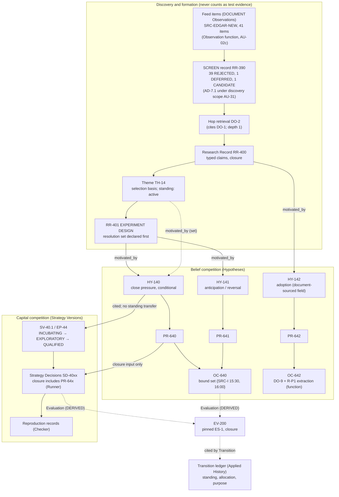
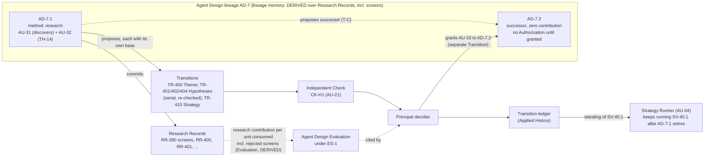
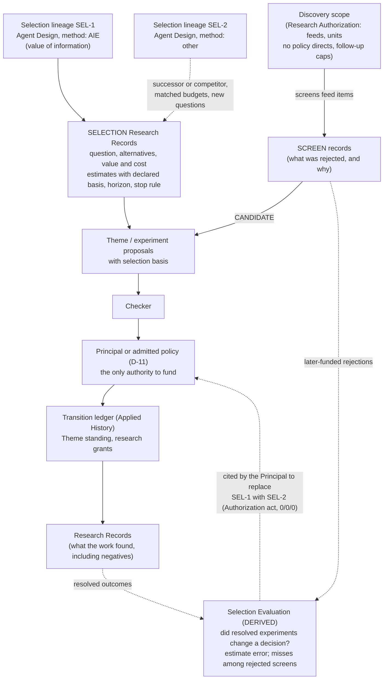
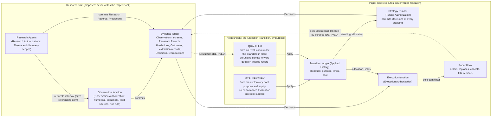

# Forward Research Design Plan

Status: **PROPOSED PLAN — DOCUMENTATION ONLY. Authorizes no code, no
infrastructure, no revision of the Constitution, PD-001 or PD-002. Nothing
here is admitted.** Revision 2 (2026-10-18): aligned with revision 2 of
the audit after the Principal's four questions; adds the scope of PD-003.

Date: 2026-10-18

Governs: the smallest set of document changes that make forward research
constitutionally coherent, in the order they should be decided. Source of
defects: the
[forward research OSA audit](../audits/forward_research_osa_audit_20261018.md)
(FR-1 to FR-13; unresolved decisions UD-1 to UD-8). Dependencies: PD-002
(proposed) for Observation independence, the Runner, closures and
resolution sets; the Constitution revision 2 for everything else.

## 1. The smallest changes

Every change is a field, a form, a scope, a kind or a Check rule on an
existing object. No governed object is added. The Transition ledger
remains the single authority for admitted state; its applied subsequence
is the Applied History; Population State remains the derived projection.

### Group A. Immediate blockers (forward research cannot start without them)

| Ref | Change | Document and section | Delta |
| --- | --- | --- | --- |
| FR-10 (with FR-1) | Observation Authorization gains **feed sources** and the **hop rule** (depth, count, domains). Research Authorization gains a **discovery scope** (feeds it may screen, units not tied to a Theme, follow-up caps). Research Record kind `SCREEN` with dispositions `CANDIDATE`, `DEFERRED`, `REJECTED` and reasons. `SRC-ADHOC` withdrawn; every on-request retrieval cites the referencing feed item | §III.5 Evidence table (feed items, hop provenance); §III.7 Authorization content; Part V (Observation function retrieval under feeds); Part II budget table (research budget may include a discovery fraction) | `ΔA`: two scopes within the Authorization object, Principal-set; `ΔS`: Observation and Research Record content |
| FR-5 | Market Observation gains the **`DOCUMENT` form** (locator, content hash, claimed publication time, witnessed receipt, requesting Authorization for hops, stored bytes). Research Record gains a **closure** and **typed claims** (`REPORTED`, `INTERPRETATION`, `ASSUMPTION`, `QUESTION`, `PREDICTION_REF`); kinds `EXPERIMENT DESIGN` and `SELECTION` | §III.5; Part VII a `RECEIPT` row for stored bytes | `ΔS` |
| FR-11 | Hypothesis registration declares a **motivation closure**; no member of it, and no Observation below a Prediction's commitment sequence, may resolve that Prediction. Resolution-set members may be **document-sourced fields** with declared `SourceId`, period, field meaning, print rule and extraction rule. Extraction by the Observation function (deterministic rule in the Source Declaration) or by a Checker (**extraction record**, Evaluation-kind, Checker Authorization only); never by the proposer; `DISPUTED` on disagreement | §III.2 testability; §III.5 Prediction and Outcome rows; §III.7 Source Declaration (extraction rules; field meaning as a meaning field); Part V (extraction record commit) | `ΔS`; `ΔA`: one commit restriction |
| FR-3 | Hypothesis `motivated_by` is a **set** of Themes and Research Records; funding is exactly one Authorization; §III.1's one-Theme rule removed; I-5 read set-valued | §III.1, §III.2, I-5 | `ΔS` |
| FR-7 | Theme and Hypothesis registration carry a **selection basis** (uncertainty, decision it could change, experiment, value estimate with declared basis, cost, horizon, stopping rule) | §III.1, §III.2, §III.8 record form | `ΔS` |
| FR-12 | Strategy Version **capital standings** `INCUBATING`, `EXPLORATORY`, `QUALIFIED`; Allocation Transition gains a purpose and, for `EXPLORATORY`, a measurement statement and expiry; the **exploratory pool** as a Principal-declared limit; the `EXPLORATORY` label on executed records is constitutional; expiry by scheduled Transition; no numbers | §III.3 (standing), §III.6 (limits, pool), Part V (Allocation purposes; expiry Transition), Part VII (labelled executed record `DERIVED`) | `ΔS`; `ΔA = 0` |

Group A is one Principal decision record, **PD-003**. Aggregate delta:
`ΔO = 0`; `ΔS` in §III.1, §III.2, §III.3, §III.5, §III.6, §III.7, Part V,
I-5; `ΔA`: feed sources and hop rule on the Observation Authorization,
discovery scope on Research Authorizations, extraction records restricted
to Checker Authorizations. No admission authority moves; no agent or
function gains a commit right it lacks under PD-002.

### Group B. Needed before the first qualified allocation on a forward Strategy

| Ref | Change | Document and section | Delta |
| --- | --- | --- | --- |
| FR-6 | Mechanism boundary immutable as declared; explanatory standing `DERIVED` from cited Hypotheses; identity unchanged when the explanation fails | §III.3 boundary table; Part VII | `ΔS` |
| FR-8 | `ES-1` grounds qualification on forward events only, minimum per target type; trials counted across the search family; exploratory records never counted; treatment of unexplained Strategies | Evaluation Standard `ES-1` (PD-002 U-6), constitutional | Standard content |

### Group C. Can wait

| Ref | Change | Why it can wait |
| --- | --- | --- |
| FR-4 | Checker refuses a restatement of a contradicted Hypothesis without a declared difference | Belongs with the Checker contract (plan step 5, D-10) |
| FR-9 | Agent Design registration declares its method class | Matters once a second selection lineage exists; with D-14 |
| UD-7 (D-01) | Theme successor without re-parenting | Plan step 1 |
| UD-4 | Checker who extracted may not check the citing Transition | With D-10 |
| UD-3 | `EXPLORATORY` allocation for `NON-REPRODUCIBLE` versions | With PD-002 U-1 |
| UD-8 | Attribution of screening units to Themes they produced | With D-12 |
| AIE as a selection lineage | An Authorization act, `0/0/0`, after PD-003 | No constitutional text |
| UD-1, UD-2, UD-5 | Feed list and hop caps; discovery fraction; exploratory pool size | Numbers set in Authorizations and limits, not in the Constitution |

## 2. Order of decisions

1. **PD-002 admission** (proposed; pending).
2. **PD-003** (Group A), then Constitution revision 3 and a re-audit.
3. **`ES-1` drafting** with FR-6 and FR-8 (Group B) as a Constitutional
   Transition proposal.
4. Group C with the plan steps they belong to.

Nothing in this order touches the admitted PD-001 rules: the Transition
ledger's authority over admitted state and its Applied History
projection, the Economic Proposition boundaries, or the evidence clock.

## 3. Scope of PD-003: Forward Research Formation

Scope approved for drafting 2026-10-18. Drafted as
[PD-003, proposed for admission](../decisions/principal_decision_003_forward_research_formation.md)
with its [focused audit](../audits/osa_audit_pd003_proposed_20261018.md).
Not admitted. Revision 4 of the record covers dispositions 1 to 5 only;
PD-003.6 is now [PD-004](../decisions/principal_decision_004_exploratory_capital_standings.md) (admitted 2026-10-19 at revision 3 with the internal-simulator clarification; FR-12 closed),
proposed with its own `ΔA`; admission text awaiting approval is in
[admission_text_pd002_pd003_20261018.md](../decisions/admission_text_pd002_pd003_20261018.md).

| Element | Content |
| --- | --- |
| Title | PD-003: Discovery, Formation Evidence, Document Resolution and Capital Standings |
| Dispositions | PD-003.1 Discovery (FR-10, FR-1): feed sources, discovery scope, `SCREEN`, hop rule, `SRC-ADHOC` withdrawn. PD-003.2 Provenance (FR-5): `DOCUMENT` form, Research Record closure and typed claims, `EXPERIMENT DESIGN` and `SELECTION`. PD-003.3 Formation versus resolution (FR-11): motivation closure; document-sourced fields; extraction by function or Checker. PD-003.4 Explanatory graph (FR-3, FR-7): `motivated_by` set; selection basis. PD-003.5 Capital standings (FR-12): `INCUBATING`, `EXPLORATORY`, `QUALIFIED`; purpose; pool; label; expiry |
| Two-case test | Product-P sequence (audit §4.1, serially admitted) and the momentum path (audit §6) |
| Constitutional Delta | `ΔO = 0`. `ΔS` as in Group A. `ΔA`: feed sources and hop rule (Observation Authorization); discovery scope (Research Authorization); extraction records restricted to Checker Authorizations. Declared per disposition and in aggregate |
| Decisions the Principal must make on admission | Whether to keep the hop default at depth 1; whether extraction by Checker is permitted at all or only deterministic extraction by the function (narrower, safer, fewer sources); whether `EXPLORATORY` requires a stated purpose per allocation or per version; whether the discovery scope's units are a fraction or a fixed grant |
| Explicitly out of scope | FR-6 and FR-8 (Group B); `ES-1` numbers; D-10, D-11, D-12, D-14, D-17; N-1; U-1 to U-10 of PD-002 |
| Dependencies | PD-002 admitted first (Observation function, Runner, closures, resolution sets, `SourceId`/`SourceRevision`) |
| On admission | Constitution revision 3 in §III.1, §III.2, §III.3, §III.5, §III.6, §III.7, Part V, Part VII, I-5; T-F/T-G joined by the product-P sequence as T-H; re-audit for duplicate ownership between feed items, screens and formation records, for proposer influence on extraction, and for exploratory records leaking into qualification; FR-1, FR-3, FR-5, FR-7, FR-10, FR-11, FR-12, FR-13 closed by reference |

## 4. Diagrams

### 4.1 Theme → competing Hypotheses → Predictions → Strategies → Evidence

Solid edges are governed references recorded in proposals or Evidence.
Dashed edges are derived views. No edge transfers standing.

### 4.2 Agent research and successor-agent evolution

### 4.3 Research selection, with AIE as a replaceable policy

### 4.4 The governed boundary between research and paper trading

## 5. Proposed changes to the client discussion draft

Target: the draft of 17 October 2026, filed as
[reference](../reference/new_speedway_discussion_draft_20261017.md).
Revision 2 corrects the object presentation as the Principal directed:
durable authoritative records are distinguished from the derived
Population State, and the Applied History is not presented as an owner
beside the Transition ledger.

### 5.1 Opening

Keep the first three paragraphs and the three ideas. Replace the two
paragraphs after the three ideas with:

> The trading stays quantitative: prices, volume, flows and risk. What
> changes is where the ideas come from and how fast the research process
> can change itself. An agent can screen the day's new filings, notice a
> product that will create mechanical flows, ask what those flows will do
> to the close, write two competing hypotheses, commit daily predictions
> before the close, write a strategy that trades the prediction, and
> incubate that strategy on paper at zero allocation until its own forward
> record earns capital. None of that needs a backtest, and none of it
> needs a human at every step. What it needs is a record that no agent can
> rewrite.
>
> Strategies are disposable. The record, the research process and its
> ability to replace itself are the assets.

### 5.2 Section 3, "The nine durable objects"

Replace the heading with **"The ten objects, and which ones are
authoritative"** and the lead paragraph with:

> The first four evolve. Three ledgers preserve what happened:
> Transitions, Evidence and the Paper Book. Each ledger is the only
> authority for its facts, and nothing else can overrule it. Authorization
> and the Constitution govern what may happen next. Population State is
> the tenth object, and it is a view: it is rebuilt from the Transition
> ledger and has no authority of its own. An agent run is an actor, not
> state. Predictions, experiments, observations and strategy decisions are
> records within Evidence.

Replace the `Transition` and `Population state` rows and add `Paper Book`:

| Object | Required content | Admission or mutation rule |
| --- | --- | --- |
| Transition | The proposal, its base state, the checks, the decision, and the rule versions it was decided under. Applied Transitions form the system's history. | The ledger of Transitions is authoritative for membership, standing, allocation, limits and what is current. Append-only; one commit boundary; rejections and stops are kept. |
| Population state | Membership, lifecycle, budgets, paper allocations and exposure at a point in the history. | A derived, replayable view of the applied Transitions. No authority of its own; can always be rebuilt and never serves as a fallback. |
| Paper Book | Paper orders, replacements, cancels, fills and execution refusals, each bound to the allocation and the strategy decision that caused it. | Authoritative for execution facts only. Never owns targets; a gap between target and position is reported, never reconciled away. |

Amend three existing rows:

- `Theme`: add "why it was selected: what is uncertain, what decision it
  could change, what the experiment would cost"; mutation rule: "May be
  speculative; a change of scope is a successor Theme that cites its
  predecessor."
- `Hypothesis`: add "the sources that will resolve it, declared before any
  prediction, kept separate from the documents and research that motivated
  it."
- `Evidence`: add "screens of new information, document receipts,
  strategy decisions and reproduction checks".

### 5.3 Section 4, relationships table

Add one row:

| Relationship | Precise meaning |
| --- | --- |
| consumes | A strategy reads a committed prediction or observation as an input to a decision. It does not inherit the prediction's standing. |

### 5.4 Section 6, worked example

Add after "What happens when the explanation changes":

> If S2 keeps making money while H1 fails, S2 keeps its allocation on its
> own record and is labelled as unexplained; its explanation is retired,
> not rewritten, and its risk limits follow the evidence.

### 5.5 Section 7, "Choose the next experiment"

Replace the last sentence of the Pfizer paragraph with:

> The policy for choosing research is itself a research method: it
> proposes, it never funds, its choices are recorded with their reasoning,
> and it is judged afterwards by whether the experiments it chose changed a
> decision at the cost it estimated. A part of the research budget is
> always reserved for screening new information no policy chose.

### 5.6 Section 8, operator views

Add one row:

| Operator view | What it must answer | Available action |
| --- | --- | --- |
| Observation health | Which sources and feeds were retrieved on schedule, which returned nothing, which failed? Which predictions lost forward standing because of it? | Request a retrieval, add a source or slot, or declare a source unreliable. |

### 5.7 Section 9, paper trading

Add one sentence after "Start on paper to answer two questions":

> Paper activity comes in two kinds and is always labelled: exploratory
> allocations exist to measure fills, turnover and timing, and are never
> evidence of an edge; qualified allocations are earned by a strategy's own
> forward record under rules fixed in advance.

### 5.8 Language

Replace "HIL" with "the operator" or "a person" throughout; replace
"gen-ai coding angle" with "one governed record"; remove "Just like a
code gen harness" if it survives from the earlier draft.

### 5.9 What the draft already gets right

The three ideas; principle 4; the explanatory graph with no standing
transfer; the distinction between composition checks and CPOC; evaluating
research quality separately from simulated performance; measuring trading
activity before sizing execution; the token allowance framing.

## 6. Rules for this plan

- No application code, tests, infrastructure, frameworks, dependencies or
  service selection.
- No revision of the Constitution, PD-001 or PD-002 under this plan;
  Group A becomes PD-003 for the Principal.
- Every change is tested on both the product-P case (audit §4, serially
  admitted) and the momentum case (audit §6) before it is proposed.
- Rejected alternatives stay in the audit with their reason.
- Nothing is admitted by being written here.
